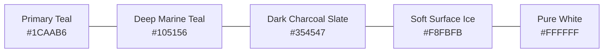

# Design System & Visual Specification

## 1. Design Overview & Philosophy

The visual identity of **Pain & Paralysis Clinic** conveys clinical authority, modern robotic technology, and empathetic healing. The palette balances an energetic, sterile medical teal (`#1CAAB6`) with deep clinical stability (`#105156`) and generous white space. 

Typography pairs the classical, high-trust serif majesty of **Marcellus SC** / **Marcellus** for titles with the clean, legible geometric clarity of **Poppins** for operational reading.

---

## 2. Color Palette Specification

| Token Name | HEX Code | RGB / RGBA | Usage & Purpose | Verification Status |
| :--- | :--- | :--- | :--- | :--- |
| `--color-primary` | `#1CAAB6` | `rgb(28, 170, 182)` | Primary brand color, CTA buttons, active links, section subheadings | **Verified** (CSS Kit) |
| `--color-secondary` | `#105156` | `rgb(16, 81, 86)` | Deep dark teal, primary H1/H2 headings, statistics background, footer | **Verified** (CSS Kit) |
| `--color-accent-blue` | `#07CCEC` | `rgb(7, 204, 236)` | Electric cyan accent, subtle gradients, button hover states | **Verified** (Theme root) |
| `--color-accent-gold` | `#FEC624` | `rgb(254, 198, 36)` | 5-star patient review ratings, badge highlights | **Verified** (Theme root) |
| `--color-text-title` | `#105156` | `rgb(16, 81, 86)` | All primary and secondary section titles | **Verified** |
| `--color-text-body` | `#354547` | `rgb(53, 69, 71)` | Main paragraph text, long-form articles, clinical explanations | **Verified** |
| `--color-text-muted` | `#888C92` | `rgb(136, 140, 146)` | Dates, meta descriptions, secondary subtitles | **Verified** |
| `--color-surface-white` | `#FFFFFF` | `rgb(255, 255, 255)` | Primary card backgrounds, light sections, header text over dark | **Verified** |
| `--color-surface-soft` | `#F8FBFB` | `rgb(248, 251, 251)` | Alternating section background (FAQ, What We Do) | **Verified** |
| `--color-surface-dark` | `#000000EB` | `rgba(0, 0, 0, 0.92)` | Footer bottom background, modal backdrops | **Verified** |
| `--color-border-subtle` | `rgba(0,0,0,0.08)`| `rgba(0, 0, 0, 0.08)` | Card borders, table dividers | **Verified** |
| `--color-border-hover` | `#1CAAB6` | `rgb(28, 170, 182)` | Interactive card hover borders | **Verified** |

---

## 3. Typography Hierarchy

### 3.1 Font Families
- **Heading Font Family**: `"Marcellus SC", "Marcellus", serif`
  - Evokes established medical stature, distinction, and patient reassurance.
- **Body Font Family**: `"Poppins", -apple-system, BlinkMacSystemFont, "Segoe UI", Roboto, sans-serif`
  - High geometric legibility across all screen sizes.
- **Icon Font**: `Font Awesome 5 Pro` / `Flaticon` (Replaced with Lucide React in modern Next.js stack).

### 3.2 Type Scale (Desktop vs. Mobile)

| Level / Tag | Font Family | Desktop Size | Mobile Size | Weight | Line Height | Letter Spacing | Text Transform |
| :--- | :--- | :--- | :--- | :--- | :--- | :--- | :--- |
| **H1 (Hero)** | Marcellus SC | `50px` | `35px` | 600 / Semi-Bold | `1.2` | `-0.01em` | Normal |
| **H2 (Section Title)** | Marcellus SC | `37px` - `40px` | `28px` | 600 / Semi-Bold | `1.25` | `0` | Normal |
| **H3 (Card Title)** | Marcellus SC | `22px` - `24px` | `18px` | 600 / Semi-Bold | `1.3` | `0` | Capitalize / Uppercase |
| **H4 (Sub-heading)** | Poppins | `18px` - `20px` | `16px` | 500 / Medium | `1.4` | `0` | Normal |
| **Section Tag / Badge**| Poppins | `14px` - `16px` | `13px` | 600 / Semi-Bold | `1.2` | `+0.12em` (`2px`) | Uppercase |
| **Body Large (Lead)** | Poppins | `18px` | `16px` | 400 / Regular | `1.6` | `0` | Normal |
| **Body Base** | Poppins | `16px` | `15px` | 400 / Regular | `1.65` | `0` | Normal |
| **Body Small / Meta** | Poppins | `14px` | `13px` | 400 / Regular | `1.5` | `0` | Normal |
| **Button Text** | Poppins | `15px` - `16px` | `14px` | 600 / Semi-Bold | `1.0` | `+0.05em` | Capitalize |

---

## 4. Spacing & Layout Specifications

### 4.1 Grid & Max Widths
- **Maximum Container Width**: `1300px` (`--content-width: 1300px`) for wide sections.
- **Standard Boxed Width**: `1140px` - `1200px` for dense reading and card grids.
- **Narrow Reader Width**: `800px` - `900px` for individual articles and FAQ accordion.
- **Gutter Width**: `24px` (Desktop), `16px` (Mobile).

### 4.2 Vertical Spacing & Section Rhythm
- **Major Section Padding (Desktop)**: `80px 0px` to `100px 0px`.
- **Major Section Padding (Mobile)**: `40px 0px` to `50px 0px`.
- **Header Height**: `90px` on desktop, `70px` on mobile.
- **Element Spacing (Widgets)**: `20px` margin bottom (`--widgets-spacing: 20px 20px`).

### 4.3 Elevation & Shadows
- **Shadow Base (Cards Idle)**: `0 4px 20px -2px rgba(16, 81, 86, 0.08)`
- **Shadow Hover (Interactive Lift)**: `0 20px 35px -5px rgba(28, 170, 182, 0.16)`
- **Shadow Sticky Header**: `0 4px 20px rgba(0, 0, 0, 0.06)`

### 4.4 Radii & Corner Geometry
- **Buttons**: `4px` to `6px` (Slightly softened clinical rectangle).
- **Cards (Services, Testimonials, Care Areas)**: `12px` to `16px`.
- **Pills / Tags**: `9999px` (Full circle ends).
- **Input Fields**: `6px` to `8px`.

---

## 5. UI Primitives & Component Styling

### 5.1 Buttons (`.vs-btn`)
- **Primary CTA ("Consult Now", "Book Appointment")**:
  - Background: `#1CAAB6`
  - Text: `#FFFFFF`, Semi-Bold `600`, `15px`
  - Padding: `14px 28px` (Desktop), `12px 22px` (Mobile)
  - Hover: Background shifts to `#105156`, subtle brightness increase.
  - Border: None.
- **Secondary CTA ("Get Directions", "Read More")**:
  - Background: Transparent or `#FFFFFF`
  - Border: `2px solid #1CAAB6`
  - Text: `#1CAAB6`, Hover: Background `#1CAAB6`, Text `#FFFFFF`.

### 5.2 Input Fields & Form Controls
- **Height**: `50px`
- **Background**: `#FFFFFF`
- **Border**: `1px solid rgba(0, 0, 0, 0.12)`, Focus: `1.5px solid #1CAAB6` with soft glow `0 0 0 3px rgba(28, 170, 182, 0.15)`.
- **Placeholder**: Color `#888C92`.

