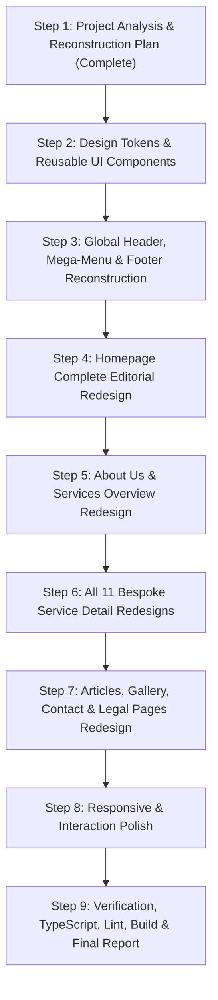

# Phase 37: Complete Website UI/UX Reconstruction Plan
**Project:** Pain & Paralysis Clinic  
**Date:** November 13, 2026  
**Status:** Approved for Implementation  
**Strict Brand Constraint:** 100% Preservation of Authorized Color Palette & Medical Authenticity  

---

## 1. Executive Summary & Design Vision

Phase 37 represents a complete visual, architectural, and user experience transformation of the Pain & Paralysis Clinic website. While previous phases focused on functional parity, route coverage, responsive stabilization, and medical content integrity, Phase 37 completely redesigns the aesthetic, compositional rhythm, and interactive presentation.

### The Problem with the Previous Design
1. **Generic WordPress/Elementor Remnants**: Flat hero sliders with auto-rotating images, full-width banners, and monotonous 3-column card grids.
2. **Repetitive Card Fatigue**: The homepage and subpages repeatedly relied on identical white rounded rectangles (`rounded-2xl` with a top image and bottom text), causing visual fatigue.
3. **Weak Header & Navigation Hierarchy**: Standard flat bar with no visual categorization for the 11 specialized medical services. Patients had no quick way to preview services before navigating.
4. **Lack of Editorial Stature**: Healthcare websites in the modern era require authoritative, calm, high-trust visual language reminiscent of top medical institutions (editorial typography contrast, generous negative space, asymmetric layouts, and clear clinical pathways).

### The New Design Vision: *Clinical Authority + Human-Centered Rehabilitation*
- **Editorial Asymmetry**: Replacing repeating grids with dynamic, content-first compositions (split hero layouts, layered imagery with glassmorphic cards, staggered editorial feature blocks).
- **Categorized Treatment Bento**: Presenting the 11 specialized therapies in an organized medical catalog (Spine Care, Joint Decompression, Diagnostic Biomechanics, Neurological Rehabilitation).
- **Sophisticated Global Navigation**: Introducing a clinical mega-menu/dropdown for desktop with service categories, direct contact info, and clinic hours in a dedicated utility bar.
- **Micro-Interactions & Fluidity**: Purposeful hover elevations, refined border glows, smooth accordion transitions, and tactile button states that respect `prefers-reduced-motion`.
- **Preserved Color Palette**: 100% adherence to the mandatory brand tokens (`#1CAAB6`, `#105156`, `#354547`, `#F8FBFB`, `#FFFFFF`, `#07CCEC`, `#FEC624`).

---

## 2. Preserved Color Palette & Token Architecture

The brand identity remains strictly untouched. All styling changes leverage opacity, layering, borders, and gradients derived from the existing tokens:

| Token Name | Hex Code | Role in New Premium Design |
|---|---|---|
| **Primary Teal** | `#1CAAB6` | Interactive buttons, active indicators, accent icons, border glows, badge tags |
| **Deep Marine Teal** | `#105156` | Authoritative section backgrounds, main H1/H2 titles, mega-menu headers, dark accent surfaces |
| **Dark Charcoal Slate** | `#354547` | High-contrast readable body copy, clinical metadata, dark labels |
| **Soft Surface Ice** | `#F8FBFB` | Calm alternating section backgrounds, subtle card containers, pill backdrops |
| **Pure White** | `#FFFFFF` | Core content cards, crisp modal surfaces, high-contrast reading layers |
| **Accent Cyan** | `#07CCEC` | Subtle gradients, subtle glowing badges, interactive highlights |
| **Rating Gold** | `#FEC624` | Review stars, trust badges, verified clinic awards |

---

## 3. Typography & Hierarchy Rethink

While preserving the core typefaces (`Marcellus SC` for headings and `Poppins` for body and UI elements), their scale and spatial rhythm are completely re-engineered:

1. **Hero Headlines**:
   - Scaled for commanding editorial impact: Desktop `text-4xl lg:text-5xl xl:text-6xl`, line-height `1.15`, letter-spacing `-0.015em`.
   - Balanced with delicate, tracked uppercase eyebrow tags (`tracking-[0.18em]` in `font-sans`).
2. **Section Headings (H2)**:
   - Restructured to avoid blunt centering; paired with contextual lead paragraphs and accent markers.
   - Desktop `text-3xl lg:text-4xl xl:text-[42px]`, line-height `1.2`.
3. **Sub-Headings & Card Titles (H3)**:
   - Elevated with dual weights: `font-heading font-medium tracking-tight text-xl lg:text-2xl`.
4. **Body & Clinical Prose**:
   - Constrained line lengths (`max-w-prose` or `max-w-2xl`) for optimal patient legibility.
   - Line-height increased to `1.7` for comfortable scanning.
5. **Labels & Micro-Copy**:
   - Standardized `text-xs font-semibold uppercase tracking-wider` for clinical tags, categories, and breadcrumbs.

---

## 4. Architectural Component Reconstruction

### 4.1 Global Header & Navigation
- **Utility Top Bar**: Clinic operating hours (`Mon-Sat: 9:00 AM - 8:00 PM`), direct emergency call dialer (`8015559609`), and Madhanandapuram clinic location indicator.
- **Main Header Bar**:
  - Balanced logo sizing with crisp SVG/WebP rendering.
  - Interactive **Services Dropdown / Mega-Menu**: Grouping all 11 services into 4 clinical departments:
    1. *Spine & Joint Decompression* (Advanced Spine Decompression, Advanced Knee Decompression)
    2. *Musculoskeletal & Manual Therapy* (Advanced Chiropractor, Advanced Physiotherapy, Pelvic Floor Therapy)
    3. *Diagnostic & Biomechanical* (Advanced 3D Gait Analysis, High Frequency EMG, Biofeedback)
    4. *Specialized Rehabilitation* (Advanced Aquatic Therapy, Advanced Laser Treatment, Neuro Physiotherapy)
  - Floating consultation CTA button with subtle gradient border.
- **Reconstructed Mobile Navigation**:
  - Modern off-canvas drawer with tabbed service categories, quick telephone dialer, and direct appointment action.

### 4.2 Global Footer
- **Editorial Clinical Layout**:
  - Column 1: Clinic credentials, Madhanandapuram address with direct Google Maps link, phone & consultation schedule.
  - Column 2: Department-wise service links covering all 11 bespoke clinical routes.
  - Column 3: Patient resources (Articles, FAQs, Gallery, About).
  - Column 4: Clinical consultation advisory & appointment request card.
  - Sub-footer: Legal compliance links (Privacy Policy, Terms & Conditions), medical disclaimer, and copyright.

### 4.3 Shared UI Primitives (`src/components/ui/`)
- `Button`: Enhanced with subtle inner glow, ripple focus state, pill or softly rounded variant, and animated icon cues.
- `Badge` / `Eyebrow`: Premium clinical badge pill with subtle border and dot accent.
- `Card`: Multi-layered cards with refined `border border-[#105156]/10`, soft dual-elevation shadows, and smooth hover translations.
- `Section`: Intentional vertical rhythm with asymmetric layout support and gradient surface options.

---

## 5. Page-Level Layout Strategy

### 5.1 Homepage (`/`)
1. **Hero Section**:
   - Replaces the 5-slide rotating carousel with a high-impact editorial split showcase.
   - Left: High-authority headline, clinical highlights, lead specialist mention (Dr. Dinesh Anandhan), dual CTAs ("Consult Our Specialists" + "Explore 11 Therapies").
   - Right: Multi-layered visual composition featuring authentic clinic imagery, floating quick-stats badge, and computerized decompression table badge.
2. **Trust & Clinical Highlights Bar**:
   - 4 verified clinical pillars: Non-Surgical Protocols, Computerized Traction, Diagnostic EMG & 3D Gait, Integrated Rehabilitation.
3. **Clinical Overview (About the Clinic)**:
   - Editorial magazine-style layout pairing authentic procedure photography with the clinic's non-surgical philosophy.
4. **Treatment Spectrum (Specialized Services)**:
   - Bento-style layout categorizing all 11 treatments into distinct clinical domains with visual cues and deep links.
5. **Clinical Methodology & Rehabilitation Pathway**:
   - 4-phase clinical protocol: Comprehensive Assessment -> Biomechanical Analysis -> Targeted Therapy -> Long-term Functional Recovery.
6. **Interactive Posture Analysis (Before / After)**:
   - Modernized split comparison tool with refined draggable thumb, clinical evaluation annotations, and touch responsiveness.
7. **Lead Specialist Feature (Dr. Dinesh Anandhan)**:
   - Elevated clinical portrait composition, patient-focused philosophy, and appointment booking trigger.
8. **Patient Information & FAQs**:
   - Re-engineered accordion with category tags, accessible keyboard navigation, and consultation guidance.
9. **Facility Location & Appointment Portal**:
   - Dual-card layout: Interactive Google Maps guide on the left, appointment inquiry portal on the right.

### 5.2 About Us (`/about-us`)
- Editorial narrative detailing clinic inception, clinical team, treatment philosophy, and advanced Madhanandapuram facility.
- High-impact visual timeline and authentic clinic procedure imagery.

### 5.3 Services Overview (`/services`)
- Interactive treatment explorer with clinical category tabs, detailed modality cards for all 11 services, and 4 specialized care areas.

### 5.4 All 11 Bespoke Service Detail Pages
Redesign each service detail component with bespoke hero layouts, clinical suitability criteria, step-by-step methodology timelines, clinical contraindications/disclaimers, and related therapies:
1. `Advanced Spine Decompression` (`/services/advanced-spine-decompression`)
2. `Advanced Chiropractor` (`/services/advanced-chiropractor`)
3. `Advanced Physiotherapy` (`/services/advanced-physiotherapy`)
4. `Advanced Aquatic Therapy` (`/services/advanced-aquatic-therapy`)
5. `Advanced 3D Gait Analysis` (`/services/advanced-3d-gait-analysis`)
6. `Advanced Knee Decompression` (`/services/advanced-knee-decompression`)
7. `Advanced Laser Treatment` (`/services/advanced-laser-treatment`)
8. `High Frequency EMG` (`/services/high-frequency-emg`)
9. `Biofeedback` (`/services/biofeedback`)
10. `Neuro Physiotherapy` (`/services/neuro-physiotherapy`)
11. `Pelvic Floor Therapy` (`/services/pelvic-floor-therapy`)

### 5.5 Supporting Pages
- **Health Tips & Articles (`/tips-article`)**: Medical journal archive with editorial cards, reading times, and rich reading layout for individual articles.
- **Gallery & Honors (`/gallery`)**: Curated exhibition of authentic clinic awards and Madhanandapuram facility exterior with interactive lightbox.
- **Contact & Consultations (`/contact-us`)**: Clean, conversion-focused layout with clinic contact cards, interactive map, and inquiry form.
- **Legal Pages (`/privacy-policy`, `/terms-and-conditions`)**: Clean, readable document layout with sticky table of contents and clear typography.

---

## 6. Implementation Sequence

---

## 7. Quality & Verification Gates

At each step and in final verification:
- `npx tsc --noEmit` must pass with 0 errors.
- `npm run lint` must pass with 0 errors.
- `npm run build` must compile all 20+ routes with 0 errors.
- All internal routing, canonical URLs, and metadata must remain intact.
- Strict color palette preservation verified.

