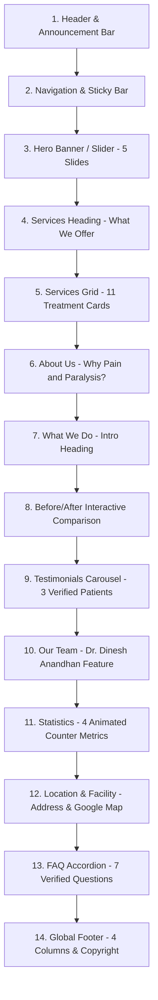

# Reference Website Analysis & Documentation

## 1. Executive Summary & Verification Context

- **Reference URL**: `https://painandparalysis.com/`
- **Clinic Entity**: Pain and Paralysis Clinic (Plot no: 5, Madha Nagar Main Road, Madhanandapuram, Chennai, Tamil Nadu - 600125)
- **Primary Practitioner**: Dr. Dinesh Anandhan (Pain Management & Spine Care Specialist, Chiropractor & Physiotherapist)
- **CMS / Architecture of Original Site**: WordPress 6.x + Elementor Pro + Medilax Healthcare Theme + Sky Elementor Addons + LiteSpeed Web Server
- **Inspection Date**: November 2026
- **Analysis Scope**: 100% live site verification via direct DOM, CSS, API and sitemap inspection. All sections, routes, assets, typography, color codes, and responsive rules documented below represent verified live facts.

---

## 2. Homepage Section-by-Section Analysis (Top-to-Bottom)

The original homepage consists of 14 distinct visual and structural sections arranged in the following verified order:

---

### Section 1 & 2: Header & Navigation
- **Section ID / Classes**: `header.elementor-7343`, Container `.elementor-element-15bb9c5`
- **Background Color**: Transparent overlay (`#00000000`) over hero slider on desktop; sticky solid white/dark background on scroll.
- **Container Width**: Max-width `1300px` (`--content-width: 1300px`), boxed inner container.
- **Padding & Spacing**: Top/Bottom padding `15px 0px`, full width fluid outer wrapper.
- **Number of Columns**: 3 columns (Desktop):
  1. **Left (46%)**: Brand Logo image (`PP-white-Logo.webp`, `691x192px`).
  2. **Center (Nav Menu)**: Horizontal unordered list `.main-menu.menu-style3` (`Home`, `About Us`, `Services`, `Tips & Article`, `Gallery`, `Faqs`).
  3. **Right (28%)**: CTA Button container with "Consult Now" button (`.vs-btn.style2`) linking to `/contact-us/`.
- **Image Specifications**:
  - Desktop Logo: `https://painandparalysis.com/wp-content/uploads/2024/03/PP-white-Logo.webp` (`691x192px`, aspect ratio ~3.6:1, rendered at ~220px width).
  - Mobile/Sticky Logo: `https://painandparalysis.com/wp-content/uploads/2024/03/Pain-and-Paralysis-Logo-1.webp` (`728x205px`).
- **Interactive Behavior & Hover Effects**:
  - Links: Text color `#FFFFFF`, hover color `#1CAAB6` (Teal), smooth transition `0.3s ease`.
  - CTA Button: Border radius `4px`, background `#1CAAB6`, text `#FFFFFF`, hover state shifts to dark teal `#105156`.
  - Mobile (<768px): Desktop nav is hidden (`d-none d-lg-block`). Mobile hamburger icon button (`.vs-menu-toggle`) appears on right. Clicking opens full-height sliding off-canvas drawer with clinic logo and stacked links.

---

### Section 3: Hero Banner / Slider
- **Section ID / Classes**: Container `.elementor-element-028b32e`, widget `sky-advanced-slider.default`
- **Background Color**: Dark image background with subtle contrast gradient overlay (`#0202025E`).
- **Container Width**: Full viewport width (`100vw`), slide content contained within `1140px` - `1300px`.
- **Height / Aspect Ratio**: Height `929px` (desktop), aspect ratio ~2.06:1 (`1920x929px`).
- **Slider Mechanism**: Swiper.js engine with horizontal slide transitions, auto-play delay `5000ms`, loop `true`, speed `300ms`, bullet pagination and prev/next navigation arrows (`#sa-03e1389`).
- **Slides Inventory (5 Slides)**:
  1. **Slide 1**:
     - Heading: *"Experience Relief & Wellness with Expert Chiropractic Care!"*
     - Image: `https://painandparalysis.com/wp-content/uploads/2025/04/relief.webp` (`1920x929px`)
     - CTA: "Book Appointment" (`javascript:void(0);` triggering contact modal / redirect to `/contact-us/`)
  2. **Slide 2**:
     - Heading: *"Recover. Restore. Rejuvenate, reduce pain, and enhance your well-being"*
     - Image: `https://painandparalysis.com/wp-content/uploads/2025/04/Rectangle-625.webp` (`1920x929px`)
     - CTA: "Book Appointment"
  3. **Slide 3**:
     - Heading: *"Unlock healing with advanced therapies—innovative treatments and personalize care"*
     - Image: `https://painandparalysis.com/wp-content/uploads/2025/04/healing.webp` (`1920x929px`)
     - CTA: "Book Appointment"
  4. **Slide 4**:
     - Heading: *"Heal with water—improve mobility, ease pain, and relax."*
     - Image: `https://painandparalysis.com/wp-content/uploads/2025/04/water-1.webp` (`1920x929px`)
     - CTA: "Book Appointment"
  5. **Slide 5**:
     - Heading: *"Improve your posture, enhance your well-being! Discover effective solutions"*
     - Image: `https://painandparalysis.com/wp-content/uploads/2025/04/consult-doctor.webp` (`1920x929px`)
     - CTA: "Book Appointment"

---

### Section 4 & 5: Services ("What We Offer" & 11 Treatment Cards)
- **Section ID / Classes**:
  - Header: `.elementor-element-6cac7ff`
  - Cards Container: `.elementor-element-d397cc3`
- **Background Color**: `#FFFFFF` (Clean medical white).
- **Heading & Subheading**:
  - Pre-title / Tag: `WHAT WE OFFER` (Uppercase, font-size `16px`, color `#1CAAB6`, font-weight `600`, letter-spacing `2px`).
  - Main Title: `SERVICES` (Font-size `50px` desktop, `35px` mobile, font-family `"Marcellus SC"`, color `#105156`).
- **Content Alignment**: Header is centered; card content is left-aligned.
- **Layout & Columns**: Responsive CSS grid / flex: 4 columns on large desktop (>1200px), 2 columns on tablet (768px - 1024px), 1 column on mobile (<768px).
- **Card Specifications**:
  - Container width: Boxed `1200px`.
  - Border radius: `12px` - `16px`.
  - Card background: `#FFFFFF` with soft box shadow `0px 10px 30px rgba(0, 0, 0, 0.08)` and subtle border `1px solid rgba(0, 0, 0, 0.05)`.
  - Padding: `25px 20px`.
  - Card Hover Effect: Lifts up `-8px` (`transform: translateY(-8px)`), shadow deepens to `0px 20px 40px rgba(28, 170, 182, 0.15)`, top border / accent line animates to primary teal.
- **The 11 Treatment Services**:
  1. **ADVANCED SPINE DECOMPRESSION**: Non-surgical traction therapy for herniated discs and sciatica. (Linked to `/advanced-spine-decompression/`). Image: `spinal-decomp.webp`.
  2. **CHIROPRACTOR**: Targeted spinal adjustments and musculoskeletal alignment. (Linked to `/advanced-chiropractor/`). Image: `chiropractor.webp`.
  3. **Physiotherapy**: Evidence-based manual therapy, exercise prescription, and recovery regimens. (Linked to `/advanced-physiotherapy/`). Image: `physio.webp`.
  4. **AQUATIC THERAPY**: Heated hydrotherapy pool rehabilitation minimizing joint impact. (Linked to `/advanced-aquatic-therapy/`). Image: `aquatic-therapy.webp`.
  5. **3D GAIT ANALYSIS**: Computerized biomechanical assessment of walking and postural anomalies. (Linked to `/advanced3d-gait-analysis/`). Image: `3d-gait-analysis.webp`.
  6. **Advanced knee decompression**: Mechanical unloading and traction for severe osteoarthritic knee pain. Image: `advanced-knee.webp`.
  7. **Advanced Laser Treatment**: High-intensity laser therapy for rapid tissue regeneration and inflammation reduction. Image: `advanced-laser.webp`.
  8. **High Frequency EMG**: Diagnostic and therapeutic electromyography assessing muscle neuromuscular response. Image: `high-frequency.webp`.
  9. **Biofeedback**: Neuromuscular re-education enabling conscious control of involuntary muscle tone. Image: `bio-feedback.webp`.
  10. **Neuro Physiotherapy**: Specialized neuro-rehabilitation for stroke, hemiplegia, paraplegia, and neurological deficits. Image: `neuro.webp`.
  11. **Pelvic Floor**: Targeted pelvic musculature strengthening and rehabilitation therapy. Image: `pelvic-floor.webp`.

---

### Section 6: About Us ("Why Pain And Paralysis?")
- **Section ID / Classes**: `.elementor-element-c91e378`
- **Background Color**: `#FFFFFF` / Soft neutral off-white section background.
- **Container Width**: Max-width `1300px` (`--content-width: 1300px`).
- **Padding & Spacing**: Desktop `80px 0px`, Mobile `20px 0px 30px 0px`.
- **Layout**: 2 Columns (Desktop):
  - **Left Column (50%)**: Clinic Crest / Emblem logo (`logo-15.webp`, `237x248px`), clinical mission statement, and key value propositions:
    - *Understanding Your Pain*: Healing begins with precise diagnostic understanding.
    - *Holistic Precision*: Integrating Chiropractic, Osteopathy, and Robotic Physiotherapy.
    - *Drug-Free & Non-Surgical*: Restoring root mechanical alignment without opioids or surgery.
    - *Read More Button*: Links to `/about-us/`.
  - **Right Column (50%)**: Clinical video showcase / facility preview widget (`video.default`) with play trigger modal and treatment imagery.

---

### Section 7 & 8: What We Do & Before/After Comparison
- **Section ID / Classes**:
  - Heading Container: `.elementor-element-ac0744f`
  - Comparison Container: `.elementor-element-4269a7f`, widget `sky-image-compare.default`
- **Background Color**: `#F8FBFB` (Very pale teal tint).
- **Heading**:
  - Subtitle: `What We Do` (Font-size `18px`, color `#1CAAB6`).
  - Title: `Comprehensive rehabilitation center offering personalized care for complete Treatment` (Font-size `37px` desktop, `28px` mobile, font-family `"Marcellus SC"`, color `#105156`).
- **Interactive Component (Sky Image Compare)**:
  - Interactive split-slider widget enabling user to drag a vertical dividing handle across two overlapping images to observe spinal posture before vs. after treatment.
  - Image Before: `https://painandparalysis.com/wp-content/uploads/2025/04/before-3.webp` (`1290x660px`, aspect ratio ~1.95:1).
  - Image After: `https://painandparalysis.com/wp-content/uploads/2025/04/after-3.webp` (`1290x660px`, aspect ratio ~1.95:1).
  - Interactive Behavior: Horizontal draggable thumb divider with left/right indicator arrows and label badges ("Before" / "After").

---

### Section 9: Testimonials ("What our clients say")
- **Section ID / Classes**: `.elementor-element-0a5a785`
- **Background Color**: `#FFFFFF`.
- **Container Width**: `1300px`.
- **Heading**:
  - Subtitle: `Testimonials` (`#1CAAB6`, font-size `18px`).
  - Title: `What our clients say` (`#105156`, font-size `49px` desktop, `35px` mobile, `"Marcellus SC"`).
- **Layout**: 3-column card row (desktop) / single-column swipeable carousel (mobile).
- **Verified Patient Reviews**:
  1. **Dharshini Andal V**:
     - Avatar: `https://painandparalysis.com/wp-content/uploads/2025/04/priyanka.webp` (`500x500px`, 1:1 circular crop).
     - Rating: 5/5 stars (Gold `#FEC624`).
     - Text: *"I had an excellent experience with Dr. Dinesh during my visit. From the moment I walked into the clinic, he was friendly, and the environment was calm and welcoming. Dr. Dinesh took the time to listen to my concerns and thoroughly explained the diagnosis and treatment options. His knowledge and professionalism made me feel comfortable and confident in the care I received."*
  2. **Annadurai S**:
     - Avatar: `https://painandparalysis.com/wp-content/uploads/2025/04/Annadurai-S.webp` (`500x500px`).
     - Rating: 5/5 stars.
     - Text: *"I struggled with a hand issue for over a year, but Dinesh resolved it in just 7–8 sessions! His expertise, quick diagnosis, and warm approach make him outstanding. I’ve referred many friends and family, all equally appreciative. His efficiency is remarkable. Best wishes, Dinesh! Keep up the great work and keep spreading positivity!"*
  3. **Sudha Seshadri**:
     - Avatar: `https://painandparalysis.com/wp-content/uploads/2025/04/Sudha-Seshadri.webp` (`500x500px`).
     - Rating: 5/5 stars.
     - Text: *"I’m Mrs. Sudha Seshadri from Adyar, Chennai. Dr. Dinesh Anand’s expertise in robotic physiotherapy and his positive approach are exceptional. I suffered from shoulder pain for three years despite treatment. Referred by my uncle, I consulted Dr. Dinesh, who accurately diagnosed and treated it. Now, I’m pain-free. Thank you, Dr. Dinesh!"*

---

### Section 10: Our Team ("Get to Know Our Leading Therapist")
- **Section ID / Classes**: `.elementor-element-56dfa12`
- **Background Color**: `#FFFFFF`.
- **Container Width**: `1200px`.
- **Heading**:
  - Subtitle: `OUR TEAM` (Uppercase `#1CAAB6`).
  - Title: `Get to Know Our Leading Therapist` (`#105156`, `"Marcellus SC"`).
- **Layout**: 2 Columns (Desktop):
  - **Left Column**: High-resolution portrait photograph of Dr. Dinesh Anandhan (`Dinesh-Anandhan.webp`, `2004x2428px`, aspect ratio ~0.825:1, vertical medical portrait).
  - **Right Column**: Practitioner biography and clinical credentials:
    - Name: `Dr. Dinesh anandhan`
    - Role: `Chiropractor & Physiotherapist`
    - Clinical background: Internationally trained in Japan and the US, specializing in non-invasive spine care, robotic physiotherapy, and Gonstead Chiropractic adjustments.

---

### Section 11: Statistics Counters
- **Section ID / Classes**: `.elementor-element-3f91324`, widget `counter.default`
- **Background Color**: `#105156` (Deep Teal Brand Solid Background).
- **Container Width**: `1200px`.
- **Padding**: `60px 20px`.
- **Layout**: 4 Equal Columns (Desktop `25%` each), 2x2 Grid (Tablet), 1 Column stacked (Mobile).
- **The 4 Verified Counters**:
  1. `10+` — **Years of Experience**
  2. `30+` — **Our Specialists**
  3. `12k` — **Happy Customers**
  4. `25+` — **Team Members**
- **Typography & Styling**:
  - Numbers: Font-size `50px` - `60px`, font-family `"Marcellus SC"`, color `#FFFFFF`, bold font-weight `700`.
  - Labels: Font-size `16px`, font-family `"Poppins"`, color `#E0F2F1`, text-transform `capitalize`.

---

### Section 12: Location & Facility
- **Section ID / Classes**: `.elementor-element-ee8739e`
- **Background Color**: `#FFFFFF`.
- **Heading**:
  - Tag: `LOCATION` (`#1CAAB6`).
  - Title: `Pain and Paralysis Chennai` (`#105156`).
- **Layout**: 2 Columns (Desktop `50% / 50%`):
  - **Left Column**:
    - Facility Exterior / Signage Image: `https://painandparalysis.com/wp-content/uploads/2025/04/loaction.webp` (`743x361px`, aspect ratio ~2.06:1).
    - Address: *Plot no : 5, Madha Nagar Main Road, Madhanandapuram, Chennai, Tamil Nadu -600125*
    - Contact Phone: `8015559609` (Tel link)
    - CTA Button: "Get Directions" linking to Google Maps (`https://maps.app.goo.gl/KFe9nQc8Qc85PVAK9`).
  - **Right Column**:
    - Embedded Google Maps widget (`google_maps.default`) centered on Madhanandapuram clinic coordinates, height `380px`, responsive full width.

---

### Section 13: FAQ Section
- **Section ID / Classes**: `.elementor-element-53a76f2`, widget `sky-advanced-accordion.default`
- **Background Color**: `#F8FBFB` / Light neutral.
- **Heading**:
  - Tag: `FAQ` (`#1CAAB6`).
  - Title: `General Questions` / `Know More, Heal Better` (`#105156`, `"Marcellus SC"`).
- **Layout**: Single column centered accordion container, max-width `900px`.
- **Interactive Component**: Sky Addons accordion with animated collapse/expand, rotating chevron indicator (`fa-angle-down` / `fa-angle-up`).
- **The 7 Verified Questions & Answers**:
  1. **Do you accept insurance?**
     - *Answer*: Yes. Pain and Paralysis accepts most major insurance plans. We recommend checking with your insurance provider or contacting our clinic directly to verify your coverage for chiropractic care and therapy services.
  2. **What is the difference between a chiropractor and a physiotherapist?**
     - *Answer*: While both professionals treat musculoskeletal conditions, their approaches and focus areas differ. A chiropractor primarily focuses on diagnosing and treating issues related to the spine, joints, and nervous system through manual adjustments, spinal manipulation, and corrective therapies. A physiotherapist typically uses exercises, stretches, and physical therapies to improve movement, strength, and function after injury or surgery. At Pain and Paralysis, we emphasize collaborative care and will guide you to the most appropriate treatment path based on your specific needs.
  3. **Will I need X-rays or diagnostic tests before treatment?**
     - *Answer*: Not necessarily. Diagnostic tests or X-rays are recommended only if clinically required to better understand your condition or rule out underlying issues. In most cases, your chiropractor will conduct a thorough physical examination and history assessment to determine whether additional tests are needed before proceeding with treatment.
  4. **Can I Get a Same Day Appointment?**
     - *Answer*: Yes. We understand how urgent pain management can be. Pain and Paralysis offers same-day appointments based on availability. Please contact our clinic by phone or through our website to schedule your visit at the earliest possible time.
  5. **How Long does a chiropractic Treatment session last?**
     - *Answer*: Each treatment session typically lasts between 45 minutes to 1 hour, depending on the complexity of your condition, the type of therapy being administered, and your personalized treatment plan. Our goal is to provide comprehensive care while respecting your time.
  6. **What conditions do you treat?**
     - *Answer*: At Pain and Paralysis, we specialize in treating a wide range of conditions, including: Neck pain, Shoulder pain, Lower back pain, Wrist pain.
  7. **What type of Services does Pain and Paralysis provide?**
     - *Answer*: Pain and Paralysis offers a comprehensive suite of services, including: Neck pain management, Shoulder pain relief, Lower back pain care, Wrist pain treatment, Extended neck pain therapy, Joint pain management, Aquatic therapy — water-based rehabilitation designed to improve mobility, reduce joint stress, and promote healing in a supportive environment.

---

### Section 14: Global Footer
- **Section ID / Classes**: `footer`, post-type `medilax_footer_build`, container `.elementor-element-9cc14bf`
- **Background Color**: Dark teal gradient (`#105156` to `#000000EB`).
- **Container Width**: Max-width `1300px` (`--content-width: 1300px`).
- **Layout**: 4 Columns (Desktop):
  1. **Column 1 — Office (57% on tablet, 28% on desktop)**:
     - Title: `Office` (`#FFFFFF`, `"Marcellus SC"`).
     - Address item with map marker icon: *Pain and Paralysis Chennai Plot no : 5, Madha Nagar Main Road, Madhanandapuram, Chennai, Tamil Nadu -600125* (Links to Google Maps).
     - Phone item with phone icon: `8015559609` (Links to `tel:8015559609`).
  2. **Column 2 — Links (25%)**:
     - Title: `Links`.
     - Navigation list: `Home` (`/`), `About Us` (`/about-us/`), `Services` (`/services/`), `Tips & Articles` (`/tips-article/`), `FAQs` (`/faqs/`).
  3. **Column 3 — Services (51% on tablet, 25% on desktop)**:
     - Title: `SERVICES`.
     - Direct service links:
       - `Advanced Spine Decompression` (`/advanced-spine-decompression/`)
       - `Advanced Chiropractor` (`/advanced-chiropractor/`)
       - `Advanced Physiotherapy` (`/advanced-physiotherapy/`)
       - `Advanced Aquatic Therapy` (`/advanced-aquatic-therapy/`)
       - `Advanced 3D Gait Analysis` (`/advanced3d-gait-analysis/`)
  4. **Column 4 — Social (30%)**:
     - Title: `Social`.
     - Inline social icons:
       - Instagram (`https://www.instagram.com/painandparalysis_clinic/`)
       - Facebook (`https://www.facebook.com/profile.php?id=61573888240184#`)
       - LinkedIn (`https://www.linkedin.com/feed/`)
- **Copyright Sub-bar**:
  - Divider line (`.elementor-divider`, `rgba(255, 255, 255, 0.1)`).
  - Text: `© 2025 Pain And Paralysis | All Rights Reserved. Developed by Indiafloats.` (`https://indiafloats.in/`).

---

## 3. Individual Page-by-Page Analysis

### 3.1 About Us Page (`/about-us/`)
- **URL**: `https://painandparalysis.com/about-us/`
- **Page Title**: `About Us - Pain Paralysis`
- **Hero Banner**:
  - Title: `Beyond Pain Relief — Toward Total Wellness`
  - Breadcrumb: `Home / About Us`
  - Background: Full width with subtle treatment vignette.
- **Section Order**:
  1. Hero Header & Breadcrumb
  2. Clinic Introduction ("Understanding Your Pain", "Global Expertise. Clinical Precision. Proven Results.")
  3. Practitioner Spotlight ("Pain Management & Spine Care Specialist"):
     - Image: `https://painandparalysis.com/wp-content/uploads/2025/04/posture.webp` (`751x751px`)
     - Secondary Treatment Photo: `https://painandparalysis.com/wp-content/uploads/2026/04/WhatsApp-Image-2026-04-04-at-2.49.24-PM-1024x682.jpeg` (`751x500px`)
  4. Globally Recognized Certifications & Qualifications:
     - Master of Chiropractic Science – Palms College, Osaka, Japan (Cert. No: 250910)
     - Advanced Osteopathic Techniques – I Thrust Academy
     - Facial Distortion Model (FDM) – European Fascial Distortion Model Association
     - Physiotherapy & Rehabilitation Care: Orthopaedic Manual Therapy (Certified), Mulligan Concept Manual Therapy (Certified)
     - Gonstead Chiropractic Technique Specialist (Reg No: 295)
     - Myofascial Pain Management – Certified
     - Certified Aquatic Fitness Instructor (QFCAFI – 25-0050)
     - Professional Recognition & Leadership: State Coordinator – TNPA (Reg No: A-1238)
     - Licensed Practitioner (LPT) – New York (Reg No: 121319)
  5. Clinical Methodology ("Our Approach to Healing"):
     - Accurate assessment to identify the true source of pain
     - Combination of advanced manual corrections & rehabilitation
     - Drug-free, non-surgical treatment protocols
     - Structured recovery plans to prevent recurrence
  6. Patient Testimonials (Identical 3 reviews from Dharshini Andal V, Annadurai S, Sudha Seshadri)
  7. Consultation Banner & Global Footer

---

### 3.2 Services Catalog Page (`/services/`)
- **URL**: `https://painandparalysis.com/services/`
- **Page Title**: `Services - Pain Paralysis`
- **Hero Banner**:
  - Title: `From Pain to Power — Explore Our Treatments`
  - Subtitle: `WHAT WE OFFER / SERVICES`
- **The 11 Treatment Services Catalog**:
  - Detailed card grid matching the homepage 11 treatments, each featuring its dedicated thumbnail, summary, and action link.
- **The 4 Specialized Care Areas**:
  1. **Posture Correction**: *"Restore spinal alignment and body balance"* (Featured Image: `1-13.webp`, `500x500px`).
  2. **Spinal Therapy**: *"Non-invasive care for back and neck pain"* (Featured Image: `3-10.webp`, `500x500px`).
  3. **Injury & Trauma Recovery**: *"Heal from accidents, falls or surgeries"* (Featured Image: `2-14.webp`, `500x500px`).
  4. **Rehab & Fitness Integration**: *"Functional training tailored to your recovery stage"* (Featured Image: `4-9.webp`, `500x500px`).
- **Call-to-Action Bar**:
  - *"Customized treatment plans and lasting recovery — Have questions? Get in touch!"* with button redirecting to `/contact-us/`.

---

### 3.3 Individual Treatment Service Pages (5 Core Dedicated Subpages)
1. `/advanced-spine-decompression/`
2. `/advanced-chiropractor/`
3. `/advanced-physiotherapy/`
4. `/advanced-aquatic-therapy/`
5. `/advanced3d-gait-analysis/`

**Shared Template Structure**:
- **Hero Title**: Service Name with breadcrumb.
- **Service Profile Section**:
  - 2 columns: Hero photo of modality (`Component.webp` for decompression, `chiropractor.webp`, `physio.webp`, `aquatic-therapy.webp`, `3d-gait-analysis.webp`) on left, clinical explanation and "Book Appointment" CTA on right.
- **Conditions Addressed Grid**: 6 structured cards:
  - Chronic Pain (Back, Neck, Knee, Headaches)
  - Digestive Disorders (IBS, Acid Reflux)
  - Respiratory Conditions (Asthma, Allergies)
  - Reproductive & Fertility Concerns
  - Sleep Disorders (Insomnia, Sleep Apnea)
  - Stress, Anxiety & Depression
- **Clinical Benefits Checklist**: Multi-item bullet list with clinical rationale.
- **Related Treatments Navigation**: Cross-links to the other 4 core therapies.

---

### 3.4 Tips & Articles Catalog (`/tips-article/`)
- **URL**: `https://painandparalysis.com/tips-article/`
- **Page Title**: `Tips & Article - Pain Paralysis`
- **Hero Banner**: `Helpful Tips for a Healthier You`
- **Articles Grid**:
  - Displays article cards with featured image (`1101x932px`), published date, author tag ("Pain Paralysis"), article title, excerpt, and "Read More" button.
- **The 3 Verified Authentic Clinical Articles**:
  1. **"How Does Spine Decompression Therapy Ease Back Pain?"** (`/how-does-spine-decompression-therapy-ease-back-pain/`)
     - Focus: Negative pressure mechanics, disc retraction, nutrient hydration, spinal canal widening.
  2. **"The Role of Physiotherapy in Chronic Back Pain Management"** (`/the-role-of-physiotherapy-in-chronic-back-pain-management/`)
     - Focus: Functional movement assessment, exercise therapy, posture ergonomics, recurrence prevention.
  3. **"Deep Tissue Thermotherapy for Neck and Shoulder Pain"** (`/deep-tissue-thermotherapy-for-neck-and-shoulder-pain/`)
     - Focus: Thermal vasodilation, blood flow stimulation, muscle spasm release, tissue extensibility.
- *(Note on WordPress Database Artifacts)*: The live WordPress blog sitemap contains legacy comment spam posts in German/Turkish which are excluded from the modern reconstruction.

---

### 3.5 Gallery Page (`/gallery/`)
- **URL**: `https://painandparalysis.com/gallery/`
- **Page Title**: `Gallery - Pain Paralysis`
- **Hero Banner**: `Gallery`
- **Main Section**: `AWARDS`
- **Layout**: 2-column and 3-column boxed grid displaying 5 high-resolution framed award certifications and clinical felicitations:
  1. Award Image 1: `pain-and-paralysis-img-1024x1024.jpeg` (`751x751px`, 1:1 square).
  2. Award Image 2: `pain-and-paralysis-img-2-768x1024.jpeg` (`751x1001px`, 3:4 portrait).
  3. Award Image 3: `gallery-4-1024x1024.png` (`751x751px`, 1:1 square).
  4. Award Image 4: `gallery-5-1024x1024.png` (`751x751px`, 1:1 square).
  5. Award Image 5: `gallery-3-1024x1024.png` (`751x751px`, 1:1 square).

---

### 3.6 FAQs Page (`/faqs/`)
- **URL**: `https://painandparalysis.com/faqs/`
- **Page Title**: `Faqs - Pain Paralysis`
- **Hero Banner**: `Know More, Heal Better / FAQ`
- **Accordion Structure**:
  - Uses Sky Elementor Addons accordion (`.sa-ac-item`) with full expandable/collapsible panels containing the 7 verified medical and appointment questions listed in Section 2 (Section 13).

---

### 3.7 Contact Us Page (`/contact-us/`)
- **URL**: `https://painandparalysis.com/contact-us/`
- **Page Title**: `Contact Us - Pain Paralysis`
- **Hero Banner**: `Contact Us`
- **Layout**: 2 Columns (Desktop):
  - **Left Column**: Clinic address, phone number (`8015559609`), working hours, interactive Google Maps location frame.
  - **Right Column — Appointment Inquiry Form**:
    - Field 1: Full Name (`input[name="text-320"]`, required)
    - Field 2: Email Address (`input[name="email-142"]`, required)
    - Field 3: Phone Number (`input[name="tel-349"]`, required)
    - Field 4: Desired Service (`input[name="service"]`, required)
    - Field 5: Message / Symptoms (`textarea[name="textarea-59"]`)
    - Submit Button: `Send Message` / `Book Consultation`

