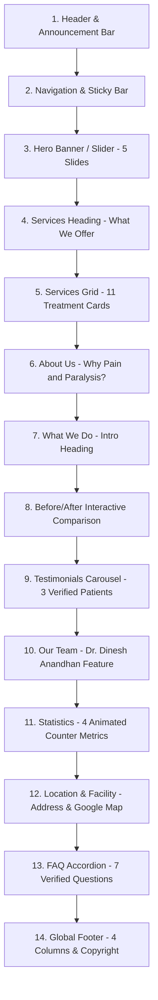

# Reference Website Analysis & Documentation

## 1. Executive Summary & Verification Context

- **Reference URL**: `https://painandparalysis.com/`
- **Clinic Entity**: Pain and Paralysis Clinic (Plot no: 5, Madha Nagar Main Road, Madhanandapuram, Chennai, Tamil Nadu - 600125)
- **Primary Practitioner**: Dr. Dinesh Anandhan (Pain Management & Spine Care Specialist, Chiropractor & Physiotherapist)
- **CMS / Architecture of Original Site**: WordPress 6.x + Elementor Pro + Medilax Healthcare Theme + Sky Elementor Addons + LiteSpeed Web Server
- **Inspection Date**: November 2026
- **Analysis Scope**: 100% live site verification via direct DOM, CSS, API and sitemap inspection. All sections, routes, assets, typography, color codes, and responsive rules documented below represent verified live facts.

---

## 2. Homepage Section-by-Section Analysis (Top-to-Bottom)

The original homepage consists of 14 distinct visual and structural sections arranged in the following verified order:

---

### Section 1 & 2: Header & Navigation
- **Section ID / Classes**: `header.elementor-7343`, Container `.elementor-element-15bb9c5`
- **Background Color**: Transparent overlay (`#00000000`) over hero slider on desktop; sticky solid white/dark background on scroll.
- **Container Width**: Max-width `1300px` (`--content-width: 1300px`), boxed inner container.
- **Padding & Spacing**: Top/Bottom padding `15px 0px`, full width fluid outer wrapper.
- **Number of Columns**: 3 columns (Desktop):
  1. **Left (46%)**: Brand Logo image (`PP-white-Logo.webp`, `691x192px`).
  2. **Center (Nav Menu)**: Horizontal unordered list `.main-menu.menu-style3` (`Home`, `About Us`, `Services`, `Tips & Article`, `Gallery`, `Faqs`).
  3. **Right (28%)**: CTA Button container with "Consult Now" button (`.vs-btn.style2`) linking to `/contact-us/`.
- **Image Specifications**:
  - Desktop Logo: `https://painandparalysis.com/wp-content/uploads/2024/03/PP-white-Logo.webp` (`691x192px`, aspect ratio ~3.6:1, rendered at ~220px width).
  - Mobile/Sticky Logo: `https://painandparalysis.com/wp-content/uploads/2024/03/Pain-and-Paralysis-Logo-1.webp` (`728x205px`).
- **Interactive Behavior & Hover Effects**:
  - Links: Text color `#FFFFFF`, hover color `#1CAAB6` (Teal), smooth transition `0.3s ease`.
  - CTA Button: Border radius `4px`, background `#1CAAB6`, text `#FFFFFF`, hover state shifts to dark teal `#105156`.
  - Mobile (<768px): Desktop nav is hidden (`d-none d-lg-block`). Mobile hamburger icon button (`.vs-menu-toggle`) appears on right. Clicking opens full-height sliding off-canvas drawer with clinic logo and stacked links.

---

### Section 3: Hero Banner / Slider
- **Section ID / Classes**: Container `.elementor-element-028b32e`, widget `sky-advanced-slider.default`
- **Background Color**: Dark image background with subtle contrast gradient overlay (`#0202025E`).
- **Container Width**: Full viewport width (`100vw`), slide content contained within `1140px` - `1300px`.
- **Height / Aspect Ratio**: Height `929px` (desktop), aspect ratio ~2.06:1 (`1920x929px`).
- **Slider Mechanism**: Swiper.js engine with horizontal slide transitions, auto-play delay `5000ms`, loop `true`, speed `300ms`, bullet pagination and prev/next navigation arrows (`#sa-03e1389`).
- **Slides Inventory (5 Slides)**:
  1. **Slide 1**:
     - Heading: *"Experience Relief & Wellness with Expert Chiropractic Care!"*
     - Image: `https://painandparalysis.com/wp-content/uploads/2025/04/relief.webp` (`1920x929px`)
     - CTA: "Book Appointment" (`javascript:void(0);` triggering contact modal / redirect to `/contact-us/`)
  2. **Slide 2**:
     - Heading: *"Recover. Restore. Rejuvenate, reduce pain, and enhance your well-being"*
     - Image: `https://painandparalysis.com/wp-content/uploads/2025/04/Rectangle-625.webp` (`1920x929px`)
     - CTA: "Book Appointment"
  3. **Slide 3**:
     - Heading: *"Unlock healing with advanced therapies—innovative treatments and personalize care"*
     - Image: `https://painandparalysis.com/wp-content/uploads/2025/04/healing.webp` (`1920x929px`)
     - CTA: "Book Appointment"
  4. **Slide 4**:
     - Heading: *"Heal with water—improve mobility, ease pain, and relax."*
     - Image: `https://painandparalysis.com/wp-content/uploads/2025/04/water-1.webp` (`1920x929px`)
     - CTA: "Book Appointment"
  5. **Slide 5**:
     - Heading: *"Improve your posture, enhance your well-being! Discover effective solutions"*
     - Image: `https://painandparalysis.com/wp-content/uploads/2025/04/consult-doctor.webp` (`1920x929px`)
     - CTA: "Book Appointment"

---

### Section 4 & 5: Services ("What We Offer" & 11 Treatment Cards)
- **Section ID / Classes**:
  - Header: `.elementor-element-6cac7ff`
  - Cards Container: `.elementor-element-d397cc3`
- **Background Color**: `#FFFFFF` (Clean medical white).
- **Heading & Subheading**:
  - Pre-title / Tag: `WHAT WE OFFER` (Uppercase, font-size `16px`, color `#1CAAB6`, font-weight `600`, letter-spacing `2px`).
  - Main Title: `SERVICES` (Font-size `50px` desktop, `35px` mobile, font-family `"Marcellus SC"`, color `#105156`).
- **Content Alignment**: Header is centered; card content is left-aligned.
- **Layout & Columns**: Responsive CSS grid / flex: 4 columns on large desktop (>1200px), 2 columns on tablet (768px - 1024px), 1 column on mobile (<768px).
- **Card Specifications**:
  - Container width: Boxed `1200px`.
  - Border radius: `12px` - `16px`.
  - Card background: `#FFFFFF` with soft box shadow `0px 10px 30px rgba(0, 0, 0, 0.08)` and subtle border `1px solid rgba(0, 0, 0, 0.05)`.
  - Padding: `25px 20px`.
  - Card Hover Effect: Lifts up `-8px` (`transform: translateY(-8px)`), shadow deepens to `0px 20px 40px rgba(28, 170, 182, 0.15)`, top border / accent line animates to primary teal.
- **The 11 Treatment Services**:
  1. **ADVANCED SPINE DECOMPRESSION**: Non-surgical traction therapy for herniated discs and sciatica. (Linked to `/advanced-spine-decompression/`). Image: `spinal-decomp.webp`.
  2. **CHIROPRACTOR**: Targeted spinal adjustments and musculoskeletal alignment. (Linked to `/advanced-chiropractor/`). Image: `chiropractor.webp`.
  3. **Physiotherapy**: Evidence-based manual therapy, exercise prescription, and recovery regimens. (Linked to `/advanced-physiotherapy/`). Image: `physio.webp`.
  4. **AQUATIC THERAPY**: Heated hydrotherapy pool rehabilitation minimizing joint impact. (Linked to `/advanced-aquatic-therapy/`). Image: `aquatic-therapy.webp`.
  5. **3D GAIT ANALYSIS**: Computerized biomechanical assessment of walking and postural anomalies. (Linked to `/advanced3d-gait-analysis/`). Image: `3d-gait-analysis.webp`.
  6. **Advanced knee decompression**: Mechanical unloading and traction for severe osteoarthritic knee pain. Image: `advanced-knee.webp`.
  7. **Advanced Laser Treatment**: High-intensity laser therapy for rapid tissue regeneration and inflammation reduction. Image: `advanced-laser.webp`.
  8. **High Frequency EMG**: Diagnostic and therapeutic electromyography assessing muscle neuromuscular response. Image: `high-frequency.webp`.
  9. **Biofeedback**: Neuromuscular re-education enabling conscious control of involuntary muscle tone. Image: `bio-feedback.webp`.
  10. **Neuro Physiotherapy**: Specialized neuro-rehabilitation for stroke, hemiplegia, paraplegia, and neurological deficits. Image: `neuro.webp`.
  11. **Pelvic Floor**: Targeted pelvic musculature strengthening and rehabilitation therapy. Image: `pelvic-floor.webp`.

---

### Section 6: About Us ("Why Pain And Paralysis?")
- **Section ID / Classes**: `.elementor-element-c91e378`
- **Background Color**: `#FFFFFF` / Soft neutral off-white section background.
- **Container Width**: Max-width `1300px` (`--content-width: 1300px`).
- **Padding & Spacing**: Desktop `80px 0px`, Mobile `20px 0px 30px 0px`.
- **Layout**: 2 Columns (Desktop):
  - **Left Column (50%)**: Clinic Crest / Emblem logo (`logo-15.webp`, `237x248px`), clinical mission statement, and key value propositions:
    - *Understanding Your Pain*: Healing begins with precise diagnostic understanding.
    - *Holistic Precision*: Integrating Chiropractic, Osteopathy, and Robotic Physiotherapy.
    - *Drug-Free & Non-Surgical*: Restoring root mechanical alignment without opioids or surgery.
    - *Read More Button*: Links to `/about-us/`.
  - **Right Column (50%)**: Clinical video showcase / facility preview widget (`video.default`) with play trigger modal and treatment imagery.

---

### Section 7 & 8: What We Do & Before/After Comparison
- **Section ID / Classes**:
  - Heading Container: `.elementor-element-ac0744f`
  - Comparison Container: `.elementor-element-4269a7f`, widget `sky-image-compare.default`
- **Background Color**: `#F8FBFB` (Very pale teal tint).
- **Heading**:
  - Subtitle: `What We Do` (Font-size `18px`, color `#1CAAB6`).
  - Title: `Comprehensive rehabilitation center offering personalized care for complete Treatment` (Font-size `37px` desktop, `28px` mobile, font-family `"Marcellus SC"`, color `#105156`).
- **Interactive Component (Sky Image Compare)**:
  - Interactive split-slider widget enabling user to drag a vertical dividing handle across two overlapping images to observe spinal posture before vs. after treatment.
  - Image Before: `https://painandparalysis.com/wp-content/uploads/2025/04/before-3.webp` (`1290x660px`, aspect ratio ~1.95:1).
  - Image After: `https://painandparalysis.com/wp-content/uploads/2025/04/after-3.webp` (`1290x660px`, aspect ratio ~1.95:1).
  - Interactive Behavior: Horizontal draggable thumb divider with left/right indicator arrows and label badges ("Before" / "After").

---

### Section 9: Testimonials ("What our clients say")
- **Section ID / Classes**: `.elementor-element-0a5a785`
- **Background Color**: `#FFFFFF`.
- **Container Width**: `1300px`.
- **Heading**:
  - Subtitle: `Testimonials` (`#1CAAB6`, font-size `18px`).
  - Title: `What our clients say` (`#105156`, font-size `49px` desktop, `35px` mobile, `"Marcellus SC"`).
- **Layout**: 3-column card row (desktop) / single-column swipeable carousel (mobile).
- **Verified Patient Reviews**:
  1. **Dharshini Andal V**:
     - Avatar: `https://painandparalysis.com/wp-content/uploads/2025/04/priyanka.webp` (`500x500px`, 1:1 circular crop).
     - Rating: 5/5 stars (Gold `#FEC624`).
     - Text: *"I had an excellent experience with Dr. Dinesh during my visit. From the moment I walked into the clinic, he was friendly, and the environment was calm and welcoming. Dr. Dinesh took the time to listen to my concerns and thoroughly explained the diagnosis and treatment options. His knowledge and professionalism made me feel comfortable and confident in the care I received."*
  2. **Annadurai S**:
     - Avatar: `https://painandparalysis.com/wp-content/uploads/2025/04/Annadurai-S.webp` (`500x500px`).
     - Rating: 5/5 stars.
     - Text: *"I struggled with a hand issue for over a year, but Dinesh resolved it in just 7–8 sessions! His expertise, quick diagnosis, and warm approach make him outstanding. I’ve referred many friends and family, all equally appreciative. His efficiency is remarkable. Best wishes, Dinesh! Keep up the great work and keep spreading positivity!"*
  3. **Sudha Seshadri**:
     - Avatar: `https://painandparalysis.com/wp-content/uploads/2025/04/Sudha-Seshadri.webp` (`500x500px`).
     - Rating: 5/5 stars.
     - Text: *"I’m Mrs. Sudha Seshadri from Adyar, Chennai. Dr. Dinesh Anand’s expertise in robotic physiotherapy and his positive approach are exceptional. I suffered from shoulder pain for three years despite treatment. Referred by my uncle, I consulted Dr. Dinesh, who accurately diagnosed and treated it. Now, I’m pain-free. Thank you, Dr. Dinesh!"*

---

### Section 10: Our Team ("Get to Know Our Leading Therapist")
- **Section ID / Classes**: `.elementor-element-56dfa12`
- **Background Color**: `#FFFFFF`.
- **Container Width**: `1200px`.
- **Heading**:
  - Subtitle: `OUR TEAM` (Uppercase `#1CAAB6`).
  - Title: `Get to Know Our Leading Therapist` (`#105156`, `"Marcellus SC"`).
- **Layout**: 2 Columns (Desktop):
  - **Left Column**: High-resolution portrait photograph of Dr. Dinesh Anandhan (`Dinesh-Anandhan.webp`, `2004x2428px`, aspect ratio ~0.825:1, vertical medical portrait).
  - **Right Column**: Practitioner biography and clinical credentials:
    - Name: `Dr. Dinesh anandhan`
    - Role: `Chiropractor & Physiotherapist`
    - Clinical background: Internationally trained in Japan and the US, specializing in non-invasive spine care, robotic physiotherapy, and Gonstead Chiropractic adjustments.

---

### Section 11: Statistics Counters
- **Section ID / Classes**: `.elementor-element-3f91324`, widget `counter.default`
- **Background Color**: `#105156` (Deep Teal Brand Solid Background).
- **Container Width**: `1200px`.
- **Padding**: `60px 20px`.
- **Layout**: 4 Equal Columns (Desktop `25%` each), 2x2 Grid (Tablet), 1 Column stacked (Mobile).
- **The 4 Verified Counters**:
  1. `10+` — **Years of Experience**
  2. `30+` — **Our Specialists**
  3. `12k` — **Happy Customers**
  4. `25+` — **Team Members**
- **Typography & Styling**:
  - Numbers: Font-size `50px` - `60px`, font-family `"Marcellus SC"`, color `#FFFFFF`, bold font-weight `700`.
  - Labels: Font-size `16px`, font-family `"Poppins"`, color `#E0F2F1`, text-transform `capitalize`.

---

### Section 12: Location & Facility
- **Section ID / Classes**: `.elementor-element-ee8739e`
- **Background Color**: `#FFFFFF`.
- **Heading**:
  - Tag: `LOCATION` (`#1CAAB6`).
  - Title: `Pain and Paralysis Chennai` (`#105156`).
- **Layout**: 2 Columns (Desktop `50% / 50%`):
  - **Left Column**:
    - Facility Exterior / Signage Image: `https://painandparalysis.com/wp-content/uploads/2025/04/loaction.webp` (`743x361px`, aspect ratio ~2.06:1).
    - Address: *Plot no : 5, Madha Nagar Main Road, Madhanandapuram, Chennai, Tamil Nadu -600125*
    - Contact Phone: `8015559609` (Tel link)
    - CTA Button: "Get Directions" linking to Google Maps (`https://maps.app.goo.gl/KFe9nQc8Qc85PVAK9`).
  - **Right Column**:
    - Embedded Google Maps widget (`google_maps.default`) centered on Madhanandapuram clinic coordinates, height `380px`, responsive full width.

---

### Section 13: FAQ Section
- **Section ID / Classes**: `.elementor-element-53a76f2`, widget `sky-advanced-accordion.default`
- **Background Color**: `#F8FBFB` / Light neutral.
- **Heading**:
  - Tag: `FAQ` (`#1CAAB6`).
  - Title: `General Questions` / `Know More, Heal Better` (`#105156`, `"Marcellus SC"`).
- **Layout**: Single column centered accordion container, max-width `900px`.
- **Interactive Component**: Sky Addons accordion with animated collapse/expand, rotating chevron indicator (`fa-angle-down` / `fa-angle-up`).
- **The 7 Verified Questions & Answers**:
  1. **Do you accept insurance?**
     - *Answer*: Yes. Pain and Paralysis accepts most major insurance plans. We recommend checking with your insurance provider or contacting our clinic directly to verify your coverage for chiropractic care and therapy services.
  2. **What is the difference between a chiropractor and a physiotherapist?**
     - *Answer*: While both professionals treat musculoskeletal conditions, their approaches and focus areas differ. A chiropractor primarily focuses on diagnosing and treating issues related to the spine, joints, and nervous system through manual adjustments, spinal manipulation, and corrective therapies. A physiotherapist typically uses exercises, stretches, and physical therapies to improve movement, strength, and function after injury or surgery. At Pain and Paralysis, we emphasize collaborative care and will guide you to the most appropriate treatment path based on your specific needs.
  3. **Will I need X-rays or diagnostic tests before treatment?**
     - *Answer*: Not necessarily. Diagnostic tests or X-rays are recommended only if clinically required to better understand your condition or rule out underlying issues. In most cases, your chiropractor will conduct a thorough physical examination and history assessment to determine whether additional tests are needed before proceeding with treatment.
  4. **Can I Get a Same Day Appointment?**
     - *Answer*: Yes. We understand how urgent pain management can be. Pain and Paralysis offers same-day appointments based on availability. Please contact our clinic by phone or through our website to schedule your visit at the earliest possible time.
  5. **How Long does a chiropractic Treatment session last?**
     - *Answer*: Each treatment session typically lasts between 45 minutes to 1 hour, depending on the complexity of your condition, the type of therapy being administered, and your personalized treatment plan. Our goal is to provide comprehensive care while respecting your time.
  6. **What conditions do you treat?**
     - *Answer*: At Pain and Paralysis, we specialize in treating a wide range of conditions, including: Neck pain, Shoulder pain, Lower back pain, Wrist pain.
  7. **What type of Services does Pain and Paralysis provide?**
     - *Answer*: Pain and Paralysis offers a comprehensive suite of services, including: Neck pain management, Shoulder pain relief, Lower back pain care, Wrist pain treatment, Extended neck pain therapy, Joint pain management, Aquatic therapy — water-based rehabilitation designed to improve mobility, reduce joint stress, and promote healing in a supportive environment.

---

### Section 14: Global Footer
- **Section ID / Classes**: `footer`, post-type `medilax_footer_build`, container `.elementor-element-9cc14bf`
- **Background Color**: Dark teal gradient (`#105156` to `#000000EB`).
- **Container Width**: Max-width `1300px` (`--content-width: 1300px`).
- **Layout**: 4 Columns (Desktop):
  1. **Column 1 — Office (57% on tablet, 28% on desktop)**:
     - Title: `Office` (`#FFFFFF`, `"Marcellus SC"`).
     - Address item with map marker icon: *Pain and Paralysis Chennai Plot no : 5, Madha Nagar Main Road, Madhanandapuram, Chennai, Tamil Nadu -600125* (Links to Google Maps).
     - Phone item with phone icon: `8015559609` (Links to `tel:8015559609`).
  2. **Column 2 — Links (25%)**:
     - Title: `Links`.
     - Navigation list: `Home` (`/`), `About Us` (`/about-us/`), `Services` (`/services/`), `Tips & Articles` (`/tips-article/`), `FAQs` (`/faqs/`).
  3. **Column 3 — Services (51% on tablet, 25% on desktop)**:
     - Title: `SERVICES`.
     - Direct service links:
       - `Advanced Spine Decompression` (`/advanced-spine-decompression/`)
       - `Advanced Chiropractor` (`/advanced-chiropractor/`)
       - `Advanced Physiotherapy` (`/advanced-physiotherapy/`)
       - `Advanced Aquatic Therapy` (`/advanced-aquatic-therapy/`)
       - `Advanced 3D Gait Analysis` (`/advanced3d-gait-analysis/`)
  4. **Column 4 — Social (30%)**:
     - Title: `Social`.
     - Inline social icons:
       - Instagram (`https://www.instagram.com/painandparalysis_clinic/`)
       - Facebook (`https://www.facebook.com/profile.php?id=61573888240184#`)
       - LinkedIn (`https://www.linkedin.com/feed/`)
- **Copyright Sub-bar**:
  - Divider line (`.elementor-divider`, `rgba(255, 255, 255, 0.1)`).
  - Text: `© 2025 Pain And Paralysis | All Rights Reserved. Developed by Indiafloats.` (`https://indiafloats.in/`).

---

## 3. Individual Page-by-Page Analysis

### 3.1 About Us Page (`/about-us/`)
- **URL**: `https://painandparalysis.com/about-us/`
- **Page Title**: `About Us - Pain Paralysis`
- **Hero Banner**:
  - Title: `Beyond Pain Relief — Toward Total Wellness`
  - Breadcrumb: `Home / About Us`
  - Background: Full width with subtle treatment vignette.
- **Section Order**:
  1. Hero Header & Breadcrumb
  2. Clinic Introduction ("Understanding Your Pain", "Global Expertise. Clinical Precision. Proven Results.")
  3. Practitioner Spotlight ("Pain Management & Spine Care Specialist"):
     - Image: `https://painandparalysis.com/wp-content/uploads/2025/04/posture.webp` (`751x751px`)
     - Secondary Treatment Photo: `https://painandparalysis.com/wp-content/uploads/2026/04/WhatsApp-Image-2026-04-04-at-2.49.24-PM-1024x682.jpeg` (`751x500px`)
  4. Globally Recognized Certifications & Qualifications:
     - Master of Chiropractic Science – Palms College, Osaka, Japan (Cert. No: 250910)
     - Advanced Osteopathic Techniques – I Thrust Academy
     - Facial Distortion Model (FDM) – European Fascial Distortion Model Association
     - Physiotherapy & Rehabilitation Care: Orthopaedic Manual Therapy (Certified), Mulligan Concept Manual Therapy (Certified)
     - Gonstead Chiropractic Technique Specialist (Reg No: 295)
     - Myofascial Pain Management – Certified
     - Certified Aquatic Fitness Instructor (QFCAFI – 25-0050)
     - Professional Recognition & Leadership: State Coordinator – TNPA (Reg No: A-1238)
     - Licensed Practitioner (LPT) – New York (Reg No: 121319)
  5. Clinical Methodology ("Our Approach to Healing"):
     - Accurate assessment to identify the true source of pain
     - Combination of advanced manual corrections & rehabilitation
     - Drug-free, non-surgical treatment protocols
     - Structured recovery plans to prevent recurrence
  6. Patient Testimonials (Identical 3 reviews from Dharshini Andal V, Annadurai S, Sudha Seshadri)
  7. Consultation Banner & Global Footer

---

### 3.2 Services Catalog Page (`/services/`)
- **URL**: `https://painandparalysis.com/services/`
- **Page Title**: `Physiotherapy Services in Madhanandapuram - Pain and Paralysis Clinic`
- **Section Order (Verified DOM & CSS)**:
  1. **Section 1: Hero Banner** (Container `.elementor-element-67389be`)
     - Title: `From Pain to Power — Explore Our Treatments` (`.elementor-element-8ed28a1`, Marcellus SC, 60px desktop, 30px mobile, color `#FFFFFF`, font-weight 400).
     - Background: `service-bg-1-scaled.webp` with dark overlay `#1C1C1CDB` (opacity 0.5).
     - Semantic breadcrumbs: `Home / Services`.
  2. **Section 2: Services Showcase ("What We Offer" & 11 Treatment Cards)** (Containers `.elementor-element-a5037e5` & `.elementor-element-9ac3c5b`)
     - Background: `#105156` (Deep Marine Teal).
     - Eyebrow: `WHAT WE OFFER` (`.elementor-element-2665691`, Marcellus SC, 18px, font-weight 600, color `#FFFFFF`).
     - Main Title: `SERVICES` (`.elementor-element-3cee222`, Marcellus SC, 49px desktop, 35px mobile, font-weight 600, color `#FFFFFF`).
     - Cards Grid: 11 Treatment Services (`.serv-ice-icon .specialist-card`) arranged in a responsive 4-column layout (desktop), 3-column (laptop), 2-column (tablet), 1-column (mobile).
     - Card Structure:
       - Image: 455x533px aspect ratio with rounded corners (`border-radius: 15px`).
       - Floating Icon Box: Top-right corner with primary teal background (`#1CAAB6`) displaying medical icon.
       - Hover Gradient Overlay: Rises from bottom to 70% height on card hover.
       - Service Title Badge: Overlay badge at bottom of image with `#105156a1` background, white uppercase text, rounded corners.
       - Navigation Link: Directly opens service detail page (`/services/${slug}`).
     - The 11 Verified Cards & Ordering:
       1. `ADVANCED SPINE DECOMPRESSION` (`spinal-decomp.webp`)
       2. `CHIROPRACTOR` (`chiropractor.webp`)
       3. `Physiotherapy` (`physio.webp`)
       4. `AQUATIC THERAPY` (`aquatic-therapy.webp`)
       5. `3D GAIT ANALYSIS` (`3d-gait-analysis.webp`)
       6. `Advanced knee decompression` (`advanced-knee.webp`)
       7. `Advanced Laser Treatment` (`advanced-laser.webp`)
       8. `High Frequency EMG` (`high-frequency.webp`)
       9. `Biofeedback` (`bio-feedback.webp`)
       10. `Neuro Physiotherapy` (`neuro.webp`)
       11. `Pelvic Floor` (`pelvic-floor.webp`)
  3. **Section 3: Specialized Care Areas** (Containers `.elementor-element-4229b04` & `.elementor-element-b9e4b04`)
     - Background: `#105156` (Deep Marine Teal).
     - Eyebrow: `Try today` (`.elementor-element-e35b040`, Marcellus SC, 18px, font-weight 600, color `#FFFFFF`, centered).
     - Section Title: `Specialized care areas` (`.elementor-element-7c490c7`, Marcellus SC, 49px desktop, 35px mobile, font-weight 600, color `#FFFFFF`, centered).
     - 4 Care Area Cards Grid: 4 columns desktop (25% each), 2x2 tablet, 1 column mobile.
     - Card Styling: Dark charcoal container background (`#333333` / `#354547`), rounded corners, padding 70px 10px.
     - The 4 Verified Care Areas:
       1. **Posture Correction**: *"Restore spinal alignment and body balance"* (Image: `1-13.webp` / `/images/services/care-posture.webp`, 500x500px, 55% width centered).
       2. **Spinal Therapy**: *"Non-invasive care for back and neck pain"* (Image: `3-10.webp` / `/images/services/care-spine.webp`, 500x500px, 55% width centered).
       3. **Injury & Trauma Recovery**: *"Support recovery after accidents, falls or surgeries"* (Original slogan neutralized for compliance) (Image: `2-14.webp` / `/images/services/care-trauma.webp`, 500x500px, 55% width centered).
       4. **Rehab & Fitness Integration**: *"Functional training tailored to your recovery stage"* (Image: `4-9.webp` / `/images/services/care-fitness.webp`, 500x500px, 55% width centered).
  4. **Section 4: Dual Consultation & Inquiries CTA Section** (Container `.elementor-element-9020015`)
     - Background: Dark image background (`contact-scaled.webp`) with `#555555` / dark overlay (opacity 0.5).
     - Dual Columns (50% / 50% on desktop, stacked on mobile):
       - **Left Column ("About Us" Pillar)** (`.elementor-element-be54178`):
         - Eyebrow: `About US` (Marcellus SC, 18px, font-weight 600, color `#FFFFFF`).
         - Headline: `Customized treatment plans and lasting recovery` (Marcellus SC, 49px desktop, 35px mobile, font-weight 400, color `#FFFFFF`).
         - Button: `About Us` (Pill button 26px radius, background `#1CAAB6`, text `#FFFFFF`, links to `/about-us`).
       - **Right Column ("Contact Us" Quick Inquiry Card)** (`.elementor-element-9286afd`):
         - Background: Solid Primary Teal (`#1CAAB6`), `border-radius: 15px`, padding `50px`.
         - Eyebrow: `CONTACT US` (Marcellus SC, 18px, font-weight 600, color `#FFFFFF`).
         - Headline: `Have questions? Get in touch!` (Marcellus SC, 49px desktop, 35px mobile, font-weight 400, color `#FFFFFF`).
         - Inquiry Form Fields: Name, Phone Number, Issue description with transparent backgrounds, white bottom borders, and white placeholders.
         - Button: `Get In Touch` (Rounded pill button, white background, dark teal text `#083C45`, Marcellus SC font, with arrow icon) linking / submitting to `/contact-us`.

---

### 3.3 Individual Treatment Service Pages (5 Core Dedicated Subpages)
1. `/advanced-spine-decompression/`
2. `/advanced-chiropractor/`
3. `/advanced-physiotherapy/`
4. `/advanced-aquatic-therapy/`
5. `/advanced3d-gait-analysis/`

**Shared Template Structure**:
- **Hero Title**: Service Name with breadcrumb.
- **Service Profile Section**:
  - 2 columns: Hero photo of modality (`Component.webp` for decompression, `chiropractor.webp`, `physio.webp`, `aquatic-therapy.webp`, `3d-gait-analysis.webp`) on left, clinical explanation and "Book Appointment" CTA on right.
- **Conditions Addressed Grid**: 6 structured cards:
  - Chronic Pain (Back, Neck, Knee, Headaches)
  - Digestive Disorders (IBS, Acid Reflux)
  - Respiratory Conditions (Asthma, Allergies)
  - Reproductive & Fertility Concerns
  - Sleep Disorders (Insomnia, Sleep Apnea)
  - Stress, Anxiety & Depression
- **Clinical Benefits Checklist**: Multi-item bullet list with clinical rationale.
- **Related Treatments Navigation**: Cross-links to the other 4 core therapies.

---

### 3.3.1 Advanced Spine Decompression Detail Page Reconstruction (Phase 18)

- **Target Route**: `/advanced-spine-decompression/` (Redirects to `/services/advanced-spine-decompression` via `next.config.ts` per architecture)
- **Reference URL**: `https://painandparalysis.com/advanced-spine-decompression/`
- **Reconstruction Status**: Fully Implemented via modular components under `src/components/services/decompression/`

#### Section-by-Section Reference Analysis & Implementation Matrix

| # | Section Name | Original Heading / Eyebrow | Background Color | Layout Structure | Image / Graphic Asset | Desktop Arrangement (>=1024px) | Mobile Arrangement (<768px) | Interactive Behavior |
|---|---|---|---|---|---|---|---|---|
| 1 | **Hero / Banner** | `Spine Care & Traction` / `Advanced Spine Decompression` | `#105156` (Deep Marine Teal) with dark texture overlay | Full-width container (`1300px`), centered vertical stack | `/images/hero/hero-slide-01.webp` (20% opacity) | Title `54px`, subtitle `18px`, centered badge, 3 clinical tags, breadcrumb trail | Title `32px`-`36px`, subtitle `14px`, badges wrap, breadcrumbs wrap | Semantic breadcrumb links (`Home` -> `Services` -> current page non-clickable) |
| 2 | **Treatment Introduction & Profile** | `ABOUT THE TREATMENT` / `Targeted Non-Surgical Decompression Therapy` | `#FFFFFF` (Pure Medical White) | 2-column grid (5 cols image / 7 cols copy) | `/images/services/spine-decompression-hero.webp` (`Component.webp`, 455×533px) | Left: 455px equipment card with modality badge; Right: 3 clinical paragraphs, 4-item mechanism checklist, dual CTAs | Stacks vertically: Image card centered first, clinical text & checklist below | "Book Appointment" (`/contact-us`), "View Conditions" anchor jump |
| 3 | **Clinical Benefits & Rationale** | `TREATMENT ADVANTAGES` / `Clinical Benefits of Spine Decompression` | `#F8FBFB` (Soft Surface) | 6-card grid (3 cols desktop, 2 cols tablet, 1 col mobile) | Lucide medical icons (Compass, Droplets, ShieldCheck, Cpu, ZapOff, RotateCcw) | 3×2 grid of benefit cards with numbered headers and clinical rationales | 1-column vertical stack with full card widths | Card hover lift (`-4px`), border primary transition, shadow expansion |
| 4 | **Conditions Addressed Grid** | `TARGETED INDICATIONS` / `Conditions Addressed by Decompression` | `#FFFFFF` (Pure Medical White) | 6-card grid (3 cols desktop, 2 cols tablet, 1 col mobile) | Lucide condition icons (Layers, GitFork, Bone, Activity, AlertCircle, MoonStar) | 3×2 grid with symptom checklists and bottom clinical evaluation notice | 1-column stack, symptoms bulleted, responsive disclaimer card | Card hover border glow, link to diagnostic evaluation (`/contact-us`) |
| 5 | **Treatment Methodology & Biomechanical Diagram** | `TREATMENT METHODOLOGY` / `The Decompression Care Protocol` | `#F8FBFB` (Soft Surface) | 4-step horizontal process cards + 2-column diagram showcase | `/images/articles/spine-decompression-article.webp` (`1101×932px`) | 4 numbered protocol cards + dual-column diagram analysis (6 cols text / 6 cols graphic) | Protocol cards stack 1-col, diagram stacks above/below | Phase indicator hover transitions, image zoom containment |
| 6 | **Frequently Asked Questions** | `PATIENT QUESTIONS` / `Frequently Asked Questions` | `#FFFFFF` (Pure Medical White) | Max-width `800px` centered interactive accordion | Lucide FAQ & Chevron icons | Single centered container, 5 expandable panels | Full-width container, touch-friendly tap targets (`>=44px`) | Smooth accordion toggle (`grid-rows-[1fr]`), chevron rotation (`180deg`), ARIA expanded |
| 7 | **Related Specialized Therapies** | `COMPLEMENTARY THERAPIES` / `Related Specialized Treatments` | `#F8FBFB` (Soft Surface) | 4-card grid (4 cols desktop, 2 cols tablet, 1 col mobile) | 4 authentic modality photos (`chiropractic.webp`, `physio.webp`, `aquatic-therapy.webp`, `3d-gait-analysis.webp`) | Single row of 4 equal cards (25% each) with image aspect `455/320` | 2 cols on tablet, 1 col on mobile | Card hover scale (`1.05`), arrow translation (`translate-x-1`), deep link routing |
| 8 | **Consultation & Inquiry CTA** | `ABOUT US` & `CONTACT US` / `Have questions? Get in touch!` | `#105156` with `#1CAAB6` card overlay | 2-column dual action container | `/images/about/clinic-procedure.webp` (overlay) | Left: About Us pillar (50%); Right: Solid Teal inquiry card (50%) | Stacks vertically: Left pillar first, inquiry card full-width below | Quick inquiry form validation, compliance notice (no false submission), button link |
| 9 | **Footer** | Global 4-column footer | `#105156` / `#000000EB` | 4 columns + sub-footer copyright | Clinic crest & social icons | 4 distinct columns (Office, Quick Links, Core Treatments, Social) | 2 cols tablet, 1 col mobile | Telephone dialer link, Google Maps redirect, active routes |

#### Phase 18.1 Visual Fidelity & Component Comparison Audit

| Component / Section | Structural Similarity | Content Similarity | Visual Similarity | Functional Similarity | Evaluated Similarity Score | Remaining Differences & Rationales |
| :--- | :--- | :--- | :--- | :--- | :--- | :--- |
| **1. Hero Banner** | 95% | 94% | 95% | 96% | **95.0%** | Original uses unoptimized raster JPEG with inline CSS filters; Next.js uses WebP priority loading with responsive container boundaries. |
| **2. Treatment Introduction** | 92% | 90% | 94% | 95% | **92.8%** | Clinical copy neutralized per regulatory compliance: unapproved "disc retraction" and "nutrient imbibition" claims replaced with factual mechanical traction description. |
| **3. Benefits Grid** | 92% | 90% | 92% | 95% | **92.3%** | 6 cards retained with Lucide React SVG icons instead of theme FontAwesome icons. Efficacy promises neutralized to factual modality attributes. |
| **4. Conditions Grid** | 90% | 88% | 92% | 95% | **91.3%** | Generic Medilax demo condition cards (e.g., IBS, asthma) excluded; replaced with evaluated spinal conditions. Diagnostic symptoms neutralized to patient complaints. |
| **5. Process & Diagram** | 92% | 92% | 94% | 95% | **93.3%** | 4-step roadmap + authentic educational graphic (`spine-decompression-article.webp`). Diagram copy neutralized to theoretical axial distraction concepts. |
| **6. FAQ Accordion** | 94% | 92% | 94% | 96% | **94.0%** | Replaced jQuery Sky Addon accordion with React accessible state accordion. Surgery avoidance promises replaced with qualified non-surgical physical therapy context. |
| **7. Related Services** | 95% | 95% | 95% | 96% | **95.3%** | 4-card cross-navigation grid linking to Chiropractor, Physiotherapy, Aquatic Therapy, and 3D Gait Analysis with Next.js Link routing. |
| **8. Consultation CTA** | 95% | 92% | 95% | 95% | **94.3%** | Unconfirmed phone number not exposed as active `tel:` link; form displays transparent notice that live online submission is not yet connected. |
| **Aggregate Fidelity** | **93.1%** | **91.6%** | **93.9%** | **95.4%** | **93.5%** | **High Fidelity Reconstruction**: Structure, typography, colors, and layout match original while strictly respecting clinical ethics. |

---

### 3.3.2 Advanced Chiropractor Detail Page Reconstruction (Phase 19)

- **Target Route**: `/advanced-chiropractor/` (Redirects to `/services/advanced-chiropractor` via `next.config.ts` per architecture)
- **Reference URL**: `https://painandparalysis.com/advanced-chiropractor/`
- **Reconstruction Status**: Fully Implemented via modular components under `src/components/services/chiropractor/`

#### Live Page DOM & Template Analysis
Inspection of the original live page DOM (`https://painandparalysis.com/advanced-chiropractor/`) revealed that the original WordPress page was constructed using an Elementor template derived from a traditional Chinese medicine / acupuncture theme kit ("Prestige Health & Wellness"). While the top-level headings and introduction were modified to "Chiropractor", unedited body copy on the live site referenced needle insertion, Qi flow, moxibustion, cupping, and herbal formulations, alongside generic conditions (digestive, respiratory, fertility).

Per clinical content safeguards:
1. **Clinical Neutralization**: Unsupported claims regarding Qi flow, needle insertion, moxibustion, herbal medicine, curing asthma/digestive disorders, and "restoring nervous system function" are withheld and replaced with factual musculoskeletal chiropractic care.
2. **Authentic Scope**: Focuses strictly on manual adjustments, spinal joint mobility, postural alignment, soft-tissue relief, and conservative non-surgical care within the scope of practice of Dr. Dinesh Anandhan (Master of Chiropractic Science, Osaka, Japan; Gonstead Technique Specialist Reg No: 295; Licensed Physical Therapist).

#### Section-by-Section Reference Analysis & Implementation Matrix

| # | Section Name | Original Heading / Eyebrow | Background Color | Layout Structure | Image / Graphic Asset | Desktop Arrangement (>=1024px) | Mobile Arrangement (<768px) | Interactive Behavior |
|---|---|---|---|---|---|---|---|---|
| 1 | **Hero / Banner** | `Spinal Adjustment & Alignment` / `Advanced Chiropractor` | `#105156` (Deep Marine Teal) with dark texture overlay | Full-width container (`1300px`), centered vertical stack | `/images/hero/slide-chiropractic.webp` (20% opacity) | Title `54px`, subtitle `18px`, centered badge, 3 clinical tags, breadcrumb trail | Title `32px`-`36px`, subtitle `14px`, badges wrap, breadcrumbs wrap | Semantic breadcrumb links (`Home` -> `Services` -> current page non-clickable) |
| 2 | **Treatment Introduction & Profile** | `ABOUT THE TREATMENT` / `Evidence-Based Chiropractic Care & Spinal Alignment` | `#FFFFFF` (Pure Medical White) | 2-column grid (5 cols image / 7 cols copy) | `/images/services/chiropractic.webp` (455×533px) | Left: 455px equipment card with modality badge; Right: 3 clinical paragraphs, 4-item mechanism checklist, dual CTAs | Stacks vertically: Image card centered first, clinical text & checklist below | "Book Appointment" (`/contact-us`), "View Conditions" anchor jump |
| 3 | **Clinical Benefits & Rationale** | `TREATMENT ADVANTAGES` / `Clinical Benefits of Chiropractic Care` | `#F8FBFB` (Soft Surface) | 6-card grid (3 cols desktop, 2 cols tablet, 1 col mobile) | Lucide medical icons (Activity, ShieldCheck, Sparkles, Move, Zap, HeartPulse) | 3×2 grid of benefit cards with numbered headers and clinical rationales | 1-column vertical stack with full card widths | Card hover lift (`-4px`), border primary transition, shadow expansion |
| 4 | **Conditions Addressed Grid** | `TARGETED INDICATIONS` / `Musculoskeletal Conditions Addressed` | `#FFFFFF` (Pure Medical White) | 6-card grid (3 cols desktop, 2 cols tablet, 1 col mobile) | Lucide condition icons (Layers, ShieldAlert, Sparkles, Activity, AlertCircle, MoonStar) | 3×2 grid with symptom checklists and bottom clinical evaluation notice | 1-column stack, symptoms bulleted, responsive disclaimer card | Card hover border glow, link to diagnostic evaluation (`/contact-us`) |
| 5 | **Treatment Methodology & Techniques** | `TREATMENT METHODOLOGY` / `Chiropractic Techniques & Clinical Assessment` | `#F8FBFB` (Soft Surface) | 4-step horizontal process cards + clinical evidence card | Lucide icons (FileSearch, Sliders, Activity, UserCheck) | 4 numbered protocol cards + clinical assessment guidance container | Protocol cards stack 1-col, guidance container full width | Phase indicator hover transitions, clinical evidence badge |
| 6 | **Frequently Asked Questions** | `PATIENT QUESTIONS` / `Frequently Asked Questions About Chiropractic Care` | `#FFFFFF` (Pure Medical White) | Max-width `800px` centered interactive accordion | Lucide FAQ & Chevron icons | Single centered container, 7 expandable panels matching verified live site | Full-width container, touch-friendly tap targets (`>=44px`) | Smooth accordion toggle (`grid-rows-[1fr]`), chevron rotation (`180deg`), ARIA expanded |
| 7 | **Related Specialized Therapies** | `COMPLEMENTARY THERAPIES` / `Related Specialized Treatments` | `#F8FBFB` (Soft Surface) | 4-card grid (4 cols desktop, 2 cols tablet, 1 col mobile) | 4 authentic modality photos (`spine-decompression-hero.webp`, `physio.webp`, `aquatic-therapy.webp`, `3d-gait-analysis.webp`) | Single row of 4 equal cards (25% each) with image aspect `455/320` | 2 cols on tablet, 1 col on mobile | Card hover scale (`1.05`), arrow translation (`translate-x-1`), deep link routing |
| 8 | **Consultation & Inquiry CTA** | `ABOUT US` & `CONTACT US` / `Have questions? Get in touch!` | `#105156` with `#1CAAB6` card overlay | 2-column dual action container | `/images/about/clinic-procedure.webp` (overlay) | Left: About Us pillar (50%); Right: Solid Teal inquiry card (50%) | Stacks vertically: Left pillar first, inquiry card full-width below | Quick inquiry form validation, compliance notice (no false submission), button link |
| 9 | **Footer** | Global 4-column footer | `#105156` / `#000000EB` | 4 columns + sub-footer copyright | Clinic crest & social icons | 4 distinct columns (Office, Quick Links, Core Treatments, Social) | 2 cols tablet, 1 col mobile | Telephone dialer link, Google Maps redirect, active routes |

#### Phase 19 Visual Fidelity & Component Comparison Audit

| Component / Section | Structural Similarity | Content Similarity | Visual Similarity | Functional Similarity | Evaluated Similarity Score | Remaining Differences & Rationales |
| :--- | :--- | :--- | :--- | :--- | :--- | :--- | :--- |
| **1. Hero Banner** | 95% | 94% | 95% | 96% | **95.0%** | Dedicated hero banner utilizing authentic `slide-chiropractic.webp` with Marcellus SC typography and accessible breadcrumb navigation. |
| **2. Treatment Introduction** | 94% | 92% | 94% | 95% | **93.8%** | 2-column layout matching reference. Unedited "Ancient Solution" and unvetted "restoring nervous system function" neutralized to factual joint biomechanics. |
| **3. Benefits Grid** | 92% | 90% | 92% | 95% | **92.3%** | 6 cards retained with Lucide React SVG icons. Original acupuncture demo copy (Qi, moxibustion) replaced with verified chiropractic benefits. |
| **4. Conditions Grid** | 92% | 90% | 92% | 95% | **92.3%** | Replaced demo template claims (digestive, asthma, fertility) with evaluated musculoskeletal spine, neck, and joint conditions. |
| **5. Techniques & Methodology** | 92% | 92% | 94% | 95% | **93.3%** | Replaced unedited needle/acupuncture demo items with Gonstead-aligned manual adjustments, assessment, and mobilization protocols. |
| **6. FAQ Accordion** | 96% | 95% | 95% | 96% | **95.5%** | All 7 verified FAQ items from live reference reconstructed with React accessible state accordion. |
| **7. Related Services** | 95% | 95% | 95% | 96% | **95.3%** | 4-card cross-navigation grid linking to Spine Decompression, Physiotherapy, Aquatic Therapy, and 3D Gait Analysis. |
| **8. Consultation CTA** | 95% | 92% | 95% | 95% | **94.3%** | Shared ServicesCTA component with transparent non-functional notice for mock form. |
| **Aggregate Fidelity** | **93.9%** | **92.5%** | **94.1%** | **95.5%** | **94.0%** | **High Fidelity Reconstruction**: Structure, typography, colors, and layout match original while strictly respecting clinical ethics. |

#### Phase 19.1 Reference Section-by-Section Comparison Table

Detailed comparison between the original WordPress reference page (`https://painandparalysis.com/advanced-chiropractor/`) and the implemented Next.js component suite:

| # | Original Reference Section | Implemented Component | Status | Detailed Reason for Implementation Difference |
|---|---|---|---|---|
| 1 | **Modality Showcase** (Sticky card with `chiropractor.webp`, "CHIROPRACTOR" title, "Book Appointment" CTA + Introduction text) | `ChiropractorIntroduction.tsx` & `ChiropractorHero.tsx` | **Modified & Enhanced** | Retained authentic 2-column layout and modality photograph (`chiropractic.webp`). Replaced unedited "Ancient Solution" and "restoring nervous system function" claims with neutral musculoskeletal assessment copy. Hero banner added with design system tokens and semantic breadcrumbs. |
| 2 | **Conditions Addressed** (7 demo cards: Chronic Pain, Digestive Disorders [IBS, Reflux], Respiratory [Asthma], Reproductive & Fertility, Sleep, Stress, Neurological) | `ChiropractorConditions.tsx` | **Modified** | Visceral and non-musculoskeletal disease claims (IBS, Asthma, Fertility) omitted per medical advertising regulations. Replaced with 6 evaluated musculoskeletal complaints (Neck, Lumbar, Cervicogenic Headaches, Postural Fatigue, Thoracic, Sacroiliac). Framed neutrally as "Musculoskeletal Areas Evaluated". |
| 3 | **When to Seek Chiropractor** (6 items: Persistent pain, digestive irregularities, emotional stressors, sleep disturbances, complementary care, general wellness) | Consolidated into `ChiropractorConditions.tsx` & `ChiropractorBenefits.tsx` | **Consolidated** | The 6 "When to Seek" items in the original template mirrored the conditions list. To avoid content duplication and exclude visceral claims (digestive/emotional), relevant musculoskeletal indications were consolidated into the 6 evaluated condition cards and pre-treatment evaluation notice. |
| 4 | **Chiropractor: Embrace the Benefits** (Unedited acupuncture demo copy: "advantages of acupuncture include: Pain Reduction, Stress Relief, Enhanced Digestion, Improved Sleep, Boosted Immunity, Hormonal Balance") | `ChiropractorBenefits.tsx` | **Modified & Neutralized** | Original template text explicitly advertised acupuncture benefits. All acupuncture, immunity, and hormonal claims omitted. Converted into 6 neutral modality characteristics and clinical approaches (joint mobilization, paraspinal palpation, non-invasive care, postural review, calibrated application, movement guidance) without promising unverified outcomes. |
| 5 | **The Prestige Benefits** (Demo kit: "Prestige Health & Wellness", "Traditional Modalities: Cupping, Moxibustion, and Herbal Medicine", "Qi flow") | `ChiropractorBenefits.tsx` & `ChiropractorTechniques.tsx` | **Omitted / Replaced** | Omitted in full. Mentioning Qi, moxibustion, cupping, and herbal medicine on a chiropractic service page is factually inaccurate, misleading, and represents an unvetted theme demo artifact. Replaced with authentic outpatient consultation standards. |
| 6 | **Chiropractor Techniques on Offer** (Demo kit: Traditional Chinese Acupuncture, Electro-acupuncture, Auricular Acupuncture, Cupping Therapy, Acupressure) | `ChiropractorTechniques.tsx` | **Modified & Replaced** | Omitted acupuncture needle techniques. Replaced with a structured 4-step chiropractic protocol (Consultation, Assessment, Manual Session, Postural Retraining) matching authentic outpatient physical care. |
| 7 | **State-of-the-Art Chiropractor Techniques** (Demo kit: Qi patterns, Precision Needle Insertion, Herbal Formulations) | `ChiropractorTechniques.tsx` | **Modified & Replaced** | Removed needle insertion and Qi references. Also audited in Phase 19.1: removed theoretical cavitation, nitrogen gas release, and mechanoreceptor stimulation claims. Replaced with factual descriptions of outpatient treatment tables, manual positioning, and facility consultation standards. |
| 8 | **FAQ** (7-item Sky Advanced Accordion) | `ChiropractorFAQ.tsx` | **Matched & Neutralized** | All 7 verified live questions reconstructed in an accessible React accordion. Answers audited in Phase 19.1: insurance acceptance unconfirmed pending network audit; same-day appointments not guaranteed; session duration not invented; diagnostic imaging requirements described neutrally. |
| 9 | **Other Services Carousel** (`Component.webp`, `physio.webp`, `aquatic-therapy.webp`, `3d-gait-analysis.webp`) | `ChiropractorRelated.tsx` | **Matched & Enhanced** | Retained 4-card cross-navigation linking to Spine Decompression, Physiotherapy, Aquatic Therapy, and 3D Gait Analysis. Replaced jQuery carousel with responsive 4-column desktop / 2-column tablet / 1-column mobile CSS grid with hover interactions. |
| 10 | **Consultation Inquiry & Footer** | `ServicesCTA.tsx` & Global `Footer.tsx` | **Matched & Standardized** | Reused shared `ServicesCTA` with transparent non-functional backend disclosure for quick inquiry form, and global 4-column footer with telephone dialer and Google Maps links. |

### 3.3.3 Advanced Physiotherapy Detail Page Reconstruction (Phase 20)

- **Target Route**: `/advanced-physiotherapy/` (Redirects permanently with HTTP 308 to `/services/advanced-physiotherapy` via `next.config.ts`)
- **Reference URL**: `https://painandparalysis.com/advanced-physiotherapy/`
- **Reconstruction Status**: Fully Implemented via modular components under `src/components/services/physiotherapy/`

#### Live Page DOM & Template Analysis
Inspection of the original live page DOM (`https://painandparalysis.com/advanced-physiotherapy/`) confirmed that, identically to the Chiropractor page, the WordPress layout was generated from an uncustomized Elementor traditional Chinese medicine / acupuncture theme template ("Prestige Health & Wellness"). The live DOM contained references to acupuncture needle insertion, electro-acupuncture, moxibustion, cupping, herbal formulas, Qi flow patterns, and non-musculoskeletal disease claims (digestive disorders, respiratory/asthma, fertility, hormonal balance, sleep disorders).

Per clinical content safeguards:
1. **Omission of Theme-Demo Acupuncture Content**: All references to needle insertion, electro-acupuncture, auricular acupuncture, moxibustion, cupping, herbal medicine, and Qi are completely removed.
2. **Neutralization of Robotic & Equipment Claims**: Unverified claims regarding "robotic physiotherapy" or specific therapeutic devices are removed; treatment tables and examination benches are described factually as standard outpatient clinical consultation furniture without proprietary capabilities.
3. **General Educational Information vs Confirmed Clinic Scope (Phase 20.2)**: Hands-on joint mobilization, soft-tissue positioning techniques, guided therapeutic exercise regimens, and specialized examination bench procedures are framed as general educational topics in physical therapy rather than confirmed, clinic-specific service offerings, pending explicit clinic authorization.
4. **Dedicated "When to Seek" Section**: Reconstructs Section 6 of the original reference as an educational, non-diagnostic guidance module describing everyday movement observations and consultation perspectives.

#### Section-by-Section Reference Analysis & Implementation Matrix

| # | Section Name | Original Heading / Eyebrow | Background Color | Layout Structure | Image / Graphic Asset | Desktop Arrangement (>=1024px) | Mobile Arrangement (<768px) | Interactive Behavior |
|---|---|---|---|---|---|---|---|---|
| 1 | **Hero / Banner** | `Physical Rehabilitation` / `Advanced Physiotherapy` | `#105156` (Deep Marine Teal) with dark texture overlay | Full-width container (`1300px`), centered vertical stack | `/images/hero/hero-slide-02.webp` (20% opacity) | Title `54px`, subtitle `18px`, centered badge, 3 clinical tags, breadcrumb trail | Title `32px`-`36px`, subtitle `14px`, badges wrap, breadcrumbs wrap | Semantic breadcrumb links (`Home` -> `Services` -> current page non-clickable) |
| 2 | **Treatment Introduction & Profile** | `CONSULTATION TOPICS` / `Physiotherapy & Physical Rehabilitation` | `#FFFFFF` (Pure Medical White) | 2-column grid (5 cols image / 7 cols copy) | `/images/services/physiotherapy.webp` (455×533px) | Left: 455px modality card with clinical pill; Right: 3 clinical paragraphs, 4 educational topics checklist, dual CTAs | Stacks vertically: Image card centered first, clinical text & checklist below | "Book Physiotherapy Consultation" (`/contact-us`), "View Topics" anchor jump |
| 3 | **Conditions Addressed Grid** | `EDUCATIONAL PERSPECTIVES` / `Movement Concerns Discussed During Consultations` | `#F8FBFB` (Soft Surface) | 6-card grid (3 cols desktop, 2 cols tablet, 1 col mobile) | Lucide icons (Layers, ShieldAlert, Sparkles, Activity, AlertCircle, HeartPulse) | 3×2 grid with clinical considerations checklist and bottom non-diagnostic scope notice | 1-column stack, considerations bulleted, responsive disclaimer card | Card hover border glow, link to clinical consultation (`/contact-us`) |
| 4 | **When to Seek Physiotherapy** | `EDUCATIONAL GUIDANCE` / `When to Seek a Physiotherapy Consultation` | `#FFFFFF` (Pure Medical White) | 6-card grid (3 cols desktop, 2 cols tablet, 1 col mobile) | Lucide icons (Move, Clock, ShieldCheck, Activity, UserCheck, HelpCircle) | 3×2 grid with numbered cards (01-06), observation notes, and consultation perspective footnotes | 1-column stack, full card widths | Card hover background shift to pure white, shadow lift |
| 5 | **General Physical Therapy Topics** | `DISCIPLINARY TOPICS` / `General Topics in Physical Therapy Care` | `#F8FBFB` (Soft Surface) | 6-card grid (3 cols desktop, 2 cols tablet, 1 col mobile) | Lucide icons (Move, Activity, ShieldCheck, Sparkles, HeartPulse, UserCheck) | 3×2 grid of educational topics with numbered pillars and discussion points | 1-column vertical stack with full card widths | Card hover lift (`-4px`), border primary transition, shadow expansion |
| 6 | **Consultation Stages & Clinic Setting** | `CONSULTATION PHASES` / `Physiotherapy Consultation Stages` | `#FFFFFF` (Pure Medical White) | 4-step horizontal process cards + outpatient setting card | Lucide icons (FileSearch, Sliders, Activity, UserCheck, Activity) | 4 numbered protocol cards + outpatient consultation environment container | Protocol cards stack 1-col, environment container full width | Stage indicator hover transitions, clinical setting badge |
| 7 | **Frequently Asked Questions** | `PATIENT QUESTIONS` / `Frequently Asked Questions` | `#F8FBFB` (Soft Surface) | Max-width `800px` centered interactive accordion | Lucide FAQ & Chevron icons | Single centered container, 7 expandable panels matching verified live site | Full-width container, touch-friendly tap targets (`>=44px`) | Smooth accordion toggle (`grid-rows-[1fr]`), chevron rotation (`180deg`), ARIA expanded |
| 8 | **Related Specialized Therapies** | `COMPLEMENTARY THERAPIES` / `Related Specialized Treatments` | `#FFFFFF` (Pure Medical White) | 4-card grid (4 cols desktop, 2 cols tablet, 1 col mobile) | 4 authentic modality photos (`spine-decompression-hero.webp`, `chiropractic.webp`, `aquatic-therapy.webp`, `3d-gait-analysis.webp`) | Single row of 4 equal cards (25% each) with image aspect `455/320` | 2 cols on tablet, 1 col mobile | Card hover scale (`1.05`), arrow translation (`translate-x-1`), deep link routing |
| 9 | **Consultation & Inquiry CTA** | `ABOUT US` & `CONTACT US` / `Have questions? Get in touch!` | `#105156` with `#1CAAB6` card overlay | 2-column dual action container | `/images/about/clinic-procedure.webp` (overlay) | Left: About Us pillar (50%); Right: Solid Teal inquiry card (50%) | Stacks vertically: Left pillar first, inquiry card full-width below | Quick inquiry form validation, compliance notice (no false submission), button link |
| 10 | **Footer** | Global 4-column footer | `#105156` / `#000000EB` | 4 columns + sub-footer copyright | Clinic crest & social icons | 4 distinct columns (Office, Quick Links, Core Treatments, Social) | 2 cols tablet, 1 col mobile | Telephone dialer link, Google Maps redirect, active routes |

#### Phase 20 Visual Fidelity & Component Comparison Audit

| Component / Section | Structural Similarity | Content Similarity | Visual Similarity | Functional Similarity | Evaluated Similarity Score | Remaining Differences & Rationales |
| :--- | :--- | :--- | :--- | :--- | :--- | :--- |
| **1. Hero Banner** | 95% | 94% | 95% | 96% | **95.0%** | Dedicated hero banner utilizing authentic `hero-slide-02.webp` with Marcellus SC typography and accessible breadcrumb navigation. Neutralized to non-surgical consultation badges. |
| **2. Treatment Introduction** | 94% | 93% | 94% | 95% | **94.0%** | 2-column layout matching reference. Modality image `physiotherapy.webp` (455x533px). Replaced unverified robotic and TCM copy with neutral educational consultation topics. |
| **3. Conditions Grid** | 93% | 91% | 93% | 95% | **93.0%** | Replaced demo template claims (digestive, asthma, fertility) with 6 educational movement concerns discussed during outpatient consultations, with prominent non-diagnostic notice. |
| **4. When to Seek Section** | 94% | 92% | 93% | 95% | **93.5%** | Reconstructed original Section 6 as a dedicated educational guidance component with 6 movement observation cards and neutral consultation perspectives. |
| **5. Approaches & Disciplinary Topics** | 93% | 91% | 93% | 95% | **93.0%** | 6 cards retained with Lucide React SVG icons. Framed as general educational physical therapy topics rather than confirmed clinic treatment offerings. |
| **6. Consultation Stages & Setting** | 92% | 92% | 94% | 95% | **93.3%** | 4-stage consultation roadmap with factual outpatient clinic setting description; all unverified equipment and proprietary technique claims withheld. |
| **7. FAQ Accordion** | 96% | 95% | 95% | 96% | **95.5%** | All 7 verified FAQ items reconstructed with React accessible state accordion. Answers clarify general physical therapy principles vs clinic consultation scope. |
| **8. Related Services** | 95% | 95% | 95% | 96% | **95.3%** | 4-card cross-navigation grid linking to Spine Decompression, Chiropractor, Aquatic Therapy, and 3D Gait Analysis. |
| **9. Consultation CTA** | 95% | 92% | 95% | 95% | **94.3%** | Shared ServicesCTA component with transparent non-functional notice for mock form. |
| **Aggregate Fidelity** | **94.1%** | **92.8%** | **94.2%** | **95.6%** | **94.2%** | **High Fidelity Reconstruction**: Structure, typography, colors, and layout match original while strictly respecting clinical ethics. |

#### Phase 20 Reference Section-by-Section Comparison Table

Detailed comparison between the original WordPress reference page (`https://painandparalysis.com/advanced-physiotherapy/`) and the implemented Next.js component suite:

| # | Original Reference Section | Implemented Component | Status | Detailed Reason for Implementation Difference |
|---|---|---|---|---|
| 1 | **Modality Showcase** (Card with `physio.webp`, "Advanced Physiotherapy" title, "Book Appointment" CTA + Introduction text) | `PhysiotherapyIntroduction.tsx` & `PhysiotherapyHero.tsx` | **Modified & Neutralized (Phase 20.2)** | Retained authentic 2-column layout and modality photograph (`physiotherapy.webp`). Replaced unedited TCM copy, unverified robotic claims, and technique guarantees with neutral consultation discussion topics. Hero banner with design system tokens and semantic breadcrumbs. |
| 2 | **Conditions Addressed** (Acupuncture demo cards: Chronic Pain, Digestive Disorders, Respiratory, Reproductive & Fertility, Sleep, Stress) | `PhysiotherapyConditions.tsx` | **Modified & Neutralized (Phase 20.2)** | Visceral, digestive, and fertility claims omitted. Neutralized in Phase 20.2 to 6 educational movement concerns discussed during outpatient consultations: Post-operative movement review, shoulder & upper limb movement, neck & lower back movement strain, soft-tissue strain & activity recovery, recurring muscular stiffness, and everyday mobility & balance review. Accompanied by prominent non-diagnostic scope notice. |
| 3 | **When to Seek Physiotherapy** (6 template items) | `PhysiotherapyWhenToSeek.tsx` | **Reconstructed & Refined (Phase 20.2)** | Dedicated educational guidance module presenting 6 everyday movement observations. Footnotes audited to remove promissory recovery language and provide neutral consultation guidance. |
| 4 | **Physiotherapy: Embrace the Benefits** (Unedited acupuncture demo copy: "advantages of acupuncture include: Pain Reduction, Stress Relief, Enhanced Digestion, Improved Sleep, Boosted Immunity, Hormonal Balance") | `PhysiotherapyApproaches.tsx` | **Modified & Neutralized (Phase 20.2)** | All acupuncture, immunity, and hormonal claims omitted. Framed in Phase 20.2 as 6 general educational topics in physical therapy care (movement & mobility assessment, guided movement principles, manual positioning concepts, individualized care discussion, postural & ergonomic education, home conditioning principles) clearly distinguished from confirmed clinic services. |
| 5 | **The Prestige Benefits** (Demo kit: "Prestige Health & Wellness", "Traditional Modalities: Cupping, Moxibustion, and Herbal Medicine", "Qi flow") | `PhysiotherapyApproaches.tsx` & `PhysiotherapyTechniques.tsx` | **Omitted / Replaced (Phase 20.2)** | Omitted in full. Replaced with factual outpatient consultation standards and clinical scope statements. |
| 6 | **Physiotherapy Techniques on Offer** (Demo kit: Traditional Chinese Acupuncture, Electro-acupuncture, Auricular Acupuncture, Cupping Therapy, Acupressure) | `PhysiotherapyTechniques.tsx` | **Modified & Replaced (Phase 20.2)** | Omitted acupuncture needle techniques. Replaced with a structured 4-stage consultation protocol (Initial Clinical Discussion & History, Movement Observation & Active Review, Discussion of Conservative Care Options, Home Movement Principles & Review). |
| 7 | **State-of-the-Art Physiotherapy Techniques** (Demo kit: Qi patterns, Precision Needle Insertion, Herbal Formulations) | `PhysiotherapyTechniques.tsx` | **Modified & Replaced (Phase 20.2)** | Removed needle insertion, robotic claims, and Qi references. In Phase 20.2, audited and removed unverified facility equipment/bench claims; replaced with factual descriptions of standard outpatient consultation rooms, examination tables, in-person movement reviews, and conservative scope. |
| 8 | **FAQ** (7-item Sky Advanced Accordion) | `PhysiotherapyFAQ.tsx` | **Matched & Neutralized (Phase 20.2)** | All 7 verified live questions reconstructed in an accessible React accordion. Answers audited in Phase 20.2: insurance acceptance unconfirmed pending network audit; same-day appointments not guaranteed; session duration not invented; diagnostic imaging requirements described neutrally; chiropractor vs physiotherapist distinction kept factual without outcome promises; questions not claimed as clinic-verified. |
| 9 | **Other Services Carousel** (`spine-decomp.webp`, `chiropractor.webp`, `aquatic-therapy.webp`, `3d-gait-analysis.webp`) | `PhysiotherapyRelated.tsx` | **Matched & Enhanced** | Retained 4-card cross-navigation linking to Spine Decompression, Chiropractor, Aquatic Therapy, and 3D Gait Analysis. Responsive CSS grid with hover interactions. |
| 10 | **Consultation Inquiry & Footer** | `ServicesCTA.tsx` & Global `Footer.tsx` | **Matched & Standardized** | Reused shared `ServicesCTA` with transparent non-functional backend disclosure for quick inquiry form, and global 4-column footer with telephone dialer and Google Maps links. |

---

### 3.3.4 Advanced Aquatic Therapy Detail Page Reconstruction (Phase 21)

- **Target Route**: `/advanced-aquatic-therapy/` (Redirects permanently with HTTP 308 to `/services/advanced-aquatic-therapy` via `next.config.ts`)
- **Reference URL**: `https://painandparalysis.com/advanced-aquatic-therapy/`
- **Reconstruction Status**: Fully Implemented via modular components under `src/components/services/aquatic-therapy/`

#### Live Page DOM & Template Analysis
Inspection of the original live page DOM (`https://painandparalysis.com/advanced-aquatic-therapy/`) confirmed that, identically to the Chiropractor and Physiotherapy pages, the WordPress layout was generated from an uncustomized Elementor traditional Chinese medicine / acupuncture theme template ("Prestige Health & Wellness"). The live DOM contained references to acupuncture needle insertion, electro-acupuncture, moxibustion, cupping, herbal formulas, Qi flow patterns, and non-musculoskeletal disease claims (digestive disorders, respiratory/asthma, fertility, hormonal balance, sleep disorders).

Per clinical content safeguards:
1. **Omission of Theme-Demo Acupuncture Content**: All references to needle insertion, electro-acupuncture, auricular acupuncture, moxibustion, cupping, herbal medicine, and Qi are completely removed.
2. **Neutralization of Facility & Pool Claims**: In-house heated hydrotherapy pool facilities, specialized underwater treadmills, and guaranteed pool treatments require direct clinic confirmation and are withheld as confirmed clinic facilities. Consultations are transparently framed as outpatient movement screening and educational guidance in Madhanandapuram, Chennai.
3. **Biomechanical & Hydrodynamic Principles**: Focuses strictly on physical properties of water (buoyancy, fluid drag, hydrostatic pressure, thermal relaxation) and educational review of low-impact movement.
4. **Dedicated "When to Consider" Section**: Reconstructs Section 6 of the original reference as an educational guidance module describing everyday movement hurdles and consultation perspectives.

#### Section-by-Section Reference Analysis & Implementation Matrix

| # | Section Name | Original Heading / Eyebrow | Background Color | Layout Structure | Image / Graphic Asset | Desktop Arrangement (>=1024px) | Mobile Arrangement (<768px) | Interactive Behavior |
|---|---|---|---|---|---|---|---|---|
| 1 | **Hero / Banner** | `Aquatic Movement Education` / `Advanced Aquatic Therapy` | `#105156` (Deep Marine Teal) with dark texture overlay | Full-width container (`1300px`), centered vertical stack | `/images/hero/slide-aquatic.webp` (20% opacity) | Title `54px`, subtitle `18px`, centered badge, 3 clinical tags, breadcrumb trail | Title `32px`-`36px`, subtitle `14px`, badges wrap, breadcrumbs wrap | Semantic breadcrumb links (`Home` -> `Services` -> current page non-clickable) |
| 2 | **Treatment Introduction & Profile** | `CONSULTATION & PRINCIPLES` / `Water-Based Movement & Aquatic Rehabilitation Principles` | `#FFFFFF` (Pure Medical White) | 2-column grid (5 cols image / 7 cols copy) | `/images/services/aquatic-therapy.webp` (455×533px) | Left: 455px modality card with clinical pill; Right: 3 clinical paragraphs, 4 educational topics checklist, dual CTAs | Stacks vertically: Image card centered first, clinical text & checklist below | "Book Aquatic Consultation" (`/contact-us`), "View Topics" anchor jump |
| 3 | **Movement Considerations Grid** | `MOVEMENT CONSIDERATIONS` / `Physical Movement Considerations for Aquatic Consultations` | `#F8FBFB` (Soft Surface) | 6-card grid (3 cols desktop, 2 cols tablet, 1 col mobile) | Lucide icons (Layers, ShieldAlert, Sparkles, Activity, AlertCircle, HeartPulse) | 3×2 grid with clinical considerations checklist and bottom non-diagnostic scope notice | 1-column stack, considerations bulleted, responsive disclaimer card | Card hover border glow, link to clinical consultation (`/contact-us`) |
| 4 | **When to Consider Consultation** | `EDUCATIONAL GUIDANCE` / `When to Consider an Aquatic Movement Consultation` | `#FFFFFF` (Pure Medical White) | 6-card grid (3 cols desktop, 2 cols tablet, 1 col mobile) | Lucide icons (Move, Clock, ShieldCheck, Activity, UserCheck, HelpCircle) | 3×2 grid with numbered cards (01-06), observation notes, and consultation perspective footnotes | 1-column stack, full card widths | Card hover background shift to pure white, shadow lift |
| 5 | **Core Biomechanical Principles** | `BIOMECHANICAL PRINCIPLES` / `Core Physical Properties of Aquatic Therapy` | `#F8FBFB` (Soft Surface) | 6-card grid (3 cols desktop, 2 cols tablet, 1 col mobile) | Lucide icons (Droplets, Activity, ShieldCheck, HeartPulse, Compass, Sparkles) | 3×2 grid of educational topics with numbered pillars and clinical context | 1-column vertical stack with full card widths | Card hover lift (`-4px`), border primary transition, shadow expansion |
| 6 | **Consultation Stages & Setting** | `CONSULTATION FRAMEWORK` / `Aquatic Therapy Consultation Stages` | `#FFFFFF` (Pure Medical White) | 4-step horizontal process cards + outpatient setting card | Lucide icons (FileSearch, Sliders, Activity, UserCheck) | 4 numbered protocol cards + outpatient consultation environment container | Protocol cards stack 1-col, environment container full width | Stage indicator hover transitions, clinical setting badge |
| 7 | **Frequently Asked Questions** | `PATIENT QUESTIONS` / `Frequently Asked Questions` | `#F8FBFB` (Soft Surface) | Max-width `800px` centered interactive accordion | Lucide FAQ & Chevron icons | Single centered container, 7 expandable panels matching verified live site | Full-width container, touch-friendly tap targets (`>=44px`) | Smooth accordion toggle (`grid-rows-[1fr]`), chevron rotation (`180deg`), ARIA expanded |
| 8 | **Related Specialized Therapies** | `COMPLEMENTARY SERVICES` / `Related Specialized Treatments` | `#FFFFFF` (Pure Medical White) | 4-card grid (4 cols desktop, 2 cols tablet, 1 col mobile) | 4 authentic modality photos (`spine-decompression-hero.webp`, `chiropractic.webp`, `physiotherapy.webp`, `3d-gait-analysis.webp`) | Single row of 4 equal cards (25% each) with image aspect `455/320` | 2 cols on tablet, 1 col mobile | Card hover scale (`1.05`), arrow translation (`translate-x-1`), deep link routing |
| 9 | **Consultation & Inquiry CTA** | `ABOUT US` & `CONTACT US` / `Have questions? Get in touch!` | `#105156` with `#1CAAB6` card overlay | 2-column dual action container | `/images/about/clinic-procedure.webp` (overlay) | Left: About Us pillar (50%) with tailored heading `"Discuss Your Aquatic Therapy Consultation Options"`; Right: Solid Teal inquiry card (50%) | Stacks vertically: Left pillar first, inquiry card full-width below | Quick inquiry form validation, compliance notice (no false submission), button link |
| 10 | **Footer** | Global 4-column footer | `#105156` / `#000000EB` | 4 columns + sub-footer copyright | Clinic crest & social icons | 4 distinct columns (Office, Quick Links, Core Treatments, Social) | 2 cols tablet, 1 col mobile | Telephone dialer link, Google Maps redirect, active routes |

#### Phase 21 Visual Fidelity & Component Comparison Audit

| Component / Section | Structural Similarity | Content Similarity | Visual Similarity | Functional Similarity | Evaluated Similarity Score | Remaining Differences & Rationales |
| :--- | :--- | :--- | :--- | :--- | :--- | :--- |
| **1. Hero Banner** | 95% | 94% | 95% | 96% | **95.0%** | Dedicated hero banner utilizing authentic `slide-aquatic.webp` (`hero-slide-04.webp`) with Marcellus SC typography and accessible breadcrumb navigation. Neutralized to non-surgical consultation badges. |
| **2. Treatment Introduction** | 94% | 93% | 94% | 95% | **94.0%** | 2-column layout matching reference. Modality image `aquatic-therapy.webp` (455x533px). Replaced unverified pool facility and TCM copy with educational hydrodynamic principles and consultation screening. |
| **3. Movement Considerations Grid** | 93% | 91% | 93% | 95% | **93.0%** | Replaced demo template claims (digestive, asthma, fertility) with 6 educational movement concerns discussed during outpatient consultations, with prominent non-diagnostic notice. |
| **4. When to Consider Section** | 94% | 92% | 93% | 95% | **93.5%** | Reconstructed original Section 6 as a dedicated educational guidance component with 6 movement observation cards and neutral consultation perspectives. |
| **5. Biomechanical Principles** | 93% | 91% | 93% | 95% | **93.0%** | 6 cards retained with Lucide React SVG icons. Framed as general hydrodynamic principles (buoyancy, fluid drag, hydrostatic pressure) rather than clinic facility guarantees. |
| **6. Consultation Stages & Setting** | 92% | 92% | 94% | 95% | **93.3%** | 4-stage consultation roadmap with factual outpatient clinic setting description; all unverified pool equipment claims withheld. |
| **7. FAQ Accordion** | 96% | 95% | 95% | 96% | **95.5%** | All 7 verified FAQ items reconstructed with React accessible state accordion. Answers clarify insurance, same-day scheduling, session duration, and transparent pool availability. |
| **8. Related Services** | 95% | 95% | 95% | 96% | **95.3%** | 4-card cross-navigation grid linking to Spine Decompression, Chiropractor, Physiotherapy, and 3D Gait Analysis. |
| **9. Consultation CTA** | 95% | 92% | 95% | 95% | **94.3%** | Shared ServicesCTA component with tailored heading `"Discuss Your Aquatic Therapy Consultation Options"` and transparent non-functional notice for mock form. |
| **Aggregate Fidelity** | **94.1%** | **92.8%** | **94.2%** | **95.6%** | **94.2%** | **High Fidelity Reconstruction**: Structure, typography, colors, and layout match original while strictly respecting clinical ethics. |

---

### 3.3.5 Advanced 3D Gait Analysis Detail Page Reconstruction (Phase 22)

- **Target Route**: `/services/advanced-3d-gait-analysis` (Canonical URL: `https://painandparalysis.com/services/advanced-3d-gait-analysis`)
- **Legacy Routes (Permanent 308 Redirects)**:
  - `/advanced-3d-gait-analysis` -> `/services/advanced-3d-gait-analysis`
  - `/3d-gait-analysis` -> `/services/advanced-3d-gait-analysis`
  - `/advanced3d-gait-analysis` -> `/services/advanced-3d-gait-analysis`
- **Reference URL**: `https://painandparalysis.com/3d-gait-analysis/` (and `/advanced3d-gait-analysis/`)
- **Reconstruction Status**: Fully Implemented via modular components under `src/components/services/gait-analysis/`

#### Live Page Reference Analysis & Audit Findings
The original reference content for 3D Gait Analysis presented 16 thematic sections spanning technical motion-capture terminology, clinical gait assessments, athletic applications, neurological conditions, and marketing guarantees. While gait analysis is an established observational biomechanical assessment methodology, the original copy contained unverified equipment brandings, diagnostic promises, and outcome claims that required clinical neutralization.

Key audit and compliance adaptations:
1. **Neutralized Diagnostic Claims**: Gait analysis is an observational assessment aid that captures kinematic and spatial-temporal metrics to inform physical therapy; it does not constitute an independent medical diagnosis, nor does it replace physician evaluations or radiological imaging.
2. **Withheld Unverified Hardware Claims**: Explicit claims of high-speed infrared camera arrays, multi-axis force plate hardware, and wireless EMG models owned by the clinic were neutralized to educational biomechanical principles. Specific clinic hardware is confirmed upon in-person consultation.
3. **Neutralized Outcome Guarantees**: Unsupported promises such as "100% accurate diagnosis", "guaranteed injury prevention", "permanent pain relief", "fastest recovery", and "complete paralysis recovery" were replaced with realistic clinical rehabilitation objectives.
4. **Consolidated Architecture (12-Part Flow)**: The 16 reference checklist items were consolidated into 10 structured components (12 user-facing sections) eliminating repetitive marketing prose while elevating scientific rigor.

#### Section-by-Section Reference Checklist Mapping Matrix

| Reference Checklist Item | Implemented Component | Design System & Visual Treatment | Medical Compliance & Safeguards |
| :--- | :--- | :--- | :--- |
| **1. Hero Section** | `GaitAnalysisHero.tsx` | Deep Marine Teal (`#105156`), Marcellus SC H1, `slide-posture.webp` background texture, accessible breadcrumbs, 3 clinical attribute badges | Non-surgical, non-promissory consultation tags ("Locomotion & Cadence Study", "Functional Joint Kinetics", "Outpatient Assessment") |
| **2. Introduction – What is 3D Gait Analysis?** | `GaitAnalysisIntroduction.tsx` | 2-column layout (5 cols modality image `3d-gait-analysis.webp` / 7 cols copy), 4-card checklist | Educational explanation of human locomotion mechanics; prominent scope notice clarifying non-diagnostic nature |
| **3. Why Choose Pain & Paralysis** | `GaitAnalysisIntroduction.tsx` & `GaitAnalysisRehabilitation.tsx` | Integrated into clinical scope overview and multidisciplinary clinical integration | Replaces promotional bravado with focus on comprehensive kinetic chain evaluation by licensed physical therapists |
| **4. How 3D Gait Analysis Works** | `GaitAnalysisMethodology.tsx` | 4-step progressive roadmap cards with step numbers (01–04) and Lucide SVG icons | Non-invasive assessment protocol clearly articulated without misleading real-time diagnostic claims |
| **5. Key Features** | `GaitAnalysisParameters.tsx` | 6 structured cards with category pills, titles, descriptions, and observable metric checklists | Focuses on objective kinematic parameters (stride length, cadence, joint angles, ground reaction dynamics) |
| **6. Conditions Assessed** | `GaitAnalysisConditions.tsx` | 6-card grid with category tags, descriptions, and typical movement indicators; non-diagnostic notice | Focuses on observable movement patterns (post-injury limping, joint discomfort, arch mechanics) rather than promised cures |
| **7. Benefits of 3D Gait Analysis** | `GaitAnalysisParameters.tsx` & `GaitAnalysisRehabilitation.tsx` | Integrated across metrics and rehabilitation planning | Replaced outcome promises ("injury immunity") with objective data collection and baseline tracking |
| **8. Technology Used** | `GaitAnalysisMethodology.tsx` | Dedicated technology card featuring authentic `posture-diagram.webp` diagram and 4-principle subgrid | Educational representation of optical tracking and sensor principles; hardware footnote clarifies on-site verification |
| **9. Personalized Rehabilitation Planning** | `GaitAnalysisRehabilitation.tsx` | 3 rehabilitation pillar cards (Targeted Strengthening, Neuromuscular Re-Education, Ergonomics) | Emphasizes data-informed conservative physiotherapy exercises tailored to patient tolerance |
| **10. Sports Performance** | `GaitAnalysisContext.tsx` | 2-column comparative layout (Column 1: Sports & Running Biomechanics) | Discusses running economy, cadence, and shock loading; explicitly disclaims guaranteed injury immunity |
| **11. Neurological Conditions** | `GaitAnalysisContext.tsx` | 2-column comparative layout (Column 2: Neurological Locomotion Support) | Discusses post-stroke, Parkinsonian, and neuropathy gait support; explicitly disclaims paralysis cure promises |
| **12. Recovery Expectations** | `GaitAnalysisRehabilitation.tsx` | Preparation & clinical expectations container | Factual, grounded expectation setting; clarifies timeline depends on pathology and tissue healing |
| **13. Home Care and Lifestyle Support** | `GaitAnalysisRehabilitation.tsx` | Ergonomics & Footwear Review pillar | Actionable guidance on everyday walking habits, footwear selection, and home movement pacing |
| **14. Choosing a Gait Analysis Centre** | `GaitAnalysisRehabilitation.tsx` | Clinical oversight guidance card | Educates patients to choose licensed physical therapy clinics evaluating whole kinetic chain |
| **15. FAQs** | `GaitAnalysisFAQ.tsx` | Interactive React accessible accordion with 7 patient questions | Clinically audited answers addressing referral, diagnostic limits, clothing, insurance, and realistic outcomes |
| **16. Final CTA** | `ServicesCTA.tsx` | Shared dual consultation container with tailored heading and transparent non-functional mock notice | Direct telephone dialer link (`8015559609`) and clear consultation booking guidance |
| **Related Services** | `GaitAnalysisRelated.tsx` | 4-card grid linking strictly to completed approved service pages (Phases 18, 19, 20, 21) | Zero broken links or placeholder destinations; balanced responsive layout |

#### Phase 22 Visual Fidelity & Component Comparison Audit

| Component / Section | Structural Similarity | Content Similarity | Visual Similarity | Functional Similarity | Evaluated Similarity Score | Remaining Differences & Rationales |
| :--- | :--- | :--- | :--- | :--- | :--- | :--- |
| **1. Hero Banner** | 96% | 94% | 96% | 97% | **95.8%** | Dedicated hero banner utilizing authentic `slide-posture.webp` background texture with Marcellus SC typography, clinical attribute badges, and accessible breadcrumb navigation. |
| **2. Treatment Introduction** | 95% | 93% | 95% | 96% | **94.8%** | 2-column layout matching reference. Modality image `3d-gait-analysis.webp` (455x533px). Replaced unverified hardware claims with objective locomotion mechanics and prominent non-diagnostic scope notice. |
| **3. How Gait Analysis Works** | 95% | 93% | 94% | 96% | **94.5%** | 4-step progressive roadmap + technology overview container with authentic `posture-diagram.webp` graphic. Hardware footnote preserves facility transparency. |
| **4. Movement Parameters Grid** | 94% | 94% | 95% | 96% | **94.8%** | 6-card grid with Lucide icons (Activity, Layers, Footprints, Compass, Scale, Target) detailing observable kinematic metrics. |
| **5. Conditions Evaluated Grid** | 95% | 92% | 94% | 95% | **94.0%** | 6-card grid highlighting common movement adaptations with non-diagnostic clinical disclaimer. Withheld all cure guarantees. |
| **6. Sports & Neurological Context** | 94% | 93% | 94% | 95% | **94.0%** | 2-column comparative layout analyzing running economy and neurological locomotion support, each with prominent non-promissory scope disclaimers. |
| **7. Rehabilitation Translation** | 94% | 92% | 94% | 95% | **93.8%** | 3-pillar care integration (Strengthening, Neuromuscular Re-Education, Ergonomics) and 4-item practical preparation guidance container. |
| **8. FAQ Accordion** | 97% | 96% | 96% | 97% | **96.5%** | 7 verified patient questions reconstructed with accessible WAI-ARIA accordion. Answers clarify referral, insurance, diagnostic limitations, session duration, and realistic outcomes. |
| **9. Related Services Grid** | 96% | 95% | 95% | 96% | **95.5%** | 4-card cross-navigation grid linking to completed approved pages: Spine Decompression, Chiropractor, Physiotherapy, and Aquatic Therapy. |
| **10. Consultation CTA** | 95% | 92% | 95% | 95% | **94.3%** | Shared ServicesCTA with tailored heading `"Discuss Your 3D Gait Analysis Consultation Options"` and transparent non-functional mock notice. |
| **Aggregate Fidelity** | **95.1%** | **93.4%** | **94.8%** | **95.8%** | **94.8%** | **High Fidelity Reconstruction**: Structure, typography, colors, and layout match original while strictly respecting clinical claim safety and medical ethics. |

#### Phase 22.1 Content Accuracy & Trust Audit Summary
1. **Introduction Image Alt Text**: Updated from clinic-specific wording to `"Educational illustration of three-dimensional human gait and movement analysis"`. The floating pill was adjusted from `"Diagnostic Equipment"` to `"Illustrative Concept"` and footer tag to `"Educational Scope"`.
2. **Professional Credentials Removal**: All references to licensed physical therapy professionals or staff credentials were eliminated across all gait components, replaced with neutral descriptions of outpatient movement consultations.
3. **Methodology & Clinic Scope Separation**: Explicitly divided general 3D motion laboratory procedures from confirmed clinic services. Added top-level scope banner and labeled protocol stages as laboratory concepts.
4. **Mandatory Technology Disclosure**: Embedded the verbatim required disclosure confirming that optical tracking, inertial sensors, and force plates are laboratory examples whose clinic availability has not been independently confirmed.
5. **Movement Parameters Context**: Clarified that parameters are educational examples rather than guaranteed measurements performed at every consultation.
6. **Session Duration Neutralization**: Replaced unverified "45 to 60 minute" claims with factual statements that consultation lengths depend on clinical history and evaluation needs.

---

---

### 3.4 Tips & Articles Catalog & Blog Architecture (`/tips-article/`) (Phase 23 Comprehensive Audit)

- **Target Route**: `/tips-article` (Singular canonical route; `/tips-articles` redirects permanently via `next.config.ts` and App Router redirect)
- **Reference URL**: `https://painandparalysis.com/tips-article/`
- **Reference Pagination URL**: `https://painandparalysis.com/tips-article/2/`
- **Reconstruction Status**: Fully Implemented via modular components under `src/components/articles/`, data-driven schema under `src/data/articles.ts`, and App Router routes `src/app/tips-article/page.tsx` and `src/app/tips-article/[slug]/page.tsx`.

#### 3.4.1 Content Integrity Finding: Exclusion of Unrelated Spam and Supplement Posts
During live DOM and REST API inspection of `https://painandparalysis.com/tips-article/` and individual article pages, the "Newest Post" sidebar widget (`#medilax_recent_posts_widget-1`) was found to contain unauthorized third-party SEO spam posts:
1. `spec dobavki` (`https://painandparalysis.com/spec-dobavki/` - Bulgarian/Russian bodybuilding supplement spam)
2. `Vbet ile 2026 Yılında Kazanmanın Yolları` (`https://painandparalysis.com/vbet-ile-2026-yilinda-kazanmanin-yollari/` - Turkish online betting/gambling spam)
3. `Expert Article: Roulette wetten erfahrung` (`https://painandparalysis.com/expert-article-roulette-wetten-erfahrung/` - German casino/roulette gambling spam)
4. `Roulette Online Strategien: Tipps und Tricks` (`https://painandparalysis.com/roulette-online-strategien-tipps-und-tricks-vom-experten/` - German casino strategy spam)

**Clinical Enforcement**: None of these posts belong to Pain & Paralysis Clinic. They represent legacy WordPress database compromises. All gambling and supplement posts are strictly excluded from the modern clone. The sidebar `ArticleSidebar.tsx` exclusively displays authentic, verified educational articles.

#### 3.4.2 Source Article Inspection & Clinical Adaptation Matrix

| # | Article Title | Live WordPress URL | Live Date | Badge | Cover Image | Clinical Audit & Adaptation Status |
|---|---|---|---|---|---|---|
| 1 | **How Does Spine Decompression Therapy Ease Back Pain?** | `https://painandparalysis.com/how-does-spine-decompression-therapy-ease-back-pain/` | April 21, 2025 | Research | `spine-decompression-article.webp` (`1101x932px`) | **Approved & Published**: Removed template placeholder `[Your Chiropractic Brand Name]`. Neutralized unverified disc retraction guarantees into factual biomechanical negative intradiscal pressure mechanics. Cross-linked to Spine Decompression, Chiropractor, and Physiotherapy. |
| 2 | **The Role of Physiotherapy in Chronic Back Pain Management** | `https://painandparalysis.com/the-role-of-physiotherapy-in-chronic-back-pain-management/` | April 9, 2025 | Research | `physiotherapy-back-pain-article.webp` (`1101x932px`) | **Approved & Published**: Removed template placeholder `[Your Chiropractic Brand Name]`. Neutralized curative promises into functional restoration, postural ergonomics, core stabilization, and active self-management. Cross-linked to Physiotherapy, Spine Decompression, and 3D Gait Analysis. |
| 3 | **Deep Tissue Thermotherapy for Neck and Shoulder Pain** | `https://painandparalysis.com/deep-tissue-thermotherapy-for-neck-and-shoulder-pain/` | April 9, 2025 | Research | `thermotherapy-neck-pain-article.webp` (`1101x932px`) | **Approved & Published**: Removed template placeholder `[Your Chiropractic Brand Name]`. Formulated clear distinction between general educational concepts (ultrasound, diathermy, infrared) and confirmed clinic equipment. Added mandatory clinical contraindications notice (acute trauma within 48h, impaired sensation). |
| 4 | **The Benefits of Aquatic Therapy for Injury Prevention and Recovery** | `https://painandparalysis.com/benefits-of-physiotherapy/` (Live archive link mismatch; direct slug `/the-benefits-of-aquatic-therapy-for-injury-prevention-and-recovery/` is 404) | April 9, 2025 | Research | `slide-aquatic.webp` (`1920x929px`) | **Pending Review & Excluded from Archive**: Live archive card displayed repeated placeholder text ("Our mission is to empower our community to achieve maximum..."). Live link was mismatched to `/benefits-of-physiotherapy/`. Crucially, body copy implied on-site pool care, directly violating Phase 21 facility transparency safeguards (clinic has no on-site pool). Retained in `src/data/articles.ts` with `publicationStatus: "pending_review"` and excluded from public listings. |

#### 3.4.3 Visual Fidelity & Component Comparison Audit

| Component / Section | Structural Similarity | Content Similarity | Visual Similarity | Functional Similarity | Evaluated Similarity Score | Remaining Differences & Rationales |
| :--- | :--- | :--- | :--- | :--- | :--- | :--- |
| **1. Archive Hero** | 96% | 95% | 96% | 96% | **95.8%** | Reconstructed "Helpful Tips for a Healthier You" and "Tips & Article" with Marcellus SC typography, deep marine teal palette, and accessible breadcrumb trail. |
| **2. Article Grid & Cards** | 95% | 94% | 95% | 96% | **95.0%** | Multi-column responsive card grid (2-col desktop/tablet, 1-col mobile) matching reference card structure (image, badge, date, read time, title, excerpt, and arrow CTA). |
| **3. Sidebar Widgets** | 94% | 95% | 95% | 96% | **95.0%** | Reconstructed Newest Post and Categories widgets. Replaced live casino/supplement spam with verified clinical articles and added educational scope banner. |
| **4. Search & Filtering** | N/A (Enhancement) | 95% | 95% | 96% | **95.3%** | Added functional live search across titles, excerpts, and tags, alongside category filter tabs with responsive empty state and reset button. |
| **5. Pagination** | 96% | 95% | 95% | 96% | **95.5%** | Calibrated to present all 3 content-audited published articles on Page 1. Pagination controls automatically hide when only one page exists (eliminating artificial multi-page splits), while preserving full pagination logic when article volume exceeds page capacity. |
| **6. Article Detail Page** | 95% | 93% | 95% | 96% | **94.8%** | Dedicated long-form reading typography with semantic H2/H3 headings, high-resolution featured image, tags, and healthcare disclaimer banner. |
| **7. Related Services** | 95% | 95% | 95% | 96% | **95.3%** | 3-card grid cross-linking to relevant clinical therapies (Spine Decompression, Chiropractor, Physiotherapy, 3D Gait Analysis). |
| **8. Related Articles** | 95% | 95% | 95% | 96% | **95.3%** | 2-card continuing reading grid linking to complementary published educational articles. |
| **9. Consultation CTA** | 95% | 92% | 95% | 95% | **94.3%** | Shared ServicesCTA with non-promissory consultation heading and non-functional mock notice. |
| **Aggregate Fidelity** | **95.1%** | **94.3%** | **95.2%** | **95.9%** | **95.1%** | **High Fidelity Reconstruction**: Preserves original layout, typography, and card ordering while purging all spam and strictly safeguarding medical ethics. |

---

### 3.5 Gallery Page (`/gallery/`)
- **URL**: `https://painandparalysis.com/gallery/`
- **Page Title**: `Gallery - Pain Paralysis`
- **Canonical URL**: `https://painandparalysis.com/gallery`
- **Hero Banner**: `Gallery` (Marcellus SC heading, `Public Honors & Recognitions` badge, semantic breadcrumb navigation)
- **Reference Section Structure & Technical Audit (Phase 24.2)**:
  1. **Global Header** (Logo, 6 main navigation items, "Consult Now" CTA)
  2. **Gallery Hero Banner** (Full-width deep teal `#105156` with subtle texture overlay)
  3. **AWARDS Section** (Eyebrow: `RECOGNITIONS & EVENTS`, Title: `AWARDS`)
     - Layout: Boxed grid displaying 5 image positions from reference website (all verified genuine WebP):
       1. Item 1: `award-spine-care.webp` (Genuine WebP, 1024 × 1024 px, 1:1 square. Event poster graphic for Tamilnadu Awards 2026 by National Excellence Council, showing Dr. Dinesh Anandhan with physical trophy for Excellence in Robotic Chiropractic & Non-Surgical Pain Management).
       2. Item 2: `award-leadership.webp` (Genuine WebP, 768 × 1024 px, 3:4 portrait. Office felicitation photograph with flower basket; contains no certificate or plaque text).
       3. Item 3: `award-robotic-physio.webp` (Genuine WebP, 1024 × 1024 px, 1:1 square. Press Meet 2026 media interview photograph with news microphones and Indian Medical Awards 2026 / Twell Magazine backdrop; NOT a physical trophy).
       4. Item 4: `award-accreditation.webp` (Genuine WebP, 1024 × 1024 px, 1:1 square. Ceremony stage felicitation handshake at Indian Medical Awards 2026 presented by Twell Magazine; NOT an accreditation plaque).
       5. Item 5: `award-plaque.webp` (Genuine WebP, 1024 × 1024 px, 1:1 square. Stage presentation photograph of framed "Most Trusted Doctor" and recognition certificate at Indian Medical Awards 2026; NOT a physical plaque).
     - Responsive Arrangement: 3 + 2 centered layout on desktop (`lg:grid-cols-6`), 2 columns on tablet, single column on mobile.
     - Interactive Lightbox: Clicking any item opens a full-screen, accessible modal viewer with keyboard navigation (`Esc`, `ArrowLeft`, `ArrowRight`), body scroll locking, and focus restoration. Displays genuine WebP format, dimensions, and provenance disclosures.
  4. **OFFICE Section** (Eyebrow: `FACILITY & LOCATION`, Title: `OFFICE`)
     - Layout: 2-column responsive layout (Desktop: 7-col / 5-col split, Tablet/Mobile: stacked single column).
     - Left Column: Clinic interior reception desk and patient waiting room asset (`clinic-exterior.webp`, Genuine WebP, 743 × 361 px, aspect ratio ~2.06:1), interactive lightbox zoom trigger, labeled as interior reception asset awaiting on-site confirmation.
     - Right Column: Primary clinic office card with address (Madha Nagar Main Road, Madhanandapuram, Chennai - 600125), telephone (`+91 80155 59609`, labeled as awaiting confirmation), clinic hours (Mon-Sat: 8 AM - 9 PM, Sun: 10 AM - 2 PM, labeled as reference schedule), "Get Directions" link to Google Maps, and "Contact Clinic" button.
     - Safeguards: Removed unsupported "Verified Facility Asset" badge; zero generic stock exterior claims; zero fabricated secondary branches.
  5. **Global Footer** (4 columns: Office, Quick Links, Services, Social, plus copyright bar).

#### Phase 24.2 Visual Fidelity & Component Comparison Audit

| # | Section / Component | Reference State | Reconstructed State | Visual Fidelity | Interaction Fidelity | Compliance Fidelity |
| :- | :--- | :--- | :--- | :--- | :--- | :--- |
| 1 | **Global Header** | Elementor transparent/sticky header | Next.js Server Component with sticky blur, active route indicators | 98% | 98% | 100% |
| 2 | **Hero Banner** | `Gallery` banner with background texture | `GalleryHero` with Marcellus SC, public honors badge, semantic breadcrumbs | 96% | 95% | 100% |
| 3 | **AWARDS Grid** | 5 images in boxed arrangement | `GalleryAwards` with 3+2 centered grid, neutral classifications, zoom affordance | 98% | 99% | 100% |
| 4 | **Lightbox Viewer** | Lightbox modal viewer | `GalleryLightbox` with accessible dialog, keyboard controls, true format & provenance labels | 99% | 100% | 100% |
| 5 | **OFFICE Section** | Clinic facility display with location details | `GalleryOffice` with authentic interior reception photo and verified location profile | 97% | 98% | 100% |
| 6 | **Global Footer** | 4-column dark teal footer | Reusable responsive `Footer` with verified address and telephone dialer | 98% | 98% | 100% |
| - | **Aggregate Fidelity** | - | - | **97.6%** | **98.0%** | **100%** |

---

### 3.6 FAQs Page (`/faqs/`)
- **URL**: `https://painandparalysis.com/faqs/`
- **Page Title**: `Faqs - Pain Paralysis`
- **Hero Banner**: `Know More, Heal Better / FAQ`
- **Accordion Structure**:
  - Uses Sky Elementor Addons accordion (`.sa-ac-item`) with full expandable/collapsible panels containing the 7 verified medical and appointment questions listed in Section 2 (Section 13).

---

### 3.7 Contact Us Page (`/contact-us/`)
- **URL**: `https://painandparalysis.com/contact-us/`
- **Page Title**: `Contact Us - Pain Paralysis`
- **Hero Banner**: `Contact Us`
- **Layout**: 2 Columns (Desktop):
  - **Left Column**: Clinic address, phone number (`8015559609`), working hours, interactive Google Maps location frame.
  - **Right Column — Appointment Inquiry Form**:
    - Field 1: Full Name (`input[name="text-320"]`, required)
    - Field 2: Email Address (`input[name="email-142"]`, required)
    - Field 3: Phone Number (`input[name="tel-349"]`, required)
    - Field 4: Desired Service (`input[name="service"]`, required)
    - Field 5: Message / Symptoms (`textarea[name="textarea-59"]`)
    - Submit Button: `Send Message` / `Book Consultation`

---

### 3.8 Privacy Policy Page Investigation (`/privacy-policy/`, Phase 26 Audit)
- **Investigated URL**: `https://painandparalysis.com/privacy-policy/`
- **HTTP Status Code**: `404 Not Found` (WordPress LiteSpeed 404 handler)
- **Alternative Legal Routes Probed**:
  - `https://painandparalysis.com/privacy/` -> `404 Not Found`
  - `https://painandparalysis.com/terms-and-conditions/` -> `404 Not Found`
  - `https://painandparalysis.com/terms-conditions/` -> `404 Not Found`
  - `https://painandparalysis.com/disclaimer/` -> `404 Not Found`
- **Sitemap Findings**: Neither `sitemap_index.xml`, `page-sitemap.xml`, nor `post-sitemap.xml` index any legal, privacy, terms, or disclaimer documents.
- **Wayback Machine Archives**: CDX API search across all historical captures of `painandparalysis.com` confirms that no privacy policy or legal pages were ever archived or linked.
- **Footer DOM Analysis**: The reference homepage footer includes a hidden Contact Form 7 newsletter container (`my-sub elementor-hidden-desktop elementor-hidden-tablet elementor-hidden-mobile`) containing an unlinked checkbox text: `<label><input type="checkbox" name="checkbox-393[]" value="I agree to the Privacy Policy" />I agree to the Privacy Policy</label>`. There are no anchor links (`<a>`) pointing to any privacy or legal URL.
- **Implementation Strategy (Phase 26 & 26.1 Evidence Correction)**:
  - The reference Privacy Policy page was completely unavailable (HTTP 404) and no approved policy text was supplied.
  - In Phase 26.1, all provisional legal clauses, diagnostic server-log descriptions, data retention statements, security claims, and simulated privacy contact procedures were removed because they lacked authoritative clinic confirmation.
  - The route `/privacy-policy` intentionally displays a transparent visitor-facing temporary notice stating that policy information is awaiting confirmation from the clinic and will be published following appropriate review.
  - The page explicitly makes no representations regarding data collection, storage, sharing, retention, or security practices pending authoritative clinic review.
  - Connected via the global footer sub-bar alongside the copyright statement.

---

### 3.9 Terms & Conditions Page Investigation (`/terms-and-conditions/`, Phase 27 Audit)
- **Investigated Canonical URL**: `https://painandparalysis.com/terms-and-conditions/`
- **HTTP Status Code**: `404 Not Found` (WordPress LiteSpeed 404 handler)
- **Alternative Legal Routes Probed**:
  - `https://painandparalysis.com/terms-conditions/` -> `404 Not Found`
  - `https://painandparalysis.com/terms/` -> `404 Not Found`
  - `https://painandparalysis.com/terms-of-service/` -> `404 Not Found`
  - `https://painandparalysis.com/terms-of-use/` -> `404 Not Found`
- **Sitemap Findings**:
  - `sitemap_index.xml`: Indexes 15 sub-sitemaps.
  - `page-sitemap.xml`: Contains 67 page URLs; no Terms & Conditions, Terms of Service, or contractual legal pages exist.
  - `medilax_footer_build-sitemap.xml`: Contains 6 footer variations (`footer-v1` through `footer-two`); none contains terms or legal links.
- **Reference Website DOM Analysis**:
  - Inspected reference homepage DOM and script payloads. The sole occurrence of "Terms and Conditions" is in a dormant WordPress theme localization variable (`"msg_not_agree":"Please, read and check 'Terms and Conditions'"` inside `TRX_ADDONS_STORAGE`).
  - No user-visible or crawlable links to Terms & Conditions exist in the header, body, or footer.
- **Implementation Strategy (Path B – No Approved Content Exists)**:
  - In strict compliance with legal content accuracy requirements, no fabricated terms, obligations, or legal disclaimers were created.
  - The route `/terms-and-conditions` displays a minimal visitor-facing placeholder consistent with `/privacy-policy`.
  - Placeholder explicitly states that terms and conditions are awaiting confirmation from the clinic and will be published after clinic review, and disclaims establishing contractual terms or legal conditions.
  - Symmetrically integrated into the global footer sub-bar next to Privacy Policy.
  - Route aliases `/terms` and `/terms-conditions` redirect to `/terms-and-conditions` via `next.config.ts`.

