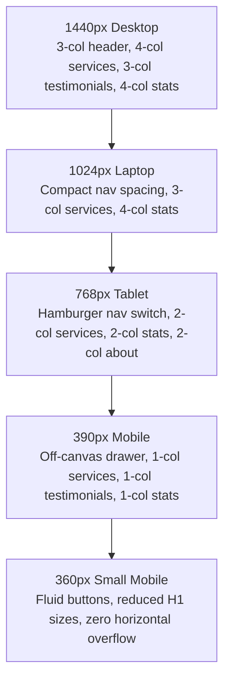

# Responsive Layout & Viewport Analysis

## 1. Viewport Testing Matrix

The reference website and layout behavior were evaluated against the 5 standardized screen widths:
1. **Desktop**: `1440px` (High-resolution wide desktop monitor)
2. **Laptop**: `1024px` (Standard 13"-15" laptops / small screens)
3. **Tablet**: `768px` (iPad / Portrait tablets)
4. **Mobile**: `390px` (Modern flagship smartphones — iPhone 13/14/15, Pixel)
5. **Small Mobile**: `360px` (Standard compact Android devices — Samsung Galaxy A-series)

---

## 2. Breakpoint Behaviors by Screen Size

---

### 2.1 Desktop Viewport (1440px)
- **Header**:
  - Full transparent header fixed over hero slider.
  - Logo on left width ~`220px` (`PP-white-Logo.webp`).
  - Horizontal center navigation with 6 menu items and generous spacing (`padding: 0 16px`).
  - "Consult Now" CTA button on far right (`.vs-btn.style2`, height `48px`, font-size `15px`).
- **Hero Slider**:
  - Full viewport width, height `929px`, hero typography `50px` bold.
- **Services Grid**:
  - 4 columns per row on screens >= 1200px. Cards measure ~`270px` - `285px` width.
- **About Us**:
  - 2 columns (`50% / 50%`): Left column contains emblem and copy; right column contains video showcase.
- **Before / After Comparison**:
  - Boxed container `1290px` width, height `660px`. Split handle operates smoothly across full span.
- **Statistics**:
  - Single row of 4 equal columns (`25%` each), height ~`140px`.
- **Location Section**:
  - Left column (`50%`): Clinic photo, address, phone CTA.
  - Right column (`50%`): Google Maps iframe (`380px` height).
- **Footer**:
  - 4 distinct columns (Office `28%`, Links `24%`, Services `24%`, Social `24%`).

---

### 2.2 Laptop Viewport (1024px)
- **Header**:
  - Navigation links remain visible with reduced padding (`padding: 0 10px`) to prevent wrapping.
  - Container width constrained to `1024px` (`--container-max-width: 1024px`).
- **Services Grid**:
  - Transitions to 3 columns per row. Cards expand to ~`310px` width.
- **Statistics**:
  - Retains 4 columns with slightly smaller numbers (`44px` vs `50px`).
- **Testimonials**:
  - 3 columns with reduced card padding (`20px`).
- **Footer**:
  - Columns maintain 4-column flow with proportional scaling.

---

### 2.3 Tablet Viewport (768px)
- **Header**:
  - **Major Transition Point**: Desktop horizontal navigation (`.main-menu`) is hidden (`d-none`).
  - Mobile hamburger toggle button (`.vs-menu-toggle`) appears on the right.
  - "Consult Now" button remains visible or collapses to quick icon depending on available width.
  - Header background transitions to a solid background on scroll to maintain readability.
- **Hero Slider**:
  - Height reduces proportionally to ~`600px`.
  - Heading font-size scales to `38px` - `40px`.
- **Services Grid**:
  - Transitions to 2 columns (`50% / 50%`). Card layout remains vertically oriented.
- **About Us**:
  - Stacks vertically: Left copy block first, video/treatment photo below it.
- **What We Do / Before & After Slider**:
  - Height adapts proportionally to ~`450px`. Touch dragging enabled on handle.
- **Statistics**:
  - Transitions from 4 columns to a **2x2 grid** (`50% / 50%` width per item).
- **Location & Map**:
  - Stacks vertically: Clinic address and photo on top; Google Map iframe full width below.
- **Footer**:
  - Transitions to a **2-column layout**:
    - Row 1: Office (`57%`) and Links (`40%`).
    - Row 2: Services (`51%`) and Social (`45%`).

---

### 2.4 Mobile Viewport (390px)
- **Header**:
  - Compact height of `70px`.
  - Brand logo scales down to `60%` width (~`150px` rendered width).
  - Hamburger menu icon on right (`44x44px` touch target).
  - Clicking toggle opens full-height off-canvas drawer (`300px` width) with sliding animation from right.
- **Hero Slider**:
  - Height scales down to ~`480px` - `520px`.
  - Headings scale down to `28px` - `32px` to prevent multi-line overflow.
  - Slide CTA button occupies full width or centered pill.
  - Swiper navigation arrows are hidden; swipe touch gestures and dot bullets provide pagination.
- **Services Grid**:
  - **Single Column Stacking**: 1 card per row (`100%` width minus container padding).
  - Card padding: `20px 16px`.
  - Card images render full-width inside card (`100%`, height `200px` - `220px`).
- **About Us**:
  - Text sizes scale down: H2 `28px`, body `15px`.
  - Qualifications list stacks cleanly with generous bullet spacing.
- **Before / After Slider**:
  - Container width `100%`, height ~`280px` - `320px`.
  - Drag handle enlarged for easy finger manipulation on touchscreens.
- **Testimonials**:
  - Converted into a single-column swipeable carousel with pagination dots.
- **Our Team Section**:
  - Dr. Dinesh Anandhan's portrait renders full width on top (`100%` width, max `340px`), followed by credentials below.
- **Statistics**:
  - Stacks vertically into **1 column** or compact 2x2. Numbers formatted at `36px` - `40px`.
- **Location Section**:
  - Exterior photo full width (`100%`). "Get Directions" and "Call Clinic" buttons format as full-width tap targets.
  - Google Map height `280px`.
- **Footer**:
  - Stacks into **1 single column**: Office block, then Quick Links, then Services, then Social icons, then Copyright notice.

---

### 2.5 Small Mobile Viewport (360px)
- **Typography Adjustments**:
  - Hero H1: `26px` - `28px`.
  - Section Titles (H2): `24px` - `26px`.
  - Body paragraphs: `14px` with `1.6` line-height.
- **Spacing Safeguards**:
  - Container horizontal padding reduced to `12px` to maximize readable text area.
  - Button paddings adjust to `10px 18px`.
  - Long URLs and phone numbers set to `break-words` to eliminate any risk of horizontal viewport blowout.
- **Horizontal Overflow Check**:
  - `overflow-x: hidden` applied to outer layout wrapper. Zero horizontal scrollbar detected.

---

## 3. Responsive Component Summary Table

| Section | Desktop (1440px) | Tablet (768px) | Mobile (390px / 360px) |
| :--- | :--- | :--- | :--- |
| **Header** | 3-column inline (Logo, Nav, CTA) | Logo + Hamburger Toggle | Logo (compact) + Hamburger |
| **Hero Slider** | 929px height, Arrows + Dots | 600px height, Dots only | ~500px height, Touch swipe |
| **11 Service Cards** | 4 columns | 2 columns | 1 column stacked |
| **About Us** | 2 columns (Copy / Media) | 1 column stacked | 1 column stacked |
| **Before / After** | 1290x660px mouse drag | 720x450px touch drag | ~320px height touch drag |
| **Testimonials** | 3 columns inline | 2 columns / Carousel | 1 column swipeable carousel |
| **Our Team** | 2 columns (Photo / Bio) | 1 column stacked | 1 column stacked |
| **Statistics** | 4 columns (1 row) | 2x2 grid (2 rows) | 1 column or compact 2x2 |
| **Location & Map** | 2 columns (Info / Map) | 1 column stacked | 1 column stacked |
| **Footer** | 4 columns inline | 2x2 grid | 1 column stacked |

