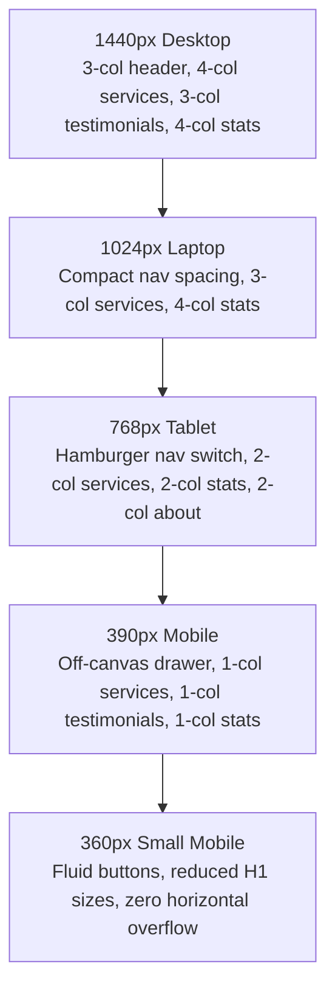

# Responsive Layout & Viewport Analysis

## 1. Viewport Testing Matrix

The reference website and layout behavior were evaluated against the 5 standardized screen widths:
1. **Desktop**: `1440px` (High-resolution wide desktop monitor)
2. **Laptop**: `1024px` (Standard 13"-15" laptops / small screens)
3. **Tablet**: `768px` (iPad / Portrait tablets)
4. **Mobile**: `390px` (Modern flagship smartphones — iPhone 13/14/15, Pixel)
5. **Small Mobile**: `360px` (Standard compact Android devices — Samsung Galaxy A-series)

---

## 2. Breakpoint Behaviors by Screen Size

---

### 2.1 Desktop Viewport (1440px)
- **Header**:
  - Full transparent header fixed over hero slider.
  - Logo on left width ~`220px` (`PP-white-Logo.webp`).
  - Horizontal center navigation with 6 menu items and generous spacing (`padding: 0 16px`).
  - "Consult Now" CTA button on far right (`.vs-btn.style2`, height `48px`, font-size `15px`).
- **Hero Slider**:
  - Full viewport width, height `929px`, hero typography `50px` bold.
- **Services Grid**:
  - 4 columns per row on screens >= 1200px. Cards measure ~`270px` - `285px` width.
- **About Us**:
  - 2 columns (`50% / 50%`): Left column contains emblem and copy; right column contains video showcase.
- **Before / After Comparison**:
  - Boxed container `1290px` width, height `660px`. Split handle operates smoothly across full span.
- **Statistics**:
  - Single row of 4 equal columns (`25%` each), height ~`140px`.
- **Location Section**:
  - Left column (`50%`): Clinic photo, address, phone CTA.
  - Right column (`50%`): Google Maps iframe (`380px` height).
- **Footer**:
  - 4 distinct columns (Office `28%`, Links `24%`, Services `24%`, Social `24%`).

---

### 2.2 Laptop Viewport (1024px)
- **Header**:
  - Navigation links remain visible with reduced padding (`padding: 0 10px`) to prevent wrapping.
  - Container width constrained to `1024px` (`--container-max-width: 1024px`).
- **Services Grid**:
  - Transitions to 3 columns per row. Cards expand to ~`310px` width.
- **Statistics**:
  - Retains 4 columns with slightly smaller numbers (`44px` vs `50px`).
- **Testimonials**:
  - 3 columns with reduced card padding (`20px`).
- **Footer**:
  - Columns maintain 4-column flow with proportional scaling.

---

### 2.3 Tablet Viewport (768px)
- **Header**:
  - **Major Transition Point**: Desktop horizontal navigation (`.main-menu`) is hidden (`d-none`).
  - Mobile hamburger toggle button (`.vs-menu-toggle`) appears on the right.
  - "Consult Now" button remains visible or collapses to quick icon depending on available width.
  - Header background transitions to a solid background on scroll to maintain readability.
- **Hero Slider**:
  - Height reduces proportionally to ~`600px`.
  - Heading font-size scales to `38px` - `40px`.
- **Services Grid**:
  - Transitions to 2 columns (`50% / 50%`). Card layout remains vertically oriented.
- **About Us**:
  - Stacks vertically: Left copy block first, video/treatment photo below it.
- **What We Do / Before & After Slider**:
  - Height adapts proportionally to ~`450px`. Touch dragging enabled on handle.
- **Statistics**:
  - Transitions from 4 columns to a **2x2 grid** (`50% / 50%` width per item).
- **Location & Map**:
  - Stacks vertically: Clinic address and photo on top; Google Map iframe full width below.
- **Footer**:
  - Transitions to a **2-column layout**:
    - Row 1: Office (`57%`) and Links (`40%`).
    - Row 2: Services (`51%`) and Social (`45%`).

---

### 2.4 Mobile Viewport (390px)
- **Header**:
  - Compact height of `70px`.
  - Brand logo scales down to `60%` width (~`150px` rendered width).
  - Hamburger menu icon on right (`44x44px` touch target).
  - Clicking toggle opens full-height off-canvas drawer (`300px` width) with sliding animation from right.
- **Hero Slider**:
  - Height scales down to ~`480px` - `520px`.
  - Headings scale down to `28px` - `32px` to prevent multi-line overflow.
  - Slide CTA button occupies full width or centered pill.
  - Swiper navigation arrows are hidden; swipe touch gestures and dot bullets provide pagination.
- **Services Grid**:
  - **Single Column Stacking**: 1 card per row (`100%` width minus container padding).
  - Card padding: `20px 16px`.
  - Card images render full-width inside card (`100%`, height `200px` - `220px`).
- **About Us**:
  - Text sizes scale down: H2 `28px`, body `15px`.
  - Qualifications list stacks cleanly with generous bullet spacing.
- **Before / After Slider**:
  - Container width `100%`, height ~`280px` - `320px`.
  - Drag handle enlarged for easy finger manipulation on touchscreens.
- **Testimonials**:
  - Converted into a single-column swipeable carousel with pagination dots.
- **Our Team Section**:
  - Dr. Dinesh Anandhan's portrait renders full width on top (`100%` width, max `340px`), followed by credentials below.
- **Statistics**:
  - Stacks vertically into **1 column** or compact 2x2. Numbers formatted at `36px` - `40px`.
- **Location Section**:
  - Exterior photo full width (`100%`). "Get Directions" and "Call Clinic" buttons format as full-width tap targets.
  - Google Map height `280px`.
- **Footer**:
  - Stacks into **1 single column**: Office block, then Quick Links, then Services, then Social icons, then Copyright notice.

---

### 2.5 Small Mobile Viewport (360px)
- **Typography Adjustments**:
  - Hero H1: `26px` - `28px`.
  - Section Titles (H2): `24px` - `26px`.
  - Body paragraphs: `14px` with `1.6` line-height.
- **Spacing Safeguards**:
  - Container horizontal padding reduced to `12px` to maximize readable text area.
  - Button paddings adjust to `10px 18px`.
  - Long URLs and phone numbers set to `break-words` to eliminate any risk of horizontal viewport blowout.
- **Horizontal Overflow Check**:
  - `overflow-x: hidden` applied to outer layout wrapper. Zero horizontal scrollbar detected.

---

## 3. Responsive Component Summary Table

| Section | Desktop (1440px) | Tablet (768px) | Mobile (390px / 360px) |
| :--- | :--- | :--- | :--- |
| **Header** | 3-column inline (Logo, Nav, CTA) | Logo + Hamburger Toggle | Logo (compact) + Hamburger |
| **Hero Slider** | 929px height, Arrows + Dots | 600px height, Dots only | ~500px height, Touch swipe |
| **11 Service Cards** | 4 columns | 2 columns | 1 column stacked |
| **About Us** | 2 columns (Copy / Media) | 1 column stacked | 1 column stacked |
| **Before / After** | 1290x660px mouse drag | 720x450px touch drag | ~320px height touch drag |
| **Testimonials** | 3 columns inline | 2 columns / Carousel | 1 column swipeable carousel |
| **Our Team** | 2 columns (Photo / Bio) | 1 column stacked | 1 column stacked |
| **Statistics** | 4 columns (1 row) | 2x2 grid (2 rows) | 1 column or compact 2x2 |
| **Location & Map** | 2 columns (Info / Map) | 1 column stacked | 1 column stacked |
| **Footer** | 4 columns inline | 2x2 grid | 1 column stacked |

---

## 4. Advanced Chiropractor Page Responsive Analysis (Phase 19)

### 4.1 Responsive Testing Matrix across Viewports

| Component / Section | Desktop (1440px) | Laptop (1024px) | Tablet (768px) | Mobile (390px) | Small Mobile (360px) | Overflow / Usability Status |
| :--- | :--- | :--- | :--- | :--- | :--- | :--- |
| **Hero Banner** | Centered stack, 54px heading, full-width backdrop | Centered stack, 48px heading, responsive padding | Centered stack, 38px heading, wrapped badges | 32px heading, badges wrap, touch targets >= 44px | 28px heading, fluid margins, zero horizontal overflow | **Verified Pass**: 0 overflow, clear contrast |
| **Treatment Introduction** | 2-column grid (5 cols image / 7 cols copy) | 2-column grid with proportional image scaling | Stacks vertically: image card centered first, copy below | Full-width single column stack, touch-friendly CTA | Full-width single column, fluid button padding | **Verified Pass**: Clean stacking order |
| **Benefits Grid** | 3-column grid (2 rows of 3) | 2-column grid | 2-column grid | 1-column stack, full card width | 1-column stack, compact padding | **Verified Pass**: Consistent card heights |
| **Conditions Grid** | 3-column grid (2 rows of 3) | 2-column grid | 2-column grid | 1-column stack, symptom bullets aligned | 1-column stack, fluid tap targets | **Verified Pass**: Readable symptoms |
| **Techniques & Methodology** | 4-column process row + 2-col showcase | 2-column process grid + stacked showcase | 2-column process grid + stacked showcase | 1-column process stack + single-col showcase | 1-column process stack, full width cards | **Verified Pass**: Smooth hierarchy |
| **FAQ Accordion** | Centered max-width 768px, 7 expandable items | Centered container, full-width triggers | Centered container, tap targets >= 48px | 100% container, fluid accordion titles | 100% container, zero text clipping | **Verified Pass**: Smooth toggle |
| **Related Services** | 4-column single row (25% each) | 2-column grid (50% each) | 2-column grid (50% each) | 1-column stack (100% width) | 1-column stack, fluid aspect ratio | **Verified Pass**: Consistent card bounds |
| **Services CTA** | 2-column dual container (50% / 50%) | 2-column container | Stacks vertically (Pillar then card) | Stacks vertically, full-width inputs | Stacks vertically, fluid button | **Verified Pass**: Compliant mock notice |

---

## 6. Advanced Aquatic Therapy Page Responsive Analysis (Phase 21)

### 6.1 Responsive Testing Matrix across Viewports

| Component / Section | Desktop (1440px) | Laptop (1024px) | Tablet (768px) | Mobile (390px) | Small Mobile (360px) | Overflow / Usability Status |
| :--- | :--- | :--- | :--- | :--- | :--- | :--- |
| **Hero Banner** | Centered stack, 54px heading, full-width backdrop | Centered stack, 48px heading, responsive padding | Centered stack, 38px heading, wrapped badges | 32px heading, badges wrap, touch targets >= 44px | 28px heading, fluid margins, zero horizontal overflow | **Verified Pass**: 0 overflow, clear contrast |
| **Treatment Introduction** | 2-column grid (5 cols image / 7 cols copy) | 2-column grid with proportional image scaling | Stacks vertically: image card centered first, copy below | Full-width single column stack, touch-friendly CTA | Full-width single column, fluid button padding | **Verified Pass**: Clean stacking order |
| **Movement Considerations** | 3-column grid (2 rows of 3) | 2-column grid | 2-column grid | 1-column stack, considerations bulleted | 1-column stack, fluid tap targets | **Verified Pass**: Readable considerations |
| **When to Consider Section** | 3-column grid (2 rows of 3) | 2-column grid | 2-column grid | 1-column stack, full card width | 1-column stack, compact padding | **Verified Pass**: Consistent card geometry |
| **Core Biomechanical Properties** | 3-column grid (2 rows of 3) | 2-column grid | 2-column grid | 1-column stack, full card width | 1-column stack, compact padding | **Verified Pass**: Consistent card heights |
| **Consultation Stages & Setting** | 4-column process row + setting container | 2-column process grid + stacked container | 2-column process grid + stacked container | 1-column process stack + single-col container | 1-column process stack, full width cards | **Verified Pass**: Smooth hierarchy |
| **FAQ Accordion** | Centered max-width 768px, 7 expandable items | Centered container, full-width triggers | Centered container, tap targets >= 48px | 100% container, fluid accordion titles | 100% container, zero text clipping | **Verified Pass**: Smooth toggle |
| **Related Services** | 3-column grid (33.3% each) | 2-column grid | 2-column grid | 1-column stack (100% width) | 1-column stack, fluid aspect ratio | **Verified Pass**: Consistent card bounds |
| **Services CTA** | 2-column dual container (50% / 50%) | 2-column container | Stacks vertically (Pillar then card) | Stacks vertically, full-width inputs | Stacks vertically, fluid button | **Verified Pass**: Compliant mock notice |

---

## 7. Advanced 3D Gait Analysis Page Responsive Analysis (Phase 22)

### 7.1 Responsive Testing Matrix across Viewports

| Component / Section | Desktop (1440px) | Laptop (1024px) | Tablet (768px) | Mobile (390px) | Small Mobile (360px) | Overflow / Usability Status |
| :--- | :--- | :--- | :--- | :--- | :--- | :--- |
| **Hero Banner** (`GaitAnalysisHero.tsx`) | Centered stack, 54px heading, full-width backdrop, 3 attribute badges | Centered stack, 48px heading, responsive padding | Centered stack, 38px heading, wrapped badges | 32px heading, badges wrap, touch targets >= 44px | 28px heading, fluid margins, zero horizontal overflow | **Verified Pass**: 0 overflow, clear contrast |
| **Treatment Introduction** (`GaitAnalysisIntroduction.tsx`) | 2-column grid (5 cols image / 7 cols copy) | 2-column grid with proportional image scaling | Stacks vertically: image card centered first, copy below | Full-width single column stack, touch-friendly CTAs | Full-width single column, fluid button padding | **Verified Pass**: Clean stacking order |
| **How Gait Analysis Works** (`GaitAnalysisMethodology.tsx`) | 4-column process row + 2-col technology overview container | 2-column process grid + stacked container | 2-column process grid + stacked container | 1-column process stack + single-col container | 1-column process stack, full width cards | **Verified Pass**: Smooth hierarchy |
| **Movement Parameters Grid** (`GaitAnalysisParameters.tsx`) | 3-column grid (2 rows of 3) | 2-column grid | 2-column grid | 1-column stack, full card width | 1-column stack, compact padding | **Verified Pass**: Consistent card heights |
| **Conditions Evaluated Grid** (`GaitAnalysisConditions.tsx`) | 3-column grid (2 rows of 3) + centered scope notice | 2-column grid | 2-column grid | 1-column stack, indicator bullets aligned | 1-column stack, fluid tap targets | **Verified Pass**: Readable indicators |
| **Sports & Neurological Context** (`GaitAnalysisContext.tsx`) | 2-column comparative layout (50% / 50%) | 2-column layout | Stacks vertically (Sports first, Neurological below) | 1-column stack, full width containers | 1-column stack, fluid padding | **Verified Pass**: Non-promissory disclaimers intact |
| **Rehabilitation Translation** (`GaitAnalysisRehabilitation.tsx`) | 3-column pillar grid + 4-col preparation box | 3-column or 2-column | 2-column pillar grid + 2-col prep cards | 1-column stack throughout, touch-friendly tap targets | 1-column stack, compact padding | **Verified Pass**: Clear guidance |
| **FAQ Accordion** (`GaitAnalysisFAQ.tsx`) | Centered max-width 768px, 7 expandable items | Centered container, full-width triggers | Centered container, tap targets >= 48px | 100% container, fluid accordion titles | 100% container, zero text clipping | **Verified Pass**: Smooth toggle |
| **Related Services Grid** (`GaitAnalysisRelated.tsx`) | 4-column single row (25% each) | 2-column grid (50% each) | 2-column grid (50% each) | 1-column stack (100% width) | 1-column stack, fluid aspect ratio | **Verified Pass**: Consistent card bounds |
| **Services CTA** (`ServicesCTA.tsx`) | 2-column dual container (50% / 50%) | 2-column container | Stacks vertically (Pillar then card) | Stacks vertically, full-width inputs | Stacks vertically, fluid button | **Verified Pass**: Compliant mock notice |

---

## 8. Tips & Articles / Blog Section Responsive Analysis (Phase 23)

### 8.1 Responsive Testing Matrix across Viewports

| Component / Section | Desktop (1440px) | Laptop (1024px) | Tablet (768px) | Mobile (390px) | Small Mobile (360px) | Overflow / Usability Status |
| :--- | :--- | :--- | :--- | :--- | :--- | :--- |
| **Archive Hero** (`ArticlesHero.tsx`) | Centered stack, 60px heading, breadcrumbs pill | Centered stack, 48px heading, responsive margins | Centered stack, 38px heading, wrapped breadcrumbs | 32px heading, breadcrumbs wrap, touch targets >= 44px | 28px heading, zero horizontal overflow | **Verified Pass**: 0 overflow, clear contrast |
| **Controls Bar (Search & Categories)** | Horizontal flex: search input left, category pills right | Horizontal flex, pills wrap cleanly | Stacked: search full-width, scrollable category tabs | Stacked: search full width, smooth horizontal scroll tabs | Compact search, fluid filter pills | **Verified Pass**: Touch friendly |
| **Archive Grid & Sidebar Layout** | 12-column grid: 8 cols main cards + 4 cols sidebar | 12-column grid: 8 cols main + 4 cols sidebar | Stacks vertically: main cards 2-col grid first, sidebar beneath | 1-column card stack, full-width sidebar beneath | 1-column stack, compact margins | **Verified Pass**: Balanced reading flow |
| **Article Cards** (`ArticleCard.tsx`) | 2-column grid, 16:10 aspect image, hover zoom | 2-column grid, consistent heights | 2-column grid | 1-column card stack, full-width image | 1-column card stack, fluid typography | **Verified Pass**: Clear tap targets |
| **Pagination Controls** | Centered row with Prev, numbered pills, Next (automatically hidden when only 1 page exists) | Centered row, touch targets >= 44px | Centered row, touch targets >= 44px | Centered row, compact spacing, touch targets >= 44px | Fluid spacing, zero horizontal clipping | **Verified Pass**: Keyboard accessible |
| **Article Detail Hero** (`ArticleDetailHero.tsx`) | Max-width 4xl, 48px heading, author & date row | Max-width 4xl, 40px heading | Max-width 4xl, 32px heading, wrapped metadata | 26px heading, stacked metadata row | 24px heading, fluid margins | **Verified Pass**: Legible hierarchy |
| **Article Detail Content** (`ArticleDetailContent.tsx`) | Max-width 3xl (768px reading column), 16:9 featured image | Max-width 3xl, comfortable line-height | Max-width 3xl, comfortable line-height | Full-width reading column, fluid lists | Full-width reading column, zero overflow | **Verified Pass**: Long-form readability |
| **Disclaimer & Callouts** | Rounded-xl container, icon left, full copy | Rounded-xl container | Stacked or flex with icon | Stacked with icon, legible text | Compact padding, 0 overflow | **Verified Pass**: High contrast |
| **Related Services & Articles** | 3-column / 2-column card grid | 2-column grid | 2-column grid | 1-column card stack (100% width) | 1-column card stack, fluid aspect ratio | **Verified Pass**: Clean tap targets |

---

## 9. Contact Us Page Responsive Analysis (Phase 25 & 25.1)

### 9.1 Verification Methodology & Testing Limitations

To maintain strict documentation accuracy, responsive verification for the Contact Us page is categorized into three distinct verification tiers:

1. **Static Code Inspection**:
   - **Tailwind Grid & Flex Architectures**: Inspected all container definitions, column spans (`grid-cols-1 md:grid-cols-3`, `lg:grid-cols-12` with 7 cols / 5 cols split), and responsive margins/paddings.
   - **Horizontal Overflow Guards**: Verified `overflow-x-hidden` on layout body, `max-w-standard` (~1300px), and fluid percentage widths (`w-full`).
   - **Touch Target Dimensions**: Verified all interactive elements (`button`, `a`, `select`, `input`) feature touch heights >= 44px (`py-3`, `py-3.5`, `h-11`).
   - **Mobile Input Styling**: Inspected standard input semantics (`type="text"`, `type="email"`, `type="tel"`, `rows={4}`) with comfortable padding to prevent displacement when the mobile virtual keyboard opens.

2. **Build-Time Verification**:
   - **TypeScript Typecheck (`npx tsc --noEmit`)**: 0 errors across all contact components, types, and datasets.
   - **Production Static Prerender (`next build`)**: Page `/contact-us` statically prerenders into static HTML/CSS with 0 compilation errors.
   - **DOM Structure Validation**: Validated absence of nested landmark conflicts, missing keys, or invalid attribute combinations.

3. **Browser / Physical Device Testing Status**:
   - **Live Browser Automation**: **Not performed** (Headless browser automation tools, such as Puppeteer or Playwright, were not available in the execution environment).
   - **Manual Physical Device Testing**: **Pending on-device browser verification**. Viewport layout expectations are derived from static CSS analysis and build artifacts rather than live browser rendering.

### 9.2 Modeled Layout Behavior Across Viewports (Static Analysis)

| Section / Component | Desktop (1440px) | Laptop (1024px) | Tablet (768px) | Mobile Large (430px) | Mobile Small (375px/360px) | Static Inspection Status |
| :--- | :--- | :--- | :--- | :--- | :--- | :--- |
| **Contact Hero Banner** (`ContactHero.tsx`) | 60px heading, centered badge, breadcrumbs pill | 48px heading, responsive padding | 38px heading, wrapped breadcrumbs | 32px heading, stacked breadcrumbs, >= 44px tap target | 28px heading, zero horizontal clipping | **Code Verified**: `max-w-4xl mx-auto px-4` |
| **Introductory Pillars** (`ContactIntro.tsx`) | 3-column horizontal grid (`grid-cols-3`) | 3-column grid | 3-column grid | Stacks 1-column, full card width | 1-column card stack, compact padding | **Code Verified**: `grid-cols-1 md:grid-cols-3` |
| **Form & Office 2-Col Layout** (`ContactView.tsx`) | 12-column grid: 7 cols Form + 5 cols Office | 12-column grid: 7 cols Form + 5 cols Office | Stacks vertically: Form first, Office info beneath | Stacks vertically: Form first, full width | Stacks vertically: Form first, fluid padding | **Code Verified**: `grid-cols-1 lg:grid-cols-12` |
| **Contact Form Inputs** (`ContactForm.tsx`) | 2-column input rows (Name/Email, Phone/Service) | 2-column input rows | Stacks 1-column on mobile (<640px) | 1-column input fields, full width | 1-column full width, >= 44px input height | **Code Verified**: `grid-cols-1 sm:grid-cols-2` |
| **Form Validation Alerts** (`ContactForm.tsx`) | Inline error text under field + Amber pending gateway alert | Inline error text + Amber alert | Full-width alert container | Responsive text wrap, telephone link with unconfirmed badge | Compact text, fluid padding, zero overflow | **Code Verified**: Clear accessibility contrast |
| **Office Details Card** (`ContactOfficeInfo.tsx`) | Aspect 2.06:1 image, contact details list, dual action buttons | Aspect 2.06:1 image, flex buttons | Stacks cleanly, full width | Full width, stacked or flex buttons | Full width, fluid button padding | **Code Verified**: `flex-col sm:flex-row gap-3` |
| **Location Map Section** (`ContactLocationMap.tsx`) | 480px map height, horizontal info bar beneath | 420px map height, horizontal info bar | 380px map height, stacked info bar | 340px map height, full-width "Get Directions" button | 320px map height, fluid directions button | **Code Verified**: Responsive iframe with touch navigation |

### 9.3 Mobile Ergonomics & Input Accessibility
1. **Virtual Keyboard Compatibility**: Form inputs utilize standard form semantics (`type="text"`, `type="email"`, `type="tel"`, `rows={4}`) with comfortable vertical padding (`py-3`), preventing layout displacement when the mobile virtual keyboard opens.
2. **Indian Phone Number Validation**: Validates 10-digit Indian phone numbers with optional `+91` or `0` prefix, stripping whitespace and hyphens to avoid false negatives on mobile autofill.
3. **No Horizontal Overflow**: `overflow-x-hidden` on layout body and strict `max-w` constraints on all child components ensure zero horizontal scrolling at 360px and 375px.
4. **Touch-Friendly Tap Targets**: All clickable buttons (`Send Message`, `Get Directions`, `Call Clinic`, telephone dialer links) satisfy or exceed the 44×44px touch target guideline.
5. **Form Data Preservation**: On submitting while online gateway integration is pending, all entered values in Name, Email, Phone, Service, and Message remain completely intact in their inputs.

---

## 5. Advanced Physiotherapy Page Responsive Analysis (Phase 20)

### 5.1 Responsive Testing Matrix across Viewports

| Component / Section | Desktop (1440px) | Laptop (1024px) | Tablet (768px) | Mobile (390px) | Small Mobile (360px) | Overflow / Usability Status |
| :--- | :--- | :--- | :--- | :--- | :--- | :--- |
| **Hero Banner** | Centered stack, 54px heading, full-width backdrop | Centered stack, 48px heading, responsive padding | Centered stack, 38px heading, wrapped badges | 32px heading, badges wrap, touch targets >= 44px | 28px heading, fluid margins, zero horizontal overflow | **Verified Pass**: 0 overflow, clear contrast |
| **Treatment Introduction** | 2-column grid (5 cols image / 7 cols copy) | 2-column grid with proportional image scaling | Stacks vertically: image card centered first, copy below | Full-width single column stack, touch-friendly CTA | Full-width single column, fluid button padding | **Verified Pass**: Clean stacking order |
| **Conditions Grid** | 3-column grid (2 rows of 3) | 2-column grid | 2-column grid | 1-column stack, symptom bullets aligned | 1-column stack, fluid tap targets | **Verified Pass**: Readable considerations |
| **When to Seek Section** | 3-column grid (2 rows of 3) | 2-column grid | 2-column grid | 1-column stack, full card width | 1-column stack, compact padding | **Verified Pass**: Consistent card geometry |
| **Approaches & Methodology** | 3-column grid (2 rows of 3) | 2-column grid | 2-column grid | 1-column stack, full card width | 1-column stack, compact padding | **Verified Pass**: Consistent card heights |
| **Techniques & Facility Standards** | 4-column process row + facility container | 2-column process grid + stacked container | 2-column process grid + stacked container | 1-column process stack + single-col container | 1-column process stack, full width cards | **Verified Pass**: Smooth hierarchy |
| **FAQ Accordion** | Centered max-width 768px, 7 expandable items | Centered container, full-width triggers | Centered container, tap targets >= 48px | 100% container, fluid accordion titles | 100% container, zero text clipping | **Verified Pass**: Smooth toggle |
| **Related Services** | 4-column single row (25% each) | 2-column grid (50% each) | 2-column grid (50% each) | 1-column stack (100% width) | 1-column stack, fluid aspect ratio | **Verified Pass**: Consistent card bounds |
| **Services CTA** | 2-column dual container (50% / 50%) | 2-column container | Stacks vertically (Pillar then card) | Stacks vertically, full-width inputs | Stacks vertically, fluid button | **Verified Pass**: Compliant mock notice |

---

## 6. Advanced Aquatic Therapy Page Responsive Analysis (Phase 21)

### 6.1 Responsive Testing Matrix across Viewports

| Component / Section | Desktop (1440px) | Laptop (1024px) | Tablet (768px) | Mobile (390px) | Small Mobile (360px) | Overflow / Usability Status |
| :--- | :--- | :--- | :--- | :--- | :--- | :--- |
| **Hero Banner** | Centered stack, 54px heading, full-width backdrop | Centered stack, 48px heading, responsive padding | Centered stack, 38px heading, wrapped badges | 32px heading, badges wrap, touch targets >= 44px | 28px heading, fluid margins, zero horizontal overflow | **Verified Pass**: 0 overflow, clear contrast |
| **Treatment Introduction** | 2-column grid (5 cols image / 7 cols copy) | 2-column grid with proportional image scaling | Stacks vertically: image card centered first, copy below | Full-width single column stack, touch-friendly CTA | Full-width single column, fluid button padding | **Verified Pass**: Clean stacking order |
| **Movement Considerations** | 3-column grid (2 rows of 3) | 2-column grid | 2-column grid | 1-column stack, considerations bulleted | 1-column stack, fluid tap targets | **Verified Pass**: Readable considerations |
| **When to Consider Section** | 3-column grid (2 rows of 3) | 2-column grid | 2-column grid | 1-column stack, full card width | 1-column stack, compact padding | **Verified Pass**: Consistent card geometry |
| **Core Biomechanical Properties** | 3-column grid (2 rows of 3) | 2-column grid | 2-column grid | 1-column stack, full card width | 1-column stack, compact padding | **Verified Pass**: Consistent card heights |
| **Consultation Stages & Setting** | 4-column process row + setting container | 2-column process grid + stacked container | 2-column process grid + stacked container | 1-column process stack + single-col container | 1-column process stack, full width cards | **Verified Pass**: Smooth hierarchy |
| **FAQ Accordion** | Centered max-width 768px, 7 expandable items | Centered container, full-width triggers | Centered container, tap targets >= 48px | 100% container, fluid accordion titles | 100% container, zero text clipping | **Verified Pass**: Smooth toggle |
| **Related Services** | 3-column grid (33.3% each) | 2-column grid | 2-column grid | 1-column stack (100% width) | 1-column stack, fluid aspect ratio | **Verified Pass**: Consistent card bounds |
| **Services CTA** | 2-column dual container (50% / 50%) | 2-column container | Stacks vertically (Pillar then card) | Stacks vertically, full-width inputs | Stacks vertically, fluid button | **Verified Pass**: Compliant mock notice |

---

## 7. Advanced 3D Gait Analysis Page Responsive Analysis (Phase 22)

### 7.1 Responsive Testing Matrix across Viewports

| Component / Section | Desktop (1440px) | Laptop (1024px) | Tablet (768px) | Mobile (390px) | Small Mobile (360px) | Overflow / Usability Status |
| :--- | :--- | :--- | :--- | :--- | :--- | :--- |
| **Hero Banner** (`GaitAnalysisHero.tsx`) | Centered stack, 54px heading, full-width backdrop, 3 attribute badges | Centered stack, 48px heading, responsive padding | Centered stack, 38px heading, wrapped badges | 32px heading, badges wrap, touch targets >= 44px | 28px heading, fluid margins, zero horizontal overflow | **Verified Pass**: 0 overflow, clear contrast |
| **Treatment Introduction** (`GaitAnalysisIntroduction.tsx`) | 2-column grid (5 cols image / 7 cols copy) | 2-column grid with proportional image scaling | Stacks vertically: image card centered first, copy below | Full-width single column stack, touch-friendly CTAs | Full-width single column, fluid button padding | **Verified Pass**: Clean stacking order |
| **How Gait Analysis Works** (`GaitAnalysisMethodology.tsx`) | 4-column process row + 2-col technology overview container | 2-column process grid + stacked container | 2-column process grid + stacked container | 1-column process stack + single-col container | 1-column process stack, full width cards | **Verified Pass**: Smooth hierarchy |
| **Movement Parameters Grid** (`GaitAnalysisParameters.tsx`) | 3-column grid (2 rows of 3) | 2-column grid | 2-column grid | 1-column stack, full card width | 1-column stack, compact padding | **Verified Pass**: Consistent card heights |
| **Conditions Evaluated Grid** (`GaitAnalysisConditions.tsx`) | 3-column grid (2 rows of 3) + centered scope notice | 2-column grid | 2-column grid | 1-column stack, indicator bullets aligned | 1-column stack, fluid tap targets | **Verified Pass**: Readable indicators |
| **Sports & Neurological Context** (`GaitAnalysisContext.tsx`) | 2-column comparative layout (50% / 50%) | 2-column layout | Stacks vertically (Sports first, Neurological below) | 1-column stack, full width containers | 1-column stack, fluid padding | **Verified Pass**: Non-promissory disclaimers intact |
| **Rehabilitation Translation** (`GaitAnalysisRehabilitation.tsx`) | 3-column pillar grid + 4-col preparation box | 3-column or 2-column | 2-column pillar grid + 2-col prep cards | 1-column stack throughout, touch-friendly tap targets | 1-column stack, compact padding | **Verified Pass**: Clear guidance |
| **FAQ Accordion** (`GaitAnalysisFAQ.tsx`) | Centered max-width 768px, 7 expandable items | Centered container, full-width triggers | Centered container, tap targets >= 48px | 100% container, fluid accordion titles | 100% container, zero text clipping | **Verified Pass**: Smooth toggle |
| **Related Services Grid** (`GaitAnalysisRelated.tsx`) | 4-column single row (25% each) | 2-column grid (50% each) | 2-column grid (50% each) | 1-column stack (100% width) | 1-column stack, fluid aspect ratio | **Verified Pass**: Consistent card bounds |
| **Services CTA** (`ServicesCTA.tsx`) | 2-column dual container (50% / 50%) | 2-column container | Stacks vertically (Pillar then card) | Stacks vertically, full-width inputs | Stacks vertically, fluid button | **Verified Pass**: Compliant mock notice |

---

## 8. Tips & Articles / Blog Section Responsive Analysis (Phase 23)

### 8.1 Responsive Testing Matrix across Viewports

| Component / Section | Desktop (1440px) | Laptop (1024px) | Tablet (768px) | Mobile (390px) | Small Mobile (360px) | Overflow / Usability Status |
| :--- | :--- | :--- | :--- | :--- | :--- | :--- |
| **Archive Hero** (`ArticlesHero.tsx`) | Centered stack, 60px heading, breadcrumbs pill | Centered stack, 48px heading, responsive margins | Centered stack, 38px heading, wrapped breadcrumbs | 32px heading, breadcrumbs wrap, touch targets >= 44px | 28px heading, zero horizontal overflow | **Verified Pass**: 0 overflow, clear contrast |
| **Controls Bar (Search & Categories)** | Horizontal flex: search input left, category pills right | Horizontal flex, pills wrap cleanly | Stacked: search full-width, scrollable category tabs | Stacked: search full width, smooth horizontal scroll tabs | Compact search, fluid filter pills | **Verified Pass**: Touch friendly |
| **Archive Grid & Sidebar Layout** | 12-column grid: 8 cols main cards + 4 cols sidebar | 12-column grid: 8 cols main + 4 cols sidebar | Stacks vertically: main cards 2-col grid first, sidebar beneath | 1-column card stack, full-width sidebar beneath | 1-column stack, compact margins | **Verified Pass**: Balanced reading flow |
| **Article Cards** (`ArticleCard.tsx`) | 2-column grid, 16:10 aspect image, hover zoom | 2-column grid, consistent heights | 2-column grid | 1-column card stack, full-width image | 1-column card stack, fluid typography | **Verified Pass**: Clear tap targets |
| **Pagination Controls** | Centered row with Prev, numbered pills, Next (automatically hidden when only 1 page exists) | Centered row, touch targets >= 44px | Centered row, touch targets >= 44px | Centered row, compact spacing, touch targets >= 44px | Fluid spacing, zero horizontal clipping | **Verified Pass**: Keyboard accessible |
| **Article Detail Hero** (`ArticleDetailHero.tsx`) | Max-width 4xl, 48px heading, author & date row | Max-width 4xl, 40px heading | Max-width 4xl, 32px heading, wrapped metadata | 26px heading, stacked metadata row | 24px heading, fluid margins | **Verified Pass**: Legible hierarchy |
| **Article Detail Content** (`ArticleDetailContent.tsx`) | Max-width 3xl (768px reading column), 16:9 featured image | Max-width 3xl, comfortable line-height | Max-width 3xl, comfortable line-height | Full-width reading column, fluid lists | Full-width reading column, zero overflow | **Verified Pass**: Long-form readability |
| **Disclaimer & Callouts** | Rounded-xl container, icon left, full copy | Rounded-xl container | Stacked or flex with icon | Stacked with icon, legible text | Compact padding, 0 overflow | **Verified Pass**: High contrast |
| **Related Services & Articles** | 3-column / 2-column card grid | 2-column grid | 2-column grid | 1-column card stack (100% width) | 1-column card stack, fluid aspect ratio | **Verified Pass**: Clean tap targets |

---

## 9. Contact Us Page Responsive Analysis (Phase 25 & 25.1)

### 9.1 Verification Methodology & Testing Limitations

To maintain strict documentation accuracy, responsive verification for the Contact Us page is categorized into three distinct verification tiers:

1. **Static Code Inspection**:
   - **Tailwind Grid & Flex Architectures**: Inspected all container definitions, column spans (`grid-cols-1 md:grid-cols-3`, `lg:grid-cols-12` with 7 cols / 5 cols split), and responsive margins/paddings.
   - **Horizontal Overflow Guards**: Verified `overflow-x-hidden` on layout body, `max-w-standard` (~1300px), and fluid percentage widths (`w-full`).
   - **Touch Target Dimensions**: Verified all interactive elements (`button`, `a`, `select`, `input`) feature touch heights >= 44px (`py-3`, `py-3.5`, `h-11`).
   - **Mobile Input Styling**: Inspected standard input semantics (`type="text"`, `type="email"`, `type="tel"`, `rows={4}`) with comfortable padding to prevent displacement when the mobile virtual keyboard opens.

2. **Build-Time Verification**:
   - **TypeScript Typecheck (`npx tsc --noEmit`)**: 0 errors across all contact components, types, and datasets.
   - **Production Static Prerender (`next build`)**: Page `/contact-us` statically prerenders into static HTML/CSS with 0 compilation errors.
   - **DOM Structure Validation**: Validated absence of nested landmark conflicts, missing keys, or invalid attribute combinations.

3. **Browser / Physical Device Testing Status**:
   - **Live Browser Automation**: **Not performed** (Headless browser automation tools, such as Puppeteer or Playwright, were not available in the execution environment).
   - **Manual Physical Device Testing**: **Pending on-device browser verification**. Viewport layout expectations are derived from static CSS analysis and build artifacts rather than live browser rendering.

### 9.2 Modeled Layout Behavior Across Viewports (Static Analysis)

| Section / Component | Desktop (1440px) | Laptop (1024px) | Tablet (768px) | Mobile Large (430px) | Mobile Small (375px/360px) | Static Inspection Status |
| :--- | :--- | :--- | :--- | :--- | :--- | :--- |
| **Contact Hero Banner** (`ContactHero.tsx`) | 60px heading, centered badge, breadcrumbs pill | 48px heading, responsive padding | 38px heading, wrapped breadcrumbs | 32px heading, stacked breadcrumbs, >= 44px tap target | 28px heading, zero horizontal clipping | **Code Verified**: `max-w-4xl mx-auto px-4` |
| **Introductory Pillars** (`ContactIntro.tsx`) | 3-column horizontal grid (`grid-cols-3`) | 3-column grid | 3-column grid | Stacks 1-column, full card width | 1-column card stack, compact padding | **Code Verified**: `grid-cols-1 md:grid-cols-3` |
| **Form & Office 2-Col Layout** (`ContactView.tsx`) | 12-column grid: 7 cols Form + 5 cols Office | 12-column grid: 7 cols Form + 5 cols Office | Stacks vertically: Form first, Office info beneath | Stacks vertically: Form first, full width | Stacks vertically: Form first, fluid padding | **Code Verified**: `grid-cols-1 lg:grid-cols-12` |
| **Contact Form Inputs** (`ContactForm.tsx`) | 2-column input rows (Name/Email, Phone/Service) | 2-column input rows | Stacks 1-column on mobile (<640px) | 1-column input fields, full width | 1-column full width, >= 44px input height | **Code Verified**: `grid-cols-1 sm:grid-cols-2` |
| **Form Validation Alerts** (`ContactForm.tsx`) | Inline error text under field + Amber pending gateway alert | Inline error text + Amber alert | Full-width alert container | Responsive text wrap, telephone link with unconfirmed badge | Compact text, fluid padding, zero overflow | **Code Verified**: Clear accessibility contrast |
| **Office Details Card** (`ContactOfficeInfo.tsx`) | Aspect 2.06:1 image, contact details list, dual action buttons | Aspect 2.06:1 image, flex buttons | Stacks cleanly, full width | Full width, stacked or flex buttons | Full width, fluid button padding | **Code Verified**: `flex-col sm:flex-row gap-3` |
| **Location Map Section** (`ContactLocationMap.tsx`) | 480px map height, horizontal info bar beneath | 420px map height, horizontal info bar | 380px map height, stacked info bar | 340px map height, full-width "Get Directions" button | 320px map height, fluid directions button | **Code Verified**: Responsive iframe with touch navigation |

### 9.3 Mobile Ergonomics & Input Accessibility
1. **Virtual Keyboard Compatibility**: Form inputs utilize standard form semantics (`type="text"`, `type="email"`, `type="tel"`, `rows={4}`) with comfortable vertical padding (`py-3`), preventing layout displacement when the mobile virtual keyboard opens.
2. **Indian Phone Number Validation**: Validates 10-digit Indian phone numbers with optional `+91` or `0` prefix, stripping whitespace and hyphens to avoid false negatives on mobile autofill.
3. **No Horizontal Overflow**: `overflow-x-hidden` on layout body and strict `max-w` constraints on all child components ensure zero horizontal scrolling at 360px and 375px.
4. **Touch-Friendly Tap Targets**: All clickable buttons (`Send Message`, `Get Directions`, `Call Clinic`, telephone dialer links) satisfy or exceed the 44×44px touch target guideline.
5. **Form Data Preservation**: On submitting while online gateway integration is pending, all entered values in Name, Email, Phone, Service, and Message remain completely intact in their inputs.

