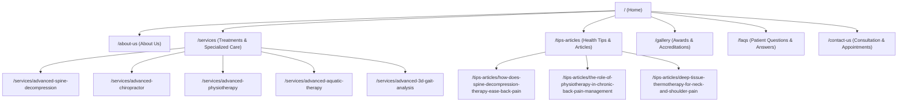

# Complete Route Map & Navigation Hierarchy

## 1. Route Discovery & Audit Overview

Through complete inspection of the sitemap index (`/sitemap_index.xml`), WordPress REST API, and internal DOM navigation links, all 203 original system URLs were categorized into:
1. **Core Production Routes**: The active clinical pages patients visit and interact with.
2. **Individual Service Subpages**: Dedicated deep-dive clinical pages.
3. **Clinical Health Articles**: Patient education blogs.
4. **Excluded Demo & Legacy Artifacts**: Medilax theme demo pages (`home-one`, `home-five`, `cart-3`, etc.) and comment spam posts to be discarded during reconstruction.

---

## 2. Production Route Hierarchy & Next.js Mapping

---

## 3. Comprehensive Route Inventory & URL Mapping

| Original Live URL | Page Title / Description | Nav Status | Target Next.js Route | Next.js File Path |
| :--- | :--- | :--- | :--- | :--- |
| `https://painandparalysis.com/` | Home — Pain Paralysis | Main Nav (Item 1) | `/` | `src/app/page.tsx` |
| `https://painandparalysis.com/about-us/` | About Us — Clinical Team & Philosophy | Main Nav (Item 2) | `/about-us` | `src/app/about-us/page.tsx` |
| `https://painandparalysis.com/services/` | Services — All 11 Treatments & 4 Care Areas | Main Nav (Item 3) | `/services` | `src/app/services/page.tsx` |
| `https://painandparalysis.com/tips-article/` | Tips & Article — Clinical Health Articles | Main Nav (Item 4) | `/tips-articles` | `src/app/tips-articles/page.tsx` |
| `https://painandparalysis.com/gallery/` | Gallery — Clinic Awards & Honors | Main Nav (Item 5) | `/gallery` | `src/app/gallery/page.tsx` |
| `https://painandparalysis.com/faqs/` | FAQs — Frequently Asked Patient Questions | Main Nav (Item 6) | `/faqs` | `src/app/faqs/page.tsx` |
| `https://painandparalysis.com/contact-us/` | Contact Us — Appointments & Location | Header CTA Button | `/contact-us` | `src/app/contact-us/page.tsx` |
| `https://painandparalysis.com/advanced-spine-decompression/` | Advanced Spine Decompression Detail | Footer & Service Link | `/services/advanced-spine-decompression` | `src/app/services/[slug]/page.tsx` |
| `https://painandparalysis.com/advanced-chiropractor/` | Advanced Chiropractor Detail | Footer & Service Link | `/services/advanced-chiropractor` | `src/app/services/[slug]/page.tsx` |
| `https://painandparalysis.com/advanced-physiotherapy/` | Advanced Physiotherapy Detail | Footer & Service Link | `/services/advanced-physiotherapy` | `src/app/services/[slug]/page.tsx` |
| `https://painandparalysis.com/advanced-aquatic-therapy/` | Advanced Aquatic Therapy Detail | Footer & Service Link | `/services/advanced-aquatic-therapy` | `src/app/services/[slug]/page.tsx` |
| `https://painandparalysis.com/advanced3d-gait-analysis/` | Advanced 3D Gait Analysis Detail | Footer & Service Link | `/services/advanced-3d-gait-analysis` | `src/app/services/[slug]/page.tsx` |
| `https://painandparalysis.com/how-does-spine-decompression-therapy-ease-back-pain/` | Article: Spine Decompression Therapy | Article Grid Link | `/tips-articles/how-does-spine-decompression-therapy-ease-back-pain` | `src/app/tips-articles/[slug]/page.tsx` |
| `https://painandparalysis.com/the-role-of-physiotherapy-in-chronic-back-pain-management/` | Article: Physiotherapy in Chronic Back Pain | Article Grid Link | `/tips-articles/the-role-of-physiotherapy-in-chronic-back-pain-management` | `src/app/tips-articles/[slug]/page.tsx` |
| `https://painandparalysis.com/deep-tissue-thermotherapy-for-neck-and-shoulder-pain/` | Article: Deep Tissue Thermotherapy | Article Grid Link | `/tips-articles/deep-tissue-thermotherapy-for-neck-and-shoulder-pain` | `src/app/tips-articles/[slug]/page.tsx` |

---

## 4. Navigation System Architecture

### 4.1 Header Primary Navigation (Desktop)
1. **Home**: `/`
2. **About Us**: `/about-us`
3. **Services**: `/services`
4. **Tips & Articles**: `/tips-articles`
5. **Gallery**: `/gallery`
6. **FAQs**: `/faqs`
7. **CTA Action**: `Consult Now` (`/contact-us`)

### 4.2 Header Mobile Navigation (Drawer)
- Accessible via hamburger toggle (`button.vs-menu-toggle`).
- Displays full-color clinic logo, full list of stacked navigation links, and direct telephone call trigger (`tel:8015559609`).

### 4.3 Footer Navigation Grid
- **Column 1 — Clinic Office & Location**:
  - Address text with Google Maps redirect (`https://maps.app.goo.gl/KFe9nQc8Qc85PVAK9`).
  - Telephone link (`tel:8015559609`).
- **Column 2 — Quick Links**:
  - `/`, `/about-us`, `/services`, `/tips-articles`, `/faqs`.
- **Column 3 — Core Treatment Links**:
  - Direct deep links to the 5 specialized therapy subpages.
- **Column 4 — Social Profiles**:
  - Instagram: `https://www.instagram.com/painandparalysis_clinic/`
  - Facebook: `https://www.facebook.com/profile.php?id=61573888240184#`
  - LinkedIn: `https://www.linkedin.com/feed/`
- **Sub-footer**:
  - Copyright line: `© 2025 Pain And Paralysis | All Rights Reserved.`
  - Developer credit: `Developed by Indiafloats.` (`https://indiafloats.in/`)

---

## 5. Audit of Excluded Legacy Routes

The inspection discovered template routes that shipped with the WordPress theme or were generated by default plugins, which are purposefully excluded from the reconstructed app:
- **Medilax Demo Variations**: `/home-one/`, `/home-two/`, `/home-three/`, `/home-four/`, `/home-five/`, `/about-2/`, `/team-2/`, `/services-2/`.
- **Dummy WooCommerce Store**: `/shop-2/`, `/shop-3/`, `/cart-3/`, `/checkout-3/`, `/my-account-3/`, and 28 pharmaceutical product pages (e.g., `/product/surgery-safety-mask/`, `/product/clonazepam/`).
- **SEO Comment Spam**: Articles in Turkish and German (`/roulette-deutschland.../`, `/vbet.../`).
- **Template Parts**: `/?medilax_footer_build=...`, `/?medilax_header_build=...`.

**Clean Solution**: In the Next.js App Router reconstruction, unmatched legacy URLs will cleanly trigger `src/app/not-found.tsx` with friendly guidance back to the active clinical services.

