# Complete Route Map & Navigation Hierarchy

## 1. Route Discovery & Audit Overview

Through complete inspection of the sitemap index (`/sitemap_index.xml`), WordPress REST API, and internal DOM navigation links, all 203 original system URLs were categorized into:
1. **Core Production Routes**: The active clinical pages patients visit and interact with.
2. **Individual Service Subpages**: Dedicated deep-dive clinical pages.
3. **Clinical Health Articles**: Patient education blogs.
4. **Excluded Demo & Legacy Artifacts**: Medilax theme demo pages (`home-one`, `home-five`, `cart-3`, etc.) and comment spam posts to be discarded during reconstruction.

---

## 2. Production Route Hierarchy & Next.js Mapping

```mermaid
graph TD
    Root["/ (Home)"] --> About["/about-us (About Us)"]
    Root --> Services["/services (Treatments & Specialized Care)"]
    Root --> Articles["/tips-articles (Health Tips & Articles)"]
    Root --> Gallery["/gallery (Awards & Accreditations)"]
    Root --> FAQs["/faqs (Patient Questions & Answers)"]
    Root --> Contact["/contact-us (Consultation & Appointments)"]
    Root --> Privacy["/privacy-policy (Privacy Policy & Data Ethics)"]
    Root --> Terms["/terms-and-conditions (Terms & Conditions)"]
    
    Services --> S1["/services/advanced-spine-decompression"]
    Services --> S2["/services/advanced-chiropractor"]
    Services --> S3["/services/advanced-physiotherapy"]
    Services --> S4["/services/advanced-aquatic-therapy"]
    Services --> S5["/services/advanced-3d-gait-analysis"]
    Services --> S6["/services/inpatient-care"]
    Services --> S7["/services/robotic-neuro-rehabilitation"]
    Services --> S8["/services/pain-management"]

    Articles --> A1["/tips-articles/how-does-spine-decompression-therapy-ease-back-pain"]
    Articles --> A2["/tips-articles/the-role-of-physiotherapy-in-chronic-back-pain-management"]
    Articles --> A3["/tips-articles/deep-tissue-thermotherapy-for-neck-and-shoulder-pain"]
```



---

## 3. Comprehensive Route Inventory & URL Mapping

| Original Live URL | Page Title / Description | Nav Status | Target Next.js Route | Next.js File Path |
| :--- | :--- | :--- | :--- | :--- |
| `https://painandparalysis.com/` | Home — Pain Paralysis | Main Nav (Item 1) | `/` | `src/app/page.tsx` |
| `https://painandparalysis.com/about-us/` | About Us — Clinical Team & Philosophy | Main Nav (Item 2) | `/about-us` | `src/app/about-us/page.tsx` |
| `https://painandparalysis.com/services/` | Services — All 11 Treatments & 4 Care Areas | Main Nav (Item 3) | `/services` | `src/app/services/page.tsx` |
| `https://painandparalysis.com/tips-article/` | Tips & Article — Clinical Health Articles | Main Nav (Item 4) | `/tips-article` | `src/app/tips-article/page.tsx` |
| `https://painandparalysis.com/gallery/` | Gallery — Clinic Awards & Honors | Main Nav (Item 5) | `/gallery` | `src/app/gallery/page.tsx` |
| `https://painandparalysis.com/faqs/` | FAQs — Frequently Asked Patient Questions | Main Nav (Item 6) | `/faqs` | `src/app/faqs/page.tsx` |
| `https://painandparalysis.com/contact-us/` | Contact Us — Appointments & Location | Header CTA Button | `/contact-us` | `src/app/contact-us/page.tsx` |
| `https://painandparalysis.com/privacy-policy/` | Privacy Policy — Patient Data Ethics & Inquiry Governance | Sub-footer Link | `/privacy-policy` | `src/app/privacy-policy/page.tsx` |
| `https://painandparalysis.com/terms-and-conditions/` | Terms & Conditions — Clinic Terms & Usage Conditions | Sub-footer Link | `/terms-and-conditions` | `src/app/terms-and-conditions/page.tsx` |
| `https://painandparalysis.com/advanced-spine-decompression/` | Advanced Spine Decompression Detail | Footer & Service Link | `/services/advanced-spine-decompression` | `src/app/services/[slug]/page.tsx` |
| `https://painandparalysis.com/advanced-chiropractor/` | Advanced Chiropractor Detail | Footer & Service Link | `/services/advanced-chiropractor` | `src/app/services/[slug]/page.tsx` |
| `https://painandparalysis.com/advanced-physiotherapy/` | Advanced Physiotherapy Detail | Footer & Service Link | `/services/advanced-physiotherapy` | `src/app/services/[slug]/page.tsx` |
| `https://painandparalysis.com/advanced-aquatic-therapy/` | Advanced Aquatic Therapy Detail | Footer & Service Link | `/services/advanced-aquatic-therapy` | `src/app/services/[slug]/page.tsx` |
| `https://painandparalysis.com/advanced3d-gait-analysis/` | Advanced 3D Gait Analysis Detail | Footer & Service Link | `/services/advanced-3d-gait-analysis` | `src/app/services/[slug]/page.tsx` |
| `https://painandparalysis.com/inpatient-care/` | Inpatient Care & Rehabilitation (Phase 37) | Mega Menu & Service Link | `/services/inpatient-care` | `src/app/services/[slug]/page.tsx` |
| `https://painandparalysis.com/robotic-neuro-rehabilitation/` | Robotic Neuro Rehabilitation (Phase 37) | Mega Menu & Service Link | `/services/robotic-neuro-rehabilitation` | `src/app/services/[slug]/page.tsx` |
| `https://painandparalysis.com/pain-management/` | Comprehensive Pain Management (Phase 37) | Mega Menu & Service Link | `/services/pain-management` | `src/app/services/[slug]/page.tsx` |
| `https://painandparalysis.com/how-does-spine-decompression-therapy-ease-back-pain/` | Article: Spine Decompression Therapy | Article Grid Link | `/tips-article/how-does-spine-decompression-therapy-ease-back-pain` | `src/app/tips-article/[slug]/page.tsx` |
| `https://painandparalysis.com/the-role-of-physiotherapy-in-chronic-back-pain-management/` | Article: Physiotherapy in Chronic Back Pain | Article Grid Link | `/tips-article/the-role-of-physiotherapy-in-chronic-back-pain-management` | `src/app/tips-article/[slug]/page.tsx` |
| `https://painandparalysis.com/deep-tissue-thermotherapy-for-neck-and-shoulder-pain/` | Article: Deep Tissue Thermotherapy | Article Grid Link | `/tips-article/deep-tissue-thermotherapy-for-neck-and-shoulder-pain` | `src/app/tips-article/[slug]/page.tsx` |
| `https://painandparalysis.com/benefits-of-physiotherapy/` | Excluded Draft: Aquatic Therapy Article | Mismatched Slug | Redirects to `/tips-article` | N/A (Excluded from archive) |

---

## 4. Navigation System Architecture

### 4.1 Header Primary Navigation (Desktop)
1. **Home**: `/`
2. **About Us**: `/about-us`
3. **Services**: `/services`
4. **Tips & Articles**: `/tips-articles`
5. **Gallery**: `/gallery`
6. **FAQs**: `/faqs`
7. **CTA Action**: `Consult Now` (`/contact-us`)

### 4.2 Header Mobile Navigation (Drawer)
- Accessible via hamburger toggle (`button.vs-menu-toggle`).
- Displays full-color clinic logo, full list of stacked navigation links, and direct telephone call trigger (`tel:8015559609`).

### 4.3 Footer Navigation Grid
- **Column 1 — Clinic Office & Location**:
  - Address text with Google Maps redirect (`https://maps.app.goo.gl/KFe9nQc8Qc85PVAK9`).
  - Telephone link (`tel:8015559609`).
- **Column 2 — Quick Links**:
  - `/`, `/about-us`, `/services`, `/tips-articles`, `/faqs`.
- **Column 3 — Core Treatment Links**:
  - Direct deep links to the 5 specialized therapy subpages.
- **Column 4 — Social Profiles**:
  - Instagram: `https://www.instagram.com/painandparalysis_clinic/`
  - Facebook: `https://www.facebook.com/profile.php?id=61573888240184#`
  - LinkedIn: `https://www.linkedin.com/feed/`
- **Sub-footer**:
  - Copyright line: `© 2025 Pain And Paralysis | All Rights Reserved.`
  - Legal links: `Privacy Policy` (`/privacy-policy`), `Terms & Conditions` (`/terms-and-conditions`)
  - Developer credit: `Developed by Indiafloats.` (`https://indiafloats.in/`)

---

## 5. Audit of Excluded Legacy Routes

The inspection discovered template routes that shipped with the WordPress theme or were generated by default plugins, which are purposefully excluded from the reconstructed app:
- **Medilax Demo Variations**: `/home-one/`, `/home-two/`, `/home-three/`, `/home-four/`, `/home-five/`, `/about-2/`, `/team-2/`, `/services-2/`.
- **Dummy WooCommerce Store**: `/shop-2/`, `/shop-3/`, `/cart-3/`, `/checkout-3/`, `/my-account-3/`, and 28 pharmaceutical product pages (e.g., `/product/surgery-safety-mask/`, `/product/clonazepam/`).
- **SEO Comment Spam**: Articles in Turkish and German (`/roulette-deutschland.../`, `/vbet.../`).
- **Template Parts**: `/?medilax_footer_build=...`, `/?medilax_header_build=...`.

**Clean Solution**: In the Next.js App Router reconstruction, unmatched legacy URLs will cleanly trigger `src/app/not-found.tsx` with friendly guidance back to the active clinical services.

---

## 6. Service Detail Route Architecture & Canonical URL Specification (Phase 18.1 Audit)

### 6.1 Architectural Decision Record: Nested vs. Root Service Detail URLs

- **Legacy Live WordPress URL**: `https://painandparalysis.com/advanced-spine-decompression/`
- **Target Canonical Next.js Route**: `https://painandparalysis.com/services/advanced-spine-decompression`
- **File System Handler**: `src/app/services/[slug]/page.tsx`
- **Redirect Rule (`next.config.ts`)**:
  ```ts
  {
    source: "/advanced-spine-decompression",
    destination: "/services/advanced-spine-decompression",
    permanent: true,
  }
  ```

### 6.2 Architectural Evaluation & Verification

1. **Intentional Architecture Decision**: The nested URL path `/services/advanced-spine-decompression` is an intentional App Router design choice established in Phase 1 (Route Map Section 2 & 3). All 11 clinical therapies reside under the `/services/` namespace, allowing dynamic static param generation (`generateStaticParams`), shared layout primitives, and scalable sub-routing.
2. **Canonical Alignment**: In Phase 18.1, the canonical metadata URL in `src/app/services/[slug]/page.tsx` was audited and updated to point strictly to `https://painandparalysis.com/services/advanced-spine-decompression`. This resolves the canonical-to-redirect mismatch, ensuring the canonical tag points to the final destination URL rather than the redirected legacy root URL.
3. **Redirect Loop Prevention**: `next.config.ts` enforces a unidirectional permanent redirect from `/advanced-spine-decompression` (and `/advanced-spine-decompression/`) to `/services/advanced-spine-decompression`. No reverse redirects or rewrites exist, eliminating any risk of redirect loops.
4. **Internal Link Uniformity**: All internal links across header menus, footer navigation (`src/data/navigation.ts`), service cards (`src/components/services/ServicesOverviewCard.tsx`), and related service cards (`SpineDecompressionRelated.tsx`) consistently point directly to `/services/advanced-spine-decompression`.

### 6.3 Advanced Chiropractor Canonical & Redirect Alignment (Phase 19)

- **Legacy Live WordPress URL**: `https://painandparalysis.com/advanced-chiropractor/`
- **Target Canonical Next.js Route**: `https://painandparalysis.com/services/advanced-chiropractor`
- **File System Handler**: `src/app/services/[slug]/page.tsx`
- **Component Handler**: `src/components/services/chiropractor/ChiropractorDetail.tsx`
- **Redirect Rule (`next.config.ts`)**:
  ```ts
  {
    source: "/advanced-chiropractor",
    destination: "/services/advanced-chiropractor",
    permanent: true,
  }
  ```
- **Canonical URL**: Confirmed set to `https://painandparalysis.com/services/advanced-chiropractor` via `generateMetadata` in `src/app/services/[slug]/page.tsx`.
- **Cross-link Validation**: Cross-navigation links in `ChiropractorRelated.tsx` and `SpineDecompressionRelated.tsx` link unidirectionally to `/services/advanced-chiropractor`.

### 6.4 Advanced Physiotherapy Canonical & Redirect Alignment (Phase 20)

- **Legacy Live WordPress URL**: `https://painandparalysis.com/advanced-physiotherapy/`
- **Target Canonical Next.js Route**: `https://painandparalysis.com/services/advanced-physiotherapy`
- **File System Handler**: `src/app/services/[slug]/page.tsx`
- **Component Handler**: `src/components/services/physiotherapy/PhysiotherapyDetail.tsx`
- **Redirect Rule (`next.config.ts`)**:
  ```ts
  {
    source: "/advanced-physiotherapy",
    destination: "/services/advanced-physiotherapy",
    permanent: true,
  }
  ```
- **Canonical URL**: Confirmed set to `https://painandparalysis.com/services/advanced-physiotherapy` via `generateMetadata` in `src/app/services/[slug]/page.tsx`.
- **Cross-link Validation**: Cross-navigation links in `PhysiotherapyRelated.tsx`, `ChiropractorRelated.tsx`, and `SpineDecompressionRelated.tsx` link unidirectionally to `/services/advanced-physiotherapy`.
- **Permanent Redirect Status**: Verified with HTTP 308 response and Location header `/services/advanced-physiotherapy`.

### 6.5 Advanced Aquatic Therapy Canonical & Redirect Alignment (Phase 21)

- **Legacy Live WordPress URL**: `https://painandparalysis.com/advanced-aquatic-therapy/`
- **Target Canonical Next.js Route**: `https://painandparalysis.com/services/advanced-aquatic-therapy`
- **File System Handler**: `src/app/services/[slug]/page.tsx`
- **Component Handler**: `src/components/services/aquatic-therapy/AquaticTherapyDetail.tsx`
- **Redirect Rule (`next.config.ts`)**:
  ```ts
  {
    source: "/advanced-aquatic-therapy",
    destination: "/services/advanced-aquatic-therapy",
    permanent: true,
  }
  ```
- **Canonical URL**: Confirmed set to `https://painandparalysis.com/services/advanced-aquatic-therapy` via `generateMetadata` in `src/app/services/[slug]/page.tsx`.
- **Cross-link Validation**: Cross-navigation links in `PhysiotherapyRelated.tsx`, `ChiropractorRelated.tsx`, and `SpineDecompressionRelated.tsx` link unidirectionally to `/services/advanced-aquatic-therapy`.
- **Permanent Redirect Status**: Verified with HTTP 308 response and Location header `/services/advanced-aquatic-therapy`.

### 6.6 Advanced 3D Gait Analysis Canonical & Redirect Alignment (Phase 22)

- **Legacy Live WordPress URLs**:
  - `https://painandparalysis.com/3d-gait-analysis/`
  - `https://painandparalysis.com/advanced-3d-gait-analysis/`
  - `https://painandparalysis.com/advanced3d-gait-analysis/`
- **Target Canonical Next.js Route**: `https://painandparalysis.com/services/advanced-3d-gait-analysis`
- **File System Handler**: `src/app/services/[slug]/page.tsx`
- **Component Handler**: `src/components/services/gait-analysis/GaitAnalysisDetail.tsx`
- **Redirect Rules (`next.config.ts`)**:
  ```ts
  {
    source: "/advanced3d-gait-analysis",
    destination: "/services/advanced-3d-gait-analysis",
    permanent: true,
  },
  {
    source: "/advanced-3d-gait-analysis",
    destination: "/services/advanced-3d-gait-analysis",
    permanent: true,
  },
  {
    source: "/3d-gait-analysis",
    destination: "/services/advanced-3d-gait-analysis",
    permanent: true,
  }
  ```
- **Canonical URL**: Confirmed set to `https://painandparalysis.com/services/advanced-3d-gait-analysis` via `generateMetadata` in `src/app/services/[slug]/page.tsx`.
- **Cross-link Validation**: Cross-navigation links in `GaitAnalysisRelated.tsx` link unidirectionally to `/services/advanced-spine-decompression`, `/services/advanced-chiropractor`, `/services/advanced-physiotherapy`, and `/services/advanced-aquatic-therapy`.
- **Permanent Redirect Status**: All 3 legacy source URLs redirect with HTTP 308 permanent status to the canonical route `/services/advanced-3d-gait-analysis`.

---

## 7. Tips & Articles Archive & Article Routes Architecture (Phase 23)

### 7.1 Canonical Architecture & Redirect Strategy

- **Target Archive Route**: `/tips-article`
- **Archive File Handler**: `src/app/tips-article/page.tsx`
- **Article Detail Route Pattern**: `/tips-article/[slug]`
- **Detail File Handler**: `src/app/tips-article/[slug]/page.tsx`
- **Plural Route Handling**: Legacy `/tips-articles` and `/tips-articles/:slug*` permanently redirect (HTTP 308) to `/tips-article` and `/tips-article/:slug*` via both `next.config.ts` and Next.js App Router route handlers.
- **Root Article URL Redirects (`next.config.ts`)**:
  - `/how-does-spine-decompression-therapy-ease-back-pain` -> `/tips-article/how-does-spine-decompression-therapy-ease-back-pain`
  - `/the-role-of-physiotherapy-in-chronic-back-pain-management` -> `/tips-article/the-role-of-physiotherapy-in-chronic-back-pain-management`
  - `/deep-tissue-thermotherapy-for-neck-and-shoulder-pain` -> `/tips-article/deep-tissue-thermotherapy-for-neck-and-shoulder-pain`
  - `/the-benefits-of-aquatic-therapy-for-injury-prevention-and-recovery` -> `/tips-article`
  - `/benefits-of-physiotherapy` -> `/tips-article`

### 7.2 Static Generation & Metadata Canonical URLs

All 3 approved articles are statically generated at build time via `generateStaticParams()`:
1. `https://painandparalysis.com/tips-article/how-does-spine-decompression-therapy-ease-back-pain`
2. `https://painandparalysis.com/tips-article/the-role-of-physiotherapy-in-chronic-back-pain-management`
3. `https://painandparalysis.com/tips-article/deep-tissue-thermotherapy-for-neck-and-shoulder-pain`

Each page emits its verified canonical URL, openGraph metadata, structured JSON-LD Article schema, and breadcrumb navigation trail.

---

## 8. Contact Us Route Architecture (Phase 25)

### 8.1 Canonical Architecture & Route Mapping
- **Reference Live URL**: `https://painandparalysis.com/contact-us/`
- **Target Canonical Next.js Route**: `/contact-us`
- **File System Handler**: `src/app/contact-us/page.tsx`
- **Component Handlers**:
  - `ContactHero`: Hero banner with clinical badge and semantic breadcrumb trail (`Home` -> `Contact Us`).
  - `ContactIntro`: Outpatient consultation principles and assessment expectations.
  - `ContactForm`: Client-side inquiry form with validation (Name, Email, Phone [Indian format], Service, Message) and transparent submission gateway notice.
  - `ContactOfficeInfo`: Office information card with published address, phone (`+91 80155 59609`), working hours, and verification status.
  - `ContactLocationMap`: Responsive interactive Google Maps iframe with verified coordinates (`13.0182, 80.1415`).
- **Canonical URL**: Confirmed set to `https://painandparalysis.com/contact-us` via static metadata in `src/app/contact-us/page.tsx`.

### 8.2 Inbound Routing & CTAs
- **Header "Consult Now" CTA**: Routes to `/contact-us`.
- **Hero Slider "Book Appointment" CTAs**: Route to `/contact-us`.
- **Treatment Detail CTAs**: Route to `/contact-us`.
- **Footer Contact Links**: Route to `/contact-us` and Google Maps destination.

---

## 9. Privacy Policy Route Architecture (Phase 26 & 26.1)

### 9.1 Canonical Architecture & Route Mapping
- **Reference Target URL**: `https://painandparalysis.com/privacy-policy/` (Returned HTTP 404 in pre-implementation audit)
- **Target Canonical Next.js Route**: `/privacy-policy`
- **File System Handler**: `src/app/privacy-policy/page.tsx`
- **Component Handlers**:
  - `PrivacyPolicyHero`: Clean hero banner with neutral clinic notice tag, "Privacy Policy" heading, and semantic breadcrumb trail (`Home` -> `Privacy Policy`). Contains no fabricated last-updated dates, approval badges, or unverified claims.
  - `PrivacyPolicyView`: Focused reader container (`max-w-[860px]`) ensuring optimal typography and responsive padding.
  - `PrivacyPolicyContent`: Body content component rendering the transparent visitor-facing placeholder notice:
    - Informs visitors that Privacy Policy information is awaiting confirmation from the clinic.
    - Explicitly disclaims representations regarding data collection, storage, sharing, retention, or security practices pending authoritative clinic review.
    - Excludes unsupported clauses, server-log claims, legal promises, and simulated privacy request channels.
- **Canonical URL**: Confirmed set to `https://painandparalysis.com/privacy-policy` via static metadata in `src/app/privacy-policy/page.tsx`.
- **Route Alias Redirect**: `/privacy` permanently redirects (HTTP 308) to `/privacy-policy` via `next.config.ts`.

### 9.2 Navigation Integration
- **Footer Sub-footer Link**: Integrated into the bottom copyright bar (`Footer.tsx`), directly accessible alongside the copyright notice with visible keyboard focus styling.

---

## 10. Terms & Conditions Route Architecture (Phase 27)

### 10.1 Canonical Architecture & Route Mapping
- **Reference Target URL**: `https://painandparalysis.com/terms-and-conditions/` (Returned HTTP 404 in pre-implementation audit; `/terms-conditions/` and `/terms/` also returned HTTP 404)
- **Target Canonical Next.js Route**: `/terms-and-conditions`
- **File System Handler**: `src/app/terms-and-conditions/page.tsx`
- **Component Handlers**:
  - `TermsHero`: Hero banner with neutral clinic notice tag, "Terms & Conditions" heading, and semantic breadcrumb trail (`Home` -> `Terms & Conditions`). Contains no fabricated last-updated dates, approval badges, or unverified claims.
  - `TermsView`: Focused reader container (`max-w-[860px]`) ensuring optimal typography and responsive padding.
  - `TermsContent`: Body content component rendering the transparent visitor-facing placeholder notice:
    - Informs visitors that Terms & Conditions information is awaiting confirmation from the clinic.
    - Explicitly disclaims representations regarding contractual terms, legal obligations, or conditions of service pending authoritative clinic review.
    - Excludes unverified user conduct rules, refund commitments, cancellation fees, liability disclaimers, or dispute resolution clauses.
- **Canonical URL**: Confirmed set to `https://painandparalysis.com/terms-and-conditions` via static metadata in `src/app/terms-and-conditions/page.tsx`.
- **Route Alias Redirects**: `/terms` and `/terms-conditions` permanently redirect (HTTP 308) to `/terms-and-conditions` via `next.config.ts`.

### 10.2 Navigation Integration
- **Footer Sub-footer Link**: Integrated into the bottom copyright bar (`Footer.tsx`), directly accessible alongside the Privacy Policy link and copyright notice with visible keyboard focus styling.

---

## 12. Legacy Redirect Hardening & Service Route Corrections (Phase 29)

### 12.1 Canonical Service Routes Specification

All 11 clinical services offered by Pain & Paralysis Clinic reside strictly under the canonical `/services/[slug]` route namespace:

| # | Service Name | Canonical Route | Implementation Component | Card Route (`services.ts`) | Status |
|---|---|---|---|---|---|
| 1 | Advanced Spine Decompression | `/services/advanced-spine-decompression` | `<SpineDecompressionDetail />` | `/services/advanced-spine-decompression` | Fully Implemented (Bespoke) |
| 2 | Advanced Chiropractor | `/services/advanced-chiropractor` | `<ChiropractorDetail />` | `/services/advanced-chiropractor` | Fully Implemented (Bespoke) |
| 3 | Advanced Physiotherapy | `/services/advanced-physiotherapy` | `<PhysiotherapyDetail />` | `/services/advanced-physiotherapy` | Fully Implemented (Bespoke) |
| 4 | Advanced Aquatic Therapy | `/services/advanced-aquatic-therapy` | `<AquaticTherapyDetail />` | `/services/advanced-aquatic-therapy` | Fully Implemented (Bespoke) |
| 5 | Advanced 3D Gait Analysis | `/services/advanced-3d-gait-analysis` | `<GaitAnalysisDetail />` | `/services/advanced-3d-gait-analysis` | Fully Implemented (Bespoke) |
| 6 | Advanced Knee Decompression | `/services/advanced-knee-decompression` | `<KneeDecompressionDetail />` | `/services/advanced-knee-decompression` | Fully Implemented (Bespoke - Phase 30) |
| 7 | Advanced Laser Treatment | `/services/advanced-laser-treatment` | `<LaserTreatmentDetail />` | `/services/advanced-laser-treatment` | Fully Implemented (Bespoke - Phase 31) |
| 8 | High Frequency EMG | `/services/high-frequency-emg` | `<HighFrequencyEMGDetail />` | `/services/high-frequency-emg` | Fully Implemented (Bespoke - Phase 32) |
| 9 | Biofeedback | `/services/biofeedback` | `<BiofeedbackDetail />` | `/services/biofeedback` | Fully Implemented (Bespoke - Phase 33) |
| 10 | Neuro Physiotherapy | `/services/neuro-physiotherapy` | `<NeuroPhysiotherapyDetail />` | `/services/neuro-physiotherapy` | Fully Implemented (Bespoke - Phase 34) |
| 11 | Pelvic Floor | `/services/pelvic-floor-therapy` | `<PelvicFloorDetail />` | `/services/pelvic-floor-therapy` | Fully Implemented (Bespoke - Phase 35) |

### 12.2 Verified Permanent Redirects Implemented (`next.config.ts`)

In Phase 29, the verified legacy URL mappings from the Phase 28 audit were added to `next.config.ts` using HTTP 308 permanent redirects:

| Incoming Legacy URL Pattern | HTTP Status | Canonical Destination Route | Classification & Purpose |
|---|---|---|---|
| `/physiotherapy-centre` | 308 Permanent | `/services/advanced-physiotherapy` | SEO landing page consolidation |
| `/physiotherapy-chennai` | 308 Permanent | `/services/advanced-physiotherapy` | Local SEO duplicate consolidation |
| `/chiropractic-treatment-centre` | 308 Permanent | `/services/advanced-chiropractor` | Local SEO duplicate consolidation |
| `/aquatic-therapy` | 308 Permanent | `/services/advanced-aquatic-therapy` | Local SEO duplicate consolidation |
| `/advanced-spine-decompression-2` | 308 Permanent | `/services/advanced-spine-decompression` | WordPress duplicate page redirect |
| `/emg-therapy` | 308 Permanent | `/services/high-frequency-emg` | Legacy shorthand therapy slug redirect |
| `/biofeedback-therapy` | 308 Permanent | `/services/biofeedback` | Legacy therapy slug redirect |
| `/neuro-physiotherapy-2` | 308 Permanent | `/services/neuro-physiotherapy` | WordPress duplicate page redirect |
| `/neuro-physiotherapy-3` | 308 Permanent | `/services/neuro-physiotherapy` | WordPress duplicate page redirect |
| `/all-services` | 308 Permanent | `/services` | Medilax CPT theme archive template redirect |
| `/all-services/3d-gait-analysis` | 308 Permanent | `/services/advanced-3d-gait-analysis` | Legacy empty Medilax CPT item redirect |
| `/all-services/advanced-spine-decompression` | 308 Permanent | `/services/advanced-spine-decompression` | Legacy Medilax CPT item redirect |
| `/all-services/chiropractor` | 308 Permanent | `/services/advanced-chiropractor` | Legacy Medilax CPT item redirect |
| `/all-services/aquatic-therapy` | 308 Permanent | `/services/advanced-aquatic-therapy` | Legacy Medilax CPT item redirect |
| `/all-services/:slug*` | 308 Permanent | `/services` | Fallback for unknown/unsupported CPT URLs to canonical catalog (prevents invalid `/services/[slug]` 404s) |
| `/appointment` | 308 Permanent | `/contact-us` | Medilax demo appointment page alias |
| `/appointments` | 308 Permanent | `/contact-us` | Medilax demo appointments page alias |

### 12.3 Physiotherapy Centre Content Preservation for Future Consolidation

The legacy URL `https://painandparalysis.com/physiotherapy-centre/` was permanently redirected to `/services/advanced-physiotherapy`. To prevent silent content loss, the unique educational elements identified in the Phase 28 audit have been recorded for Phase 36 (Physiotherapy Content Consolidation):

1. **Structured Physiotherapy Services Table**:
   - Compares manual physiotherapy, electrotherapy, exercise therapy, and specialized modalities with target indications and recovery timeframes.
2. **First Session Expectations Guide**:
   - Outlines intake history review, physical mobility assessment, diagnostic tests review, and baseline milestone establishment.
3. **Factors Influencing Physiotherapy Cost**:
   - Transparent explanation of outpatient therapy pricing drivers (session duration, specialized equipment, condition complexity, recovery frequency).
4. **5 Specialized Patient FAQs**:
   - Clinical FAQs regarding treatment duration, referral requirements, clothing recommendations, post-session soreness management, and home exercise adherence.
5. **Medical Content Safeguards**:
   - Unsupported marketing claims regarding "robotic-assisted physiotherapy that eliminates human error" or automated surgical robotics are explicitly flagged as requiring clinical verification before integration.

### 12.4 Service Overview & Home Card Navigation Corrections

1. **`src/data/services.ts`**:
   - Services 6–11 updated from `#` anchors (`/services#slug`) to canonical routes (`/services/[slug]`).
2. **`src/components/services/ServicesOverviewCard.tsx`**:
   - Link destination bound directly to `service.route` (`/services/[slug]`).
3. **`src/components/home/ServiceCard.tsx`**:
   - Link destination bound directly to `service.route` (`/services/[slug]`).
4. **Related Service Components**:
   - Canonical links validated in `SpineDecompressionRelated`, `ChiropractorRelated`, `PhysiotherapyRelated`, `AquaticTherapyRelated`, and `GaitAnalysisRelated`.

### 12.5 Unresolved Mappings & Future Phasing

All 12 candidate redirect categories identified in Phase 28 have been 100% resolved and verified. No unmapped active clinic pages remain. The planned future roadmap proceeds as follows:
- **Phase 30**: Advanced Knee Decompression bespoke detail page (`/services/advanced-knee-decompression`) — **COMPLETED** (`<KneeDecompressionDetail />`).
- **Phase 31**: Advanced Laser Treatment bespoke detail page (`/services/advanced-laser-treatment`) — **COMPLETED** (`<LaserTreatmentDetail />`).
- **Phase 32**: High Frequency EMG bespoke detail page (`/services/high-frequency-emg`) — **COMPLETED** (`<HighFrequencyEMGDetail />`).
- **Phase 33**: Biofeedback bespoke detail page (`/services/biofeedback`) — **COMPLETED** (`<BiofeedbackDetail />`).
- **Phase 34**: Neuro Physiotherapy bespoke detail page (`/services/neuro-physiotherapy`) — **COMPLETED** (`<NeuroPhysiotherapyDetail />`).
- **Phase 35**: Pelvic Floor Therapy bespoke detail page (`/services/pelvic-floor-therapy`) — **COMPLETED** (`<PelvicFloorDetail />`).
- **Phase 36**: Physiotherapy Content Consolidation (integrating preserved table and FAQs into `/services/advanced-physiotherapy`).
- **Phase 37**: Hospital Positioning, 3 New Bespoke Services (`inpatient-care`, `robotic-neuro-rehabilitation`, `pain-management`), and 14-Service 3-Pillar Architecture — **COMPLETED**.

---

## 13. Phase 37 Hospital Services Route Architecture & Canonical Redirects

### 13.1 Overview of 3 New Bespoke Clinical Services
To reflect the updated client positioning as a **25-Bedded, 24-Hour Hospital in Virugambakkam, Chennai**, three new dedicated service routes were introduced into the App Router architecture:

1. **Inpatient Rehabilitation & Hospital Care**:
   - Canonical Route: `/services/inpatient-care`
   - File System Handler: `src/app/services/[slug]/page.tsx`
   - Component Handler: `src/components/services/inpatient-care/InpatientCareDetail.tsx`
   - Permanent Redirects (`next.config.ts`):
     - `/inpatient-care` -> `/services/inpatient-care` (308)
     - `/inpatient-rehabilitation` -> `/services/inpatient-care` (308)

2. **Robotic Neuro Rehabilitation**:
   - Canonical Route: `/services/robotic-neuro-rehabilitation`
   - File System Handler: `src/app/services/[slug]/page.tsx`
   - Component Handler: `src/components/services/robotic-neuro/RoboticNeuroDetail.tsx`
   - Permanent Redirects (`next.config.ts`):
     - `/robotic-neuro-rehabilitation` -> `/services/robotic-neuro-rehabilitation` (308)
     - `/robotic-rehabilitation` -> `/services/robotic-neuro-rehabilitation` (308)

3. **Comprehensive Pain Management**:
   - Canonical Route: `/services/pain-management`
   - File System Handler: `src/app/services/[slug]/page.tsx`
   - Component Handler: `src/components/services/pain-management/PainManagementDetail.tsx`
   - Permanent Redirects (`next.config.ts`):
     - `/pain-management` -> `/services/pain-management` (308)
     - `/comprehensive-pain-management` -> `/services/pain-management` (308)

### 13.2 Complete 14-Service 3-Pillar Taxonomy
All 14 services now operate with full bespoke component suites, dedicated metadata, canonical URLs, and structured JSON-LD schemas:

- **Pillar A: Hospital & Inpatient Services**
  - `/services/inpatient-care`
- **Pillar B: Neurological & Advanced Rehabilitation**
  - `/services/robotic-neuro-rehabilitation`
  - `/services/neuro-physiotherapy`
  - `/services/advanced-physiotherapy`
  - `/services/advanced-3d-gait-analysis`
  - `/services/biofeedback`
  - `/services/high-frequency-emg`
- **Pillar C: Pain Management & Specialized Treatments**
  - `/services/pain-management`
  - `/services/advanced-chiropractor`
  - `/services/advanced-spine-decompression`
  - `/services/advanced-knee-decompression`
  - `/services/advanced-laser-treatment`
  - `/services/advanced-aquatic-therapy`
  - `/services/pelvic-floor-therapy`


